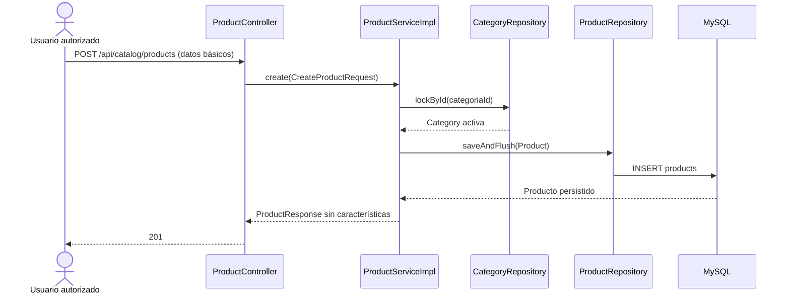
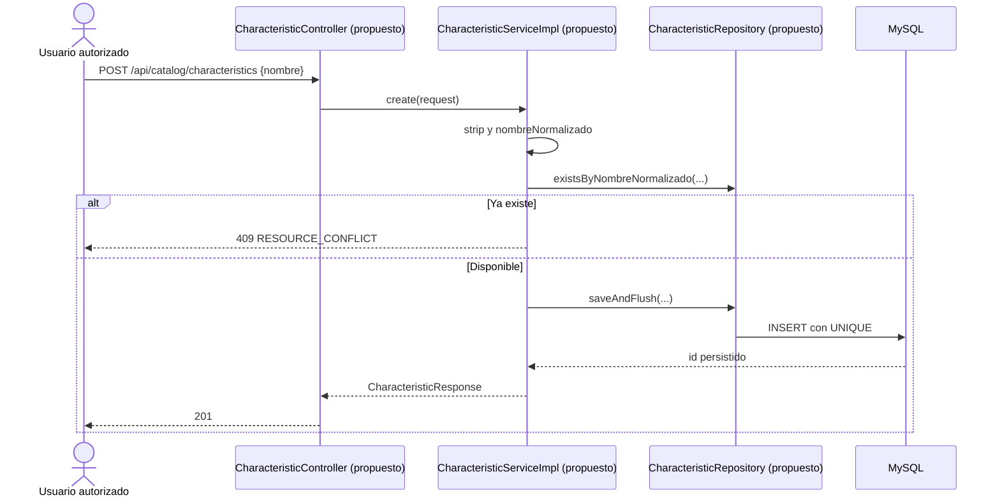

# S2 BE — Crear característica y migrar características: plan de implementación

**Estado:** ejecución en curso; tandas 1–4 autorizadas para esta ejecución.

**Fuente funcional principal:** [S2 BE Crear característica y migrar características](https://trello.com/c/uxJ6ZOVZ). **Método de planificación:** `PROMPT_GENERAR_PLAN_IMPLEMENTACION.md`. La tarjeta de [edición y eliminación](https://trello.com/c/4NeAHpsb) fija una dependencia de concurrencia, pero sus endpoints y su borrado quedan fuera de este plan.

**Alcance:** migración de definiciones y valores por producto, alta y consultas administrativas de características, y ampliación transaccional del alta de producto. No incluye edición ni eliminación de definiciones o valores, variantes, fotos, frontend ni ficha pública. `Marca` es una característica creada manualmente desde la misma API; no existe tabla, FK ni carga inicial específica de marca.

## Estado actual — COMPROBADO EN EL CÓDIGO

- Flyway termina en `V6__create_products.sql`: existen `categories` y `products`, pero no tablas, entidades, repositorios ni rutas de características. `Product` pertenece a `Category` y guarda precio de referencia, disponibilidad, `activo` y `destacado`.
- `ProductController.create(...)` recibe `CreateProductRequest` con cinco campos básicos. `ProductServiceImpl.create(...)` bloquea la categoría mediante `CategoryRepository.lockById(...)`, exige que esté activa, guarda el producto y devuelve `ProductResponse` sin características. `update(...)`, `deactivate(...)` y `reactivate(...)` comparten ese tipo de respuesta.
- `CategoryServiceImpl.create(...)` recorta el nombre y guarda `nombreNormalizado` en minúsculas; la base impone unicidad. `CategoryController` muestra el patrón de alta 201 y listado privado.
- `SecurityConfig.filterChain(...)` protege `/api/catalog/categories/**` y `/api/catalog/products/**` para `SUPER_ADMIN`, `ADMIN` y `USER`; las mutaciones requieren CSRF. La regla `/api/admin/users/**` sigue reservada a `SUPER_ADMIN`.
- `GlobalExceptionHandler` traduce validaciones en 400, recursos inexistentes en 404 y conflictos de integridad en 409 mediante `ApiError`. Hay tests H2, MockMvc y Testcontainers con MySQL 8.4. La configuración JPA valida el esquema de Flyway.
- Hay cambios locales ajenos a esta tarjeta en controller, tests y documentación de edición de producto. Las tandas deben preservarlos y partir del estado vigente al ejecutarse.

**Discrepancia documental ya resuelta:** el plan anterior de categoría afirma que un producto podría tener varios valores de una misma característica si difieren clave, valor o unidad. La tarjeta vigente y `docs/modelo-inicial.md` fijan una sola asociación por `(producto_id, caracteristica_id)`; esa es la regla de este plan. `docs/modelo-inicial.md` todavía sitúa características en Sprint 3: para estas tablas prevalece la tarjeta de Sprint 2. El documento anterior de categoría no se modifica en esta tarea.

### Flujo actual



## Comportamiento objetivo y contrato

`POST /api/catalog/characteristics` recibe `{ "nombre": "Marca" }`, crea la definición y devuelve `201` con `{ "id", "nombre" }`. `GET /api/catalog/characteristics` devuelve todas las definiciones, ordenadas por nombre e ID, o `[]`; `GET /api/catalog/characteristics/{id}` devuelve una definición o 404. Son rutas administrativas, no públicas. La característica no tiene estado `activo`.

El nombre es obligatorio, no puede consistir solo en espacios y tiene máximo 160 caracteres. Se recortan espacios exteriores y se compara en minúsculas con `Locale.ROOT`, como en categoría. Un duplicado, incluso con distinta capitalización o espacios exteriores, devuelve 409 `RESOURCE_CONFLICT`; la restricción única de MySQL cubre también carreras entre altas. `Marca` no se inserta por Flyway: se crea cuando un usuario la necesite.

`POST /api/catalog/products` conserva sus campos actuales y acepta opcionalmente:

```json
{
  "caracteristicas": [
    { "caracteristicaId": 12, "valor": "Acme", "unidad": null }
  ]
}
```

Omitir `caracteristicas` o enviar `[]` crea el producto básico con cero asociaciones. Cada elemento exige ID positivo y existente, valor de texto no vacío (máximo 500 caracteres) y unidad opcional (máximo 100); se recortan ambos textos y la unidad vacía se guarda como `null`. El mismo `caracteristicaId` no puede repetirse en un producto: 400 `VALIDATION_ERROR`. Una referencia inexistente devuelve 404 `RESOURCE_NOT_FOUND`. Los valores pertenecen al producto, no a la definición, y la base asegura una sola fila por producto/característica.

`ProductResponse` conserva todos los campos actuales y agrega `caracteristicas`, siempre presente como arreglo. Cada elemento contiene `caracteristicaId`, el **nombre actual** de la definición, `valor` y `unidad`; el nombre no se duplica como dato persistido de la asociación. Para mantener un contrato coherente, las respuestas existentes de crear, editar, desactivar y reactivar producto incluyen el mismo arreglo, aun si está vacío. Esta tarjeta no cambia el request ni las reglas de edición de producto.

El alta de producto, sus asociaciones y la construcción de su respuesta ocurren dentro de `ProductServiceImpl.create(...)` transaccional. Se conserva el bloqueo inicial de categoría; luego se bloquean las definiciones solicitadas por ID ascendente antes de guardar el producto. La futura eliminación de característica debe bloquear la misma fila antes de quitar asociaciones: si el alta termina primero, la eliminación posterior puede quitarlas; si la eliminación termina primero, el alta responde que la referencia ya no existe. Las FK quedan como última protección. La prueba de ambos órdenes se completa en la tarjeta de eliminación, cuando exista ese endpoint.

### Flujo objetivo completo

`CharacteristicController`, `CharacteristicServiceImpl`, `CharacteristicRepository`, `ProductCharacteristicRepository` y sus métodos son **PROPUESTOS**. Los componentes de producto, categoría, seguridad y errores citados ya existen; sus ampliaciones se indican como propuestas.

```mermaid
sequenceDiagram
    actor A as Usuario autorizado
    participant Sec as SecurityConfig / CSRF
    participant CC as CharacteristicController (propuesto)
    participant CS as CharacteristicServiceImpl (propuesto)
    participant CR as CharacteristicRepository (propuesto)
    participant PC as ProductController
    participant PS as ProductServiceImpl
    participant Cat as CategoryRepository
    participant PR as ProductRepository
    participant PCR as ProductCharacteristicRepository (propuesto)
    participant DB as MySQL

    A->>Sec: POST /api/catalog/characteristics
    Sec->>CC: autoriza rol y CSRF
    CC->>CS: create(nombre)
    CS->>CR: existsByNombreNormalizado(clave)
    CS->>CR: saveAndFlush(Characteristic)
    CR->>DB: INSERT characteristics
    DB-->>CC: id y nombre
    CC-->>A: 201 CharacteristicResponse

    A->>Sec: POST /api/catalog/products + caracteristicas
    Sec->>PC: autoriza rol y CSRF
    PC->>PS: create(CreateProductRequest)
    PS->>Cat: lockById(categoriaId)
    Cat-->>PS: categoría activa
    PS->>CR: lockById(...) en orden ascendente
    CR-->>PS: definiciones existentes
    alt ID repetido o inexistente
        PS-->>A: 400 o 404 ApiError; sin producto
    else Referencias válidas
        PS->>PR: saveAndFlush(Product)
        PR->>DB: INSERT products
        PS->>PCR: saveAll(asociaciones)
        PCR->>DB: INSERT product_characteristics
        DB-->>PS: producto y valores persistidos
        PS-->>PC: ProductResponse con nombres y valores
        PC-->>A: 201
    end
```

## Orden de implementación

| Tanda | Objetivo | Depende de | Estado |
| --- | --- | --- | --- |
| 1 | Esquema, entidades y repositorios | V5 y V6 | Planificada |
| 2 | Alta y consultas privadas de definiciones | Tanda 1 | Planificada |
| 3 | Asociación transaccional en `ProductServiceImpl.create(...)` | Tandas 1 y 2 | Planificada |
| 4 | Contrato HTTP de producto y regresión integral | Tanda 3 | Planificada |

```text
Tanda 1 → Tanda 2 → Tanda 3 → Tanda 4
```

La tanda 2 deja disponible el catálogo de claves antes de permitir asociarlas en el alta de producto. La eliminación y edición de valores corresponden a otra tarjeta.

## Tanda 1 — Esquema y persistencia

**Objetivo:** disponer de definiciones reutilizables y valores por producto, con integridad garantizada en MySQL.

**Depende de:** migraciones V5 y V6 ya aplicadas.

### Mapa de código

```text
[NUEVO] V7__create_characteristics.sql
Backend/spring-starter/src/main/resources/db/migration/
└── characteristics; product_characteristics; UNIQUE y FK
        ↓
[NUEVOS] Characteristic; ProductCharacteristic; ProductCharacteristicId
Backend/spring-starter/src/main/java/com/ashenox/starter/catalog/characteristic/model/
└── Mapeo JPA de definición y asociación con clave compuesta
        ↓
[NUEVOS] CharacteristicRepository; ProductCharacteristicRepository
Backend/spring-starter/src/main/java/com/ashenox/starter/catalog/characteristic/repository/
└── Acceso por ID, nombre normalizado y producto
        ↓
MySQL
```

### Clases/archivos nuevos

- `Characteristic` hereda `EntidadAuditable` y mapea nombre y clave normalizada; no incorpora `activo`.
- `ProductCharacteristic` mapea valor, unidad y referencias a producto y característica. `ProductCharacteristicId` representa la clave `(productId, characteristicId)`; usar `@EmbeddedId` y `@MapsId`, sin colección con cascada de borrado en `Product`.
- Repositorios JPA para el catálogo y las asociaciones. Preparar `CharacteristicRepository.lockById(...)` con `PESSIMISTIC_WRITE` para la tanda 3.

### Flujo de la tanda

La tanda es estructural: Flyway crea restricciones y JPA valida el mapeo al iniciar. No hay entrada HTTP nueva, por lo que un `sequenceDiagram` repetiría el mapa de persistencia.

### Cambios de persistencia/configuración

- `characteristics`: ID autoincremental, `nombre VARCHAR(160)`, `nombre_normalizado VARCHAR(160)` único y fechas de auditoría.
- `product_characteristics`: PK compuesta `(product_id, characteristic_id)`, `valor VARCHAR(500)`, `unidad VARCHAR(100)` nullable, dos FK e índice por `characteristic_id` para consultas y futura eliminación. No configurar `ON DELETE CASCADE`: la otra tarjeta quitará asociaciones explícitamente en su transacción.
- No alterar V5/V6 ni insertar `Marca` automáticamente. No añadir variables de entorno.

### Tests necesarios

- **Integración H2:** Flyway y validación JPA arrancan; definición y asociación pueden persistirse y leerse.
- **MySQL/Testcontainers:** V7 aparece en `flyway_schema_history`; unicidad del nombre normalizado y de la pareja producto/característica; FK rechaza IDs inexistentes; se conservan productos al manipular asociaciones.

### Qué NO queda probado

```text
NO PROBADO: validación de requests, API, roles y transacción de alta de producto.
RIESGO: el mapeo podría compilar pero no respetar restricciones reales en MySQL si solo corre H2.
TRATAMIENTO: ejecutar MySQL/Testcontainers para cerrar esta tanda; tandas 2–4 cubren los flujos.
```

### Commit sugerido

`feat: add characteristic persistence` — migración, entidades, repositorios y tests de esquema. No incluir endpoints ni cambios de producto.

### Criterio de cierre

- [ ] V7 aplica y JPA valida en H2 y MySQL 8.4.
- [ ] PK, unicidad y FK probadas; resultados y límites registrados.
- [ ] Revisión confirma que no se modificaron migraciones previas ni datos de producto.

### Resultado de ejecución

**Estado:** COMPLETA.

**Cambios realizados:** V7 crea `characteristics` y `product_characteristics`; se incorporaron entidades con `@EmbeddedId`/`@MapsId`, repositorios y bloqueo pesimista de definición. No se alteraron V5/V6 ni datos previos.

**Diferencias respecto del plan:** ninguna funcional. El test H2 se ejecutó dentro de un contenedor Maven porque el host no tiene JDK.

**Tests ejecutados/exitosos:** `CharacteristicPersistenceIntegrationTest` (H2: Flyway V7, validación JPA, escritura y lectura de asociación) y `CharacteristicPersistenceMySqlTest` (MySQL 8.4: historial V7, unicidad normalizada, PK compuesta, ambas FK y conservación del producto al borrar la asociación). Ambos PASS. La primera ejecución H2 falló por `LazyInitializationException` en el test; se corrigió el alcance transaccional del test y pasó.

**Tests fallidos:** ninguno en la última ejecución de esta tanda.

**Incidentes:** INC-001, documentado abajo.

**Tests faltantes:** ninguno de los estructurales previstos. Requests, roles y alta de producto corresponden a las tandas siguientes.

**Riesgos residuales:** el esquema no demuestra por sí solo los flujos HTTP ni la atomicidad del alta.

**Decisiones pendientes descubiertas:** ninguna.

**Archivos modificados:** V7, tres modelos, dos repositorios, dos pruebas de persistencia.

**Criterio de cierre:** [x] V7 y JPA en H2/MySQL; [x] PK, unicidad y FK probadas; [x] V5/V6 y datos de producto sin cambios.

#### INC-001

**Contexto:** primera ejecución de `CharacteristicPersistenceIntegrationTest`.
**Test/comportamiento afectado:** lectura de nombre de la definición desde una asociación lazy.
**Esperado:** recuperar el nombre persistido. **Obtenido:** `LazyInitializationException` fuera de sesión.
**Clasificación:** defecto del test. **Causa:** la aserción accedía a la relación lazy después de cerrarse la transacción del repositorio.
**Resolución:** ejecutar el test dentro de una transacción, manteniendo la aserción. **Código productivo modificado:** no. **Tests modificados:** sí. **Configuración/migraciones modificadas:** no.
**Resultado posterior:** PASS. **Riesgo o aprendizaje derivado:** las pruebas que recorren asociaciones lazy deben fijar explícitamente su límite transaccional.

## Tanda 2 — Alta y consultas de características

**Objetivo:** ofrecer un catálogo privado de definiciones únicas para los tres roles de catálogo.

**Depende de:** tanda 1.

### Mapa de código

```text
[NUEVO] CharacteristicController (create, list, getById — PROPUESTOS)
Backend/spring-starter/src/main/java/com/ashenox/starter/catalog/characteristic/controller/
        ↓
[NUEVOS] CreateCharacteristicRequest; CharacteristicResponse
Backend/spring-starter/src/main/java/com/ashenox/starter/catalog/characteristic/dto/
        ↓
[NUEVOS] CharacteristicService; CharacteristicServiceImpl
Backend/spring-starter/src/main/java/com/ashenox/starter/catalog/characteristic/service/
└── create(...), list(), getById(...) — PROPUESTOS
        ↓
[NUEVO] CharacteristicRepository
        ↓
MySQL

[MODIFICADOS] SecurityConfig.filterChain(...); GlobalExceptionHandler
└── Rol de catálogo y conflicto de nombre
```

### Clases/archivos nuevos

Los DTO limitan el contrato público a `id` y `nombre`; nunca exponen `nombre_normalizado` ni auditoría. Una excepción de conflicto específica distingue el nombre repetido de otros fallos de integridad.

### Flujo de la tanda



El listado usa `CharacteristicController.list()` → `CharacteristicServiceImpl.list()` → `CharacteristicRepository.findAllByOrderByNombreAscIdAsc()`; la consulta por ID usa `findById(...)` y responde 404 si falta.

### Cambios de persistencia/configuración

Agregar reglas explícitas para `/api/catalog/characteristics` y `/**` en `SecurityConfig`. Reutilizar CSRF, autenticación y `ApiError` existentes. No cambiar `/api/admin/users/**`.

### Tests necesarios

- **Servicio/integración:** espacios y mayúsculas normalizados; lista vacía y orden estable; nombre duplicado rechazado; consulta inexistente 404; unicidad de MySQL protege altas concurrentes.
- **HTTP/seguridad:** 201, 200 y 404; blanco, longitud y JSON malformado; 409 con `RESOURCE_CONFLICT`; acceso de `SUPER_ADMIN`, `ADMIN`, `USER`; anónimo 401, rol ajeno 403, POST sin CSRF 403; `USER` sigue sin acceso a `/api/admin/users`.

### Qué NO queda probado

```text
NO PROBADO: asociar definiciones a productos y eliminar definiciones en uso.
RIESGO: una clave creada todavía no aporta datos a productos.
TRATAMIENTO: tanda 3 conecta el alta; eliminación corresponde a la tarjeta BE de edición.
```

### Commit sugerido

`feat: expose private characteristic catalog` — API, validación, seguridad, errores y tests correspondientes.

### Criterio de cierre

- [ ] Alta, listado y consulta por ID cumplen contrato y permisos.
- [ ] Unicidad demostrada en servicio y MySQL; errores usan `ApiError`.
- [ ] Tests ejecutados y riesgos no probados registrados.

### Resultado de ejecución

**Estado:** COMPLETA.

**Cambios realizados:** DTO de alta y respuesta, servicio y controlador para POST/GET lista/GET por ID; nombre recortado y clave normalizada con `Locale.ROOT`; conflicto específico, regla de seguridad explícita y traducción a `ApiError`.

**Diferencias respecto del plan:** el conflicto por carrera se deja a la restricción única y al manejador global de integridad. No se añadió una prueba de dos requests simultáneos; la restricción se probó directamente en MySQL en tanda 1.

**Tests ejecutados/exitosos:** `CharacteristicControllerTest` (201, 200, 404, 400, 409, JSON malformado, tres roles, anónimo, rol ajeno, CSRF y acceso denegado de `USER` a usuarios admin); `CharacteristicPersistenceMySqlTest` (unicidad normalizada real). PASS.

**Tests fallidos:** ninguno en la última ejecución.

**Incidentes:** ninguno propio de esta tanda.

**Tests faltantes:** lista vacía y orden estable no tienen aserción directa; la carrera concurrente de dos altas no tiene test de hilos. Riesgo residual: cambios futuros en la consulta de listado u orquestación concurrente podrían escapar a esta suite; recomendación: añadir casos dedicados cuando se amplíe el catálogo.

**Riesgos residuales:** una definición creada todavía no aporta valores a productos hasta la tanda 3.

**Decisiones pendientes descubiertas:** ninguna.

**Archivos modificados:** controlador, servicio, DTO y excepción de característica; `SecurityConfig`, `GlobalExceptionHandler`, test HTTP.

**Criterio de cierre:** [x] alta y consultas cumplen contrato y permisos; [x] unicidad probada en API y MySQL, errores `ApiError`; [x] resultados y faltantes registrados.

## Tanda 3 — Valores de características en el alta de producto

**Objetivo:** guardar producto y valores en una sola transacción sin romper altas básicas.

**Depende de:** tandas 1 y 2.

### Mapa de código

```text
[MODIFICADO] CreateProductRequest
Backend/spring-starter/src/main/java/com/ashenox/starter/catalog/product/dto/
└── caracteristicas opcional con validación anidada
        ↓
[MODIFICADO] ProductServiceImpl.create(...) y armado de respuestas
Backend/spring-starter/src/main/java/com/ashenox/starter/catalog/product/service/
├── CategoryRepository.lockById(...) [EXISTENTE]
├── CharacteristicRepository.lockById(...) [PROPUESTO], IDs ordenados
├── ProductRepository.saveAndFlush(...) [EXISTENTE]
├── ProductCharacteristicRepository.saveAll(...) [PROPUESTO]
└── update(...), deactivate(...) y reactivate(...) devuelven valores existentes
        ↓
[MODIFICADO] ProductResponse.from(...) / armado de respuesta
Backend/spring-starter/src/main/java/com/ashenox/starter/catalog/product/dto/
└── caracteristicas con ID, nombre actual, valor y unidad
```

### Clases/archivos nuevos

`ProductCharacteristicRequest` y `ProductCharacteristicResponse` en el paquete DTO de producto. Mantener los cinco campos básicos existentes; adaptar las construcciones Java de `CreateProductRequest` usadas por los tests sin alterar el contrato HTTP previo.

### Flujo de la tanda

El `sequenceDiagram` de **Flujo objetivo completo** muestra el camino feliz y la bifurcación por referencias inválidas. El servicio valida IDs repetidos antes de persistir, bloquea categoría y después características por ID ascendente, inserta el producto y sus valores, y compone la respuesta dentro de la misma transacción.

### Cambios de persistencia/configuración

No hay otra migración. Los requests sin el arreglo producen cero asociaciones. Los valores se guardan en `product_characteristics`, no en `products` ni en `characteristics`. Mantener `activo=true` y `destacado=false` como estados iniciales del producto.

### Tests necesarios

- **Unitarios:** alta antigua sin arreglo; varias características distintas; mismo ID repetido; valor blanco; unidad opcional; el producto no se guarda ante validación/referencia fallida.
- **Integración H2/MySQL:** dos productos reutilizan `Marca` con valores diferentes; se lee cada valor correcto; combinación duplicada falla en la base; un error tras comenzar el alta no deja producto ni asociaciones parciales.
- **Regresión:** `update(...)`, `deactivate(...)` y `reactivate(...)` conservan sus reglas y responden `caracteristicas` coherentemente sin editar valores en esta tarjeta.

### Qué NO queda probado

```text
NO PROBADO: carrera completa entre crear producto y eliminar característica; el endpoint de eliminación aún no existe.
RIESGO: una futura eliminación sin el mismo bloqueo podría producir un conflicto inesperado.
TRATAMIENTO: dejar el bloqueo de característica y exigir el test de ambos órdenes en la tarjeta BE de edición/eliminación.
```

### Commit sugerido

`feat: persist product characteristic values` — DTO, servicio, respuesta y tests de persistencia; sin edición de valores.

### Criterio de cierre

- [ ] Altas con arreglo omitido, vacío y con valores conservan el contrato.
- [ ] MySQL demuestra unicidad, referencias y atomicidad.
- [ ] Respuestas de producto existentes incluyen el arreglo sin alterar estados.
- [ ] Riesgo cruzado de eliminación registrado para la siguiente tarjeta.

### Resultado de ejecución

**Estado:** COMPLETA.

**Cambios realizados:** `CreateProductRequest` admite arreglo opcional validado; el servicio rechaza IDs repetidos, bloquea definiciones en orden ascendente después de la categoría, inserta producto y asociaciones en una transacción y responde con nombre actual, valor y unidad. `ProductResponse` incluye siempre `caracteristicas`; editar, desactivar y reactivar leen las asociaciones existentes. Se conserva el constructor Java previo de cinco argumentos para los tests y callers existentes.

**Diferencias respecto del plan:** se añadió un test de rollback con fallo inyectado en el repositorio de asociaciones para demostrar atomicidad después del INSERT del producto.

**Tests ejecutados/exitosos:** `ProductServiceTest` (regresión unitaria de alta/edición/estado), `ProductCharacteristicServiceIntegrationTest` (H2: alta básica, arreglo vacío, dos productos con una definición y valores distintos, IDs repetidos e inexistentes sin INSERT, respuestas de edición/estado), `ProductCharacteristicAtomicityIntegrationTest` (H2: rollback tras fallo del guardado de valores), `ProductCharacteristicAtomicityMySqlTest` (mismo rollback en MySQL 8.4), `CharacteristicPersistenceMySqlTest` (unicidad de pareja y FK). PASS.

**Tests fallidos:** ninguno tras la corrección de aislamiento de pruebas descrita en INC-002 de la tanda 4.

**Incidentes:** ninguno de implementación de servicio; INC-002 afectó la regresión conjunta y se registra en tanda 4.

**Tests faltantes:** no hay carrera con eliminación porque ese endpoint aún no existe; riesgo de que una implementación futura de borrado omita el bloqueo compartido. Se exige prueba de ambos órdenes en la tarjeta de eliminación.

**Riesgos residuales:** futura eliminación de característica debe bloquear la misma fila antes de quitar asociaciones.

**Decisiones pendientes descubiertas:** ninguna.

**Archivos modificados:** DTOs de producto, `ProductServiceImpl`, test unitario de servicio y tests H2/MySQL de valores y atomicidad.

**Criterio de cierre:** [x] altas omitidas, vacías y con valores; [x] unicidad, referencias y rollback en MySQL; [x] respuestas de edición/estado coherentes; [x] riesgo de eliminación registrado.

## Tanda 4 — Contrato HTTP y recorrido integral

**Objetivo:** comprobar el alta de producto con características de extremo a extremo y cerrar la documentación de alcance de esta tarjeta.

**Depende de:** tanda 3.

### Mapa de código

```text
[MODIFICADOS] ProductControllerTest; ProductServiceIntegrationTest;
ProductPersistenceMySqlTest (o tests equivalentes específicos)
Backend/spring-starter/src/test/java/com/ashenox/starter/catalog/product/
└── POST producto → ProductController.create(...) → ProductServiceImpl.create(...)
        ↓
[MODIFICADO] docs/modelo-inicial.md
docs/
└── Caracteristica y Producto_Caracteristica pasan a Sprint 2;
    Variante_Caracteristica permanece en Sprint 3
```

### Clases/archivos nuevos

Ninguna clase productiva nueva. Pueden añadirse tests específicos si evitan sobrecargar las suites existentes.

### Flujo de la tanda

El recorrido completo comienza con `CharacteristicController.create(...)`, sigue con `ProductController.create(...)` y termina comprobando las filas de MySQL y el `ProductResponse`. El diagrama global ya identifica todas las interacciones relevantes; esta tanda verifica ese flujo sin agregar otra rama funcional.

### Tests necesarios

- **HTTP/integración:** crear `Marca`, crear producto con `Marca=Acme`, comprobar 201, ID/nombre/valor/unidad de la respuesta y lectura en MySQL; crear otro producto que reutiliza la misma definición.
- **Errores/seguridad:** ID inexistente 404, ID repetido o valor inválido 400, cuerpo malformado 400, anónimo 401, CSRF ausente 403 y roles permitidos. Comprobar que los fallos no dejan producto parcial.
- **Regresión:** alta básica de producto, categoría inactiva y endpoints de categoría/usuarios conservan permisos y comportamiento.

### Qué NO queda probado

```text
NO PROBADO: frontend, edición/eliminación de características, variantes, ficha pública y carrera con un borrado aún inexistente.
RIESGO: tests de MySQL pueden quedar sin ejecutar si Docker no está disponible.
TRATAMIENTO: registrar esa limitación explícitamente y no declarar validada la aceptación MySQL hasta ejecutar Testcontainers.
```

### Commit sugerido

`test: verify characteristic product flow` — pruebas HTTP/integración y ajuste puntual de `docs/modelo-inicial.md`. Si la tanda requiere corregir código descubierto por los tests, incluirlo solo tras registrar el incidente.

### Criterio de cierre

- [ ] Recorrido completo demostrado contra MySQL 8.4.
- [ ] Errores, roles y regresión básica verificados.
- [ ] Documentación distingue atributos de producto en S2 de variantes en S3.
- [ ] Tests faltantes, incidentes y riesgos residuales registrados.

### Resultado de ejecución

**PENDIENTE DE EJECUCIÓN**

## Registro global de decisiones pendientes

No hay decisiones funcionales pendientes para comenzar las tandas. Quedaron cerradas la unicidad normalizada, cardinalidad uno por producto/clave, `Marca` manual, alta sin valores, forma de respuesta y orden de bloqueo. Si aparece una contradicción nueva de contrato, arquitectura o seguridad, registrarla aquí como **DECISIÓN PENDIENTE — DXX** con alternativas y tanda condicionada antes de implementarla.

## Protocolo global de incidentes

Durante la ejecución, un defecto relevante se documentará como **INC-XXX** con tanda, contexto, test/comportamiento afectado, esperado y obtenido, clasificación, causa confirmada o hipótesis, resolución, archivos productivos/tests/configuración modificados, resultado posterior y riesgo derivado. No cambiar tests únicamente para volverlos verdes ni registrar errores triviales de edición.

## Flujo total acumulado

```text
IMPLEMENTADO AHORA
Categoría y producto básicos → ProductController.create(...)
                           → ProductServiceImpl.create(...)
                           → products

OBJETIVO DE ESTA TARJETA
V7 characteristics + product_characteristics
       ↓
CharacteristicController.create/list/getById(...) [PROPUESTOS]
       ↓
ProductController.create(...) [AMPLIADO]
       ↓
ProductServiceImpl.create(...) [AMPLIADO, transaccional]
       ↓
products + product_characteristics → ProductResponse con valores

TARJETAS POSTERIORES
Edición/eliminación de características y valores → Variantes → Catálogo público
```

## Resumen final

**Orden de implementación:** persistencia → catálogo privado de claves → asociación transaccional de producto → recorrido HTTP/MySQL y documentación.

**Decisiones pendientes:** ninguna al iniciar. Una decisión nueva se registra antes de cambiar el contrato.

**Riesgos globales:** coherencia de bloqueos con la futura eliminación; discrepancia de documentación previa; disponibilidad de Docker para demostrar aceptación en MySQL.

**Validación final:** Flyway aplica en MySQL; se crea y reutiliza una definición, producto y valores persisten de forma atómica, datos inválidos no dejan resultados parciales y solo los tres roles de catálogo pueden usar las rutas.
