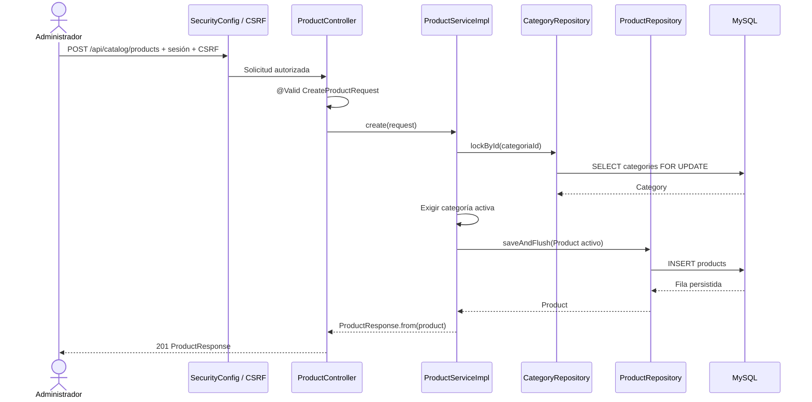
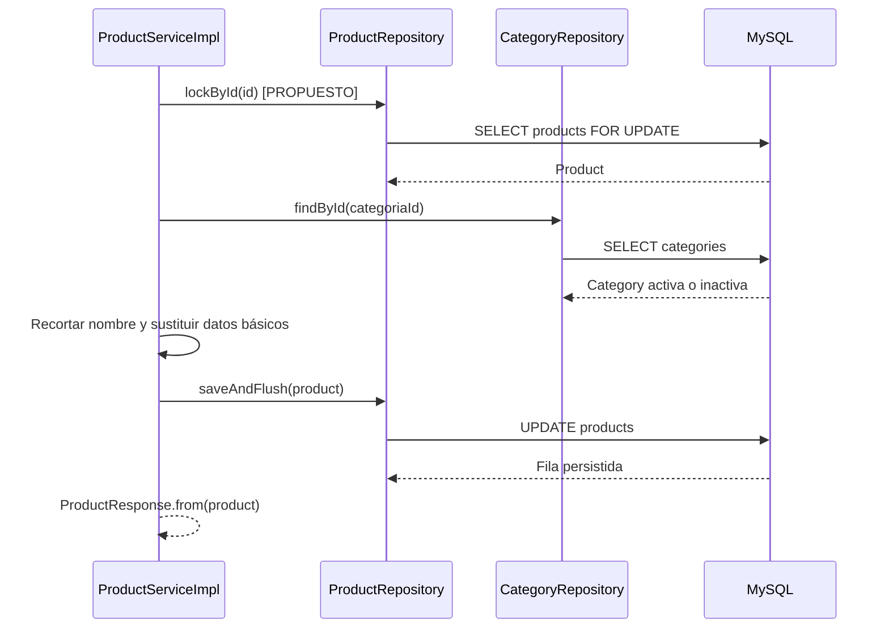
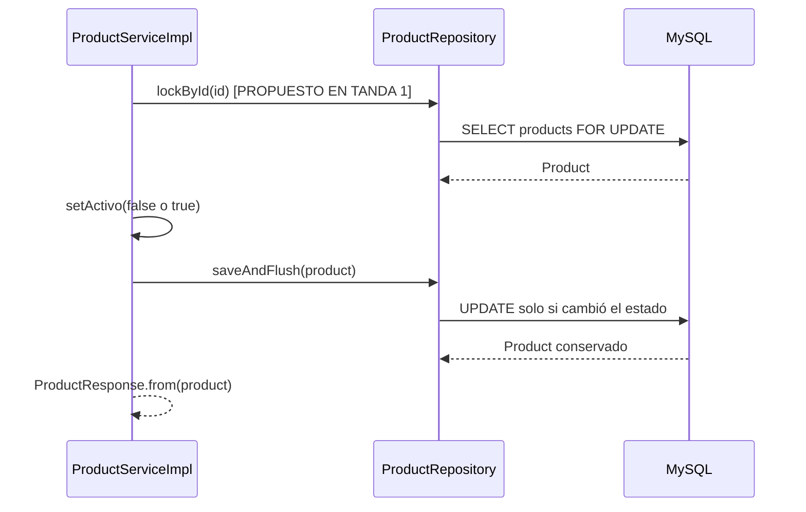
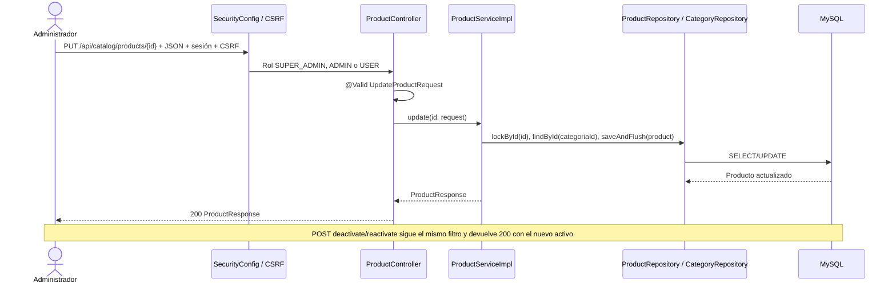

# S2 BE — Editar o desactivar producto básico: plan de implementación

**Fuentes de diseño:** [tarjeta BE de Trello](https://trello.com/c/t6Sy1vOk), [tarjeta de listados](https://trello.com/c/hW6oiQ3S), [tarjeta FE asociada](https://trello.com/c/DQGDVmWT), `docs/modelo-inicial.md`, `docs/Sprint 2/S2 BE Crear producto básico/s2-be-crear-producto-basico-plan-implementacion.md` y las decisiones acordadas para esta tarjeta. La tarjeta BE menciona características y ubica la reactivación en listados; las decisiones actuales difieren características a Sprint 3 y adelantan la reactivación a este backend.

**Alcance acordado:** editar nombre, categoría, descripción, precio de referencia y disponibilidad; desactivar y reactivar mediante baja lógica. No implementar características, variantes, fotos, promociones, control de `destacado`, listados, consulta por ID, formulario React ni ficha pública. Las tres tandas están completas.

## Estado al planificar — COMPROBADO EN EL CÓDIGO

- `ProductController` solo expone `POST /api/catalog/products`, protegido por `@PreAuthorize` para `SUPER_ADMIN`, `ADMIN` y `USER`. `SecurityConfig` ya tiene el matcher explícito para `/api/catalog/products` y `/api/catalog/products/**`; las mutaciones requieren sesión y CSRF.
- `CreateProductRequest` valida nombre, categoría, descripción, precio y disponibilidad. `ProductServiceImpl.create(...)` bloquea la fila de categoría mediante `CategoryRepository.lockById(...)`, rechaza la categoría inexistente o inactiva, fija `activo=true` y `destacado=false`, y guarda con `ProductRepository.saveAndFlush(...)`.
- `Product` y Flyway `V6__create_products.sql` ya incluyen todos los campos básicos, `activo`, `destacado`, FK a `categories`, precio positivo y auditoría. No existen tablas ni relaciones de características o variantes. `ProductRepository` solo hereda operaciones de `JpaRepository`.
- `ProductResponse.from(...)` devuelve ID, campos básicos y ambos estados. `GlobalExceptionHandler` ya traduce validación y JSON inválido a 400, recurso inexistente a 404 y el conflicto de categoría inactiva del alta a 409, con `ApiError` y `requestId`.
- Existen `ProductServiceTest`, `ProductServiceIntegrationTest`, `ProductControllerTest`, pruebas de persistencia H2/MySQL y `ProductCategoryConcurrencyMySqlTest`. Cubren el alta, la regla de categoría activa, autorización y conservación del producto al desactivar su categoría; no cubren edición ni transiciones de estado del producto.

## Contrato objetivo — implementado

| Ruta | Método propuesto | Contrato y resultado |
| --- | --- | --- |
| `PUT /api/catalog/products/{id}` | `ProductController.update` → `ProductService.update` | Recibe los cinco datos básicos completos en `UpdateProductRequest`; `descripcion` puede ser `null` para limpiarla. Devuelve `200 ProductResponse`. No modifica `activo` ni `destacado`. |
| `POST /api/catalog/products/{id}/deactivate` | `ProductController.deactivate` → `ProductService.deactivate` | Fija `activo=false` y devuelve `200 ProductResponse`. Repetirla devuelve el mismo estado sin error. |
| `POST /api/catalog/products/{id}/reactivate` | `ProductController.reactivate` → `ProductService.reactivate` | Fija `activo=true` y devuelve `200 ProductResponse`. Repetirla devuelve el mismo estado sin error. |

**Validación de `PUT`:** `nombre` obligatorio, no solo espacios, máximo 160 caracteres y persistido sin espacios exteriores; `categoriaId` obligatorio y positivo; `descripcion` opcional, máximo 1000 caracteres; `precioReferencia` obligatorio, mayor que cero, hasta 13 dígitos enteros y dos decimales sin redondeo; `disponible` booleano obligatorio. Son las reglas del alta. Se permiten nombres repetidos. La categoría indicada debe existir, pero puede estar inactiva. Se puede editar un producto inactivo.

**Validación de las rutas de estado:** el producto debe existir; se puede reactivar aunque su categoría esté inactiva. Las rutas de estado no reciben DTO ni cambian los demás campos. `activo` no forma parte de `UpdateProductRequest`; `destacado` tampoco. La reactivación y desactivación no borran el producto ni sus referencias. El alta existente conserva su regla distinta: no permite crear en categoría inactiva.

**Errores y acceso:** request inválido: `400 VALIDATION_ERROR`; JSON o ID no numérico: `400 MALFORMED_REQUEST`; producto o categoría inexistente: `404 RESOURCE_NOT_FOUND`. Las tres rutas exigen sesión, CSRF y rol `SUPER_ADMIN`, `ADMIN` o `USER`. Se reutilizan `ApiError` y `ProductResponse`. No se agrega unicidad de nombre ni migración.

### Flujo actual al planificar



### Flujo objetivo completo

`ProductServiceImpl.update(...)`, `UpdateProductRequest` y `ProductRepository.lockById(...)` quedaron **IMPLEMENTADOS EN LA TANDA 1**. `ProductServiceImpl.deactivate(...)` y `reactivate(...)` quedaron **IMPLEMENTADOS EN LA TANDA 2**. Los tres métodos nuevos de `ProductController` quedaron **IMPLEMENTADOS EN LA TANDA 3**; se reutilizaron `CategoryRepository`, `SecurityConfig`, `ProductResponse` y `GlobalExceptionHandler`.

```mermaid
sequenceDiagram
    actor U as Administrador
    participant Sec as SecurityConfig / CSRF
    participant C as ProductController
    participant S as ProductService / ProductServiceImpl
    participant PR as ProductRepository
    participant CR as CategoryRepository
    participant DB as MySQL
    participant E as GlobalExceptionHandler

    U->>Sec: PUT /api/catalog/products/{id} + sesión + CSRF
    Sec->>C: Rol admitido
    C->>C: @Valid UpdateProductRequest
    C->>S: update(id, request) [SERVICIO IMPLEMENTADO T1]
    S->>PR: lockById(id) [IMPLEMENTADO T1]
    PR->>DB: SELECT products FOR UPDATE
    alt Producto inexistente
        S->>E: ResourceNotFoundException
        E-->>U: 404 ApiError
    else Producto existente
        S->>CR: findById(categoriaId)
        CR->>DB: SELECT categories
        alt Categoría inexistente
            S->>E: ResourceNotFoundException
            E-->>U: 404 ApiError
        else Categoría existente, activa o inactiva
            S->>S: Cambiar cinco datos; conservar activo y destacado
            S->>PR: saveAndFlush(product)
            PR->>DB: UPDATE products
            DB-->>PR: Fila persistida
            S-->>C: ProductResponse.from(product)
            C-->>U: 200 ProductResponse
        end
    end
    Note over U,DB: POST deactivate/reactivate usa la misma búsqueda bloqueada, cambia solo activo y responde 200.
```

## Orden de implementación

| Tanda | Objetivo | Depende de | Estado |
| --- | --- | --- | --- |
| 1 | Edición básica en servicio y persistencia | Producto básico existente | Completa |
| 2 | Desactivación y reactivación idempotentes | Tanda 1 | Completa |
| 3 | Rutas HTTP, seguridad y verificación integral | Tandas 1 y 2 | Completa |

```text
Tanda 1 → Tanda 2 → Tanda 3
```

La tanda 1 introduce `ProductRepository.lockById(...)` para serializar las mutaciones sobre una misma fila de producto. La tanda 2 lo reutiliza; la tanda 3 publica ambos comportamientos. El bloqueo de categoría del alta permanece exclusivo del alta: la edición permite categorías inactivas y solo necesita verificar la referencia.

## Tanda 1 — Edición básica en servicio

**Objetivo:** persistir los cinco datos básicos completos sin alterar `activo` ni `destacado`.

**Depende de:** modelo, repositorio y servicio de alta actuales.

### Mapa de código

```text
[NUEVO] UpdateProductRequest
Backend/spring-starter/src/main/java/com/ashenox/starter/catalog/product/dto/UpdateProductRequest.java
└── Cinco campos editables y validación equivalente al alta [PROPUESTO]
        ↓
[MODIFICADO] ProductService / ProductServiceImpl
Backend/spring-starter/src/main/java/com/ashenox/starter/catalog/product/service/
└── update(id, request) [PROPUESTO]: buscar, verificar categoría, cambiar datos, responder
        ↓
[MODIFICADO] ProductRepository
Backend/spring-starter/src/main/java/com/ashenox/starter/catalog/product/repository/ProductRepository.java
├── lockById(id) [PROPUESTO]: bloqueo de la fila a editar
└── saveAndFlush(product) [EXISTENTE, heredado]
        ├──→ CategoryRepository.findById(categoriaId) [EXISTENTE, heredado]
        └──→ products / categories en MySQL
```

### Clases/archivos nuevos

`UpdateProductRequest`: record de nombre, categoría, descripción, precio y disponibilidad. Lo consumirá `ProductController.update(...)` en la tanda 3. No incluye `activo` ni `destacado`.

### Flujo de la tanda



`update(...)` será transaccional. Si falta producto o categoría, lanzará `ResourceNotFoundException` antes de guardar. El DTO aplica la validación HTTP en la tanda 3; las pruebas de servicio comprobarán también que la lógica no toca estados. `findById` no exige `Category.activo`. El bloqueo de producto serializa ediciones y cambios de estado sobre la misma fila, pero no añade detección de formularios obsoletos: dos ediciones válidas sucesivas pueden dejar los valores de la última.

### Cambios de persistencia/configuración

No hay migración ni columna nueva. El repositorio incorpora una consulta JPA con `PESSIMISTIC_WRITE` sobre `products.id`; se ejecuta dentro de la transacción del servicio.

### Tests necesarios

- **Servicio:** modificar los cinco datos, limpiar descripción con `null`, recortar nombre y conservar `activo` y `destacado`; demuestra el contrato de edición.
- **Servicio:** editar producto desactivado y asociar categoría inactiva existente; demuestra las decisiones distintas de la regla del alta.
- **Servicio:** ID de producto o categoría inexistente y nombre repetido; demuestra `ResourceNotFoundException` sin escritura y ausencia de unicidad artificial. La respuesta HTTP 404 se verifica en la tanda 3.
- **Integración H2/Flyway:** recargar la fila y verificar categoría, precio exacto, disponibilidad, estados y auditoría; demuestra persistencia real sin cambio de esquema.
- **Regresión:** volver a ejecutar pruebas de alta; demuestra que sigue rechazando categorías inactivas.

### Qué NO queda probado

```text
NO PROBADO: entrada HTTP, @Valid, sesión, CSRF y roles de la nueva edición.
RIESGO: el servicio puede funcionar sin contrato web protegido o sin validación efectiva.
TRATAMIENTO: cubrir en la tanda 3.
```

### Commit sugerido

`feat: add basic product editing service` — DTO, consulta de repositorio, servicio y tests de esta tanda.

### Criterio de cierre

- [x] Edición persistida con categoría activa o inactiva y producto activo o inactivo.
- [x] `activo` y `destacado` conservados; errores sin escritura parcial.
- [x] Tests de la tanda y regresión del alta ejecutados; faltantes e incidentes registrados.

### Resultado de ejecución

**Estado:** COMPLETA (02/10/2026). Detalle en [tanda-1-resultado.md](tanda-1-resultado.md).

**Cambios realizados:** `UpdateProductRequest`, `ProductService.update(...)`, consulta `ProductRepository.lockById(...)` con `PESSIMISTIC_WRITE`, pruebas de validación, servicio e integración H2. La edición admite categoría inactiva y producto inactivo, conserva `activo` y `destacado` y no cambia el alta existente.

**Diferencias respecto del plan:** se añadió una prueba directa de validación del DTO; una prueba de integración previa cambió su conteo absoluto por uno relativo para aislar su escenario. No hubo cambio funcional ni migración.

**Tests ejecutados:** selección Maven de `ProductServiceTest`, `UpdateProductRequestValidationTest`, `ProductServiceIntegrationTest`, `ProductPersistenceIntegrationTest` y `ProductControllerTest`, con Java 21 en Docker. Resultado final: 18 pruebas, 0 fallos, 0 errores, 0 omisiones.

**Tests exitosos:** 8 unitarios de servicio, 1 de validación, 3 de integración del servicio, 1 de persistencia y 5 de regresión HTTP del alta. El recorrido H2 guarda y recarga ediciones con categoría activa e inactiva, producto inactivo, precio exacto y estados conservados.

**Tests fallidos:** ninguno en la ejecución final. La primera ejecución tuvo un fallo de aislamiento del test existente; ver `INC-T1-001` en el resultado de la tanda.

**Incidentes:** `INC-T1-001`, prueba de integración dependiente del conteo global de filas. Corregida sin cambiar el comportamiento productivo.

**Tests faltantes:** ninguno de los previstos para la tanda 1. Contrato HTTP y seguridad de la edición corresponden a la tanda 3; serialización concurrente en MySQL se comprueba en la tanda 2.

**Riesgos residuales:** el DTO aún no está conectado a una ruta `@Valid`; la validación se comprobó directamente. Un formulario obsoleto no se detecta por versión y la última edición válida prevalece.

**Decisiones pendientes descubiertas:** ninguna.

**Archivos modificados:** DTO nuevo, interfaz y servicio de producto, repositorio, tres clases de test y este plan; resultado detallado en el archivo enlazado.

## Tanda 2 — Transiciones de estado del producto

**Objetivo:** desactivar y reactivar el producto de forma idempotente, conservando fila, datos y referencias.

**Depende de:** tanda 1 y su búsqueda transaccional bloqueada.

### Mapa de código

```text
[MODIFICADO] ProductService / ProductServiceImpl
Backend/spring-starter/src/main/java/com/ashenox/starter/catalog/product/service/
├── deactivate(id) [PROPUESTO]: fijar activo=false
└── reactivate(id) [PROPUESTO]: fijar activo=true
        ↓
[MODIFICADO EN TANDA 1] ProductRepository
Backend/spring-starter/src/main/java/com/ashenox/starter/catalog/product/repository/ProductRepository.java
├── lockById(id) [PROPUESTO EN TANDA 1]
└── saveAndFlush(product) [EXISTENTE, heredado]
        ↓
products en MySQL
```

### Clases/archivos nuevos

Ninguna. Se reutilizan `ProductResponse` y `ResourceNotFoundException`.

### Flujo de la tanda



Ambos métodos serán transaccionales. Un ID inexistente produce `ResourceNotFoundException`; repetir el estado solicitado devuelve éxito. No se consulta el estado de categoría para reactivar. La categoría, precio, disponibilidad, `destacado` y auditoría de creación no se sustituyen.

### Tests necesarios

- **Servicio:** desactivar dos veces y reactivar dos veces; demuestra idempotencia y retorno de `ProductResponse` con el estado solicitado.
- **Integración H2/Flyway:** recargar tras cada transición y comparar ID, relación de categoría y campos básicos; demuestra baja lógica sin pérdida de referencias.
- **Servicio:** reactivar con categoría inactiva y solicitar ID inexistente; demuestra independencia de ambos estados y ausencia de inserciones.
- **Concurrencia MySQL:** dos mutaciones del mismo producto esperan el bloqueo y terminan en un estado coherente; demuestra que el nuevo `lockById` serializa escrituras sobre esa fila.

### Qué NO queda probado

```text
NO PROBADO: rutas HTTP de estado, autorización y CSRF.
RIESGO: las transiciones aún no son accesibles de forma segura para el frontend.
TRATAMIENTO: cubrir en la tanda 3.
```

### Commit sugerido

`feat: add product status transitions` — servicio y tests de estado y concurrencia de esta tanda.

### Criterio de cierre

- [x] Desactivación y reactivación idempotentes y persistidas.
- [x] Fila, categoría y demás datos conservados, incluso con categoría inactiva.
- [x] Tests de la tanda ejecutados; faltantes, incidentes y riesgos registrados.

### Resultado de ejecución

**Estado:** COMPLETA (02/10/2026). Detalle en [tanda-2-resultado.md](tanda-2-resultado.md).

**Cambios realizados:** `ProductService.deactivate(...)` y `reactivate(...)` transaccionales reutilizan `ProductRepository.lockById(...)`, fijan solo `activo` y devuelven `ProductResponse`. Se añadieron pruebas unitarias, integración H2 y concurrencia MySQL.

**Diferencias respecto del plan:** ninguna funcional. La primera ejecución MySQL se interrumpió por la imposibilidad de conectar a Ryuk desde Docker Desktop; la repetición configuró solo el contenedor de Maven para desactivar Ryuk y usar `host.docker.internal`. No se modificó configuración del repositorio.

**Tests ejecutados:** selección Maven de `ProductServiceTest`, `ProductServiceIntegrationTest`, `ProductStatusConcurrencyMySqlTest`, `ProductCategoryConcurrencyMySqlTest`, `ProductPersistenceIntegrationTest` y `ProductControllerTest`. Resultado final: 23 pruebas, 0 fallos, 0 errores y 0 omisiones.

**Tests exitosos:** 10 unitarios de servicio, 4 de integración H2, 1 de bloqueo de producto y 2 de concurrencia de categoría en MySQL, 1 de persistencia y 5 de regresión HTTP del alta. La prueba nueva observó una espera real en `performance_schema.data_lock_waits` sobre `products`.

**Tests fallidos:** ninguno de la ejecución final. La primera ejecución quedó interrumpida antes de ejecutar la selección por el problema de Ryuk; ver `INC-T2-001`.

**Incidentes:** `INC-T2-001`, conectividad del contenedor auxiliar de Testcontainers en Docker Desktop; resuelto para la ejecución sin cambiar código ni tests.

**Tests faltantes:** ninguno de la tanda 2. Las rutas HTTP, sus permisos y CSRF pertenecen a la tanda 3.

**Riesgos residuales:** las transiciones no son accesibles por HTTP todavía; el control de formularios obsoletos sigue fuera de alcance. MySQL se verificó con Ryuk desactivado solo durante el comando de prueba; `docker ps` no mostró contenedores en ejecución al terminar.

**Decisiones pendientes descubiertas:** ninguna.

**Archivos modificados:** `ProductService.java`, `ProductServiceImpl.java`, `ProductServiceTest.java`, `ProductServiceIntegrationTest.java`, prueba MySQL nueva, este plan y el resultado detallado.

## Tanda 3 — Rutas HTTP, seguridad y aceptación integral

**Objetivo:** exponer los tres métodos privados y verificar contrato, errores, autorización y conservación de datos de extremo a extremo.

**Depende de:** tandas 1 y 2.

### Mapa de código

```text
[MODIFICADO] ProductController
Backend/spring-starter/src/main/java/com/ashenox/starter/catalog/product/controller/ProductController.java
├── update(id, @Valid UpdateProductRequest) [PROPUESTO]
├── deactivate(id) [PROPUESTO]
└── reactivate(id) [PROPUESTO]
        ↓
[MODIFICADO EN TANDAS 1 Y 2] ProductService / ProductServiceImpl
Backend/spring-starter/src/main/java/com/ashenox/starter/catalog/product/service/
├── update(id, request) [PROPUESTO]
├── deactivate(id) [PROPUESTO]
└── reactivate(id) [PROPUESTO]
        ↓
ProductRepository / CategoryRepository / MySQL

[EXISTENTES, SIN CAMBIO PREVISTO] SecurityConfig y GlobalExceptionHandler
Backend/spring-starter/src/main/java/com/ashenox/starter/security/config/SecurityConfig.java
Backend/spring-starter/src/main/java/com/ashenox/starter/shared/error/GlobalExceptionHandler.java
└── Matcher /api/catalog/products/** y respuestas ApiError existentes
```

### Clases/archivos nuevos

Ninguna. Se conecta el DTO de la tanda 1 con `@Valid` y se reutilizan los errores existentes. Solo modificar `SecurityConfig` o `GlobalExceptionHandler` si las pruebas muestran una falta concreta; el matcher y los mapeos necesarios ya están presentes.

### Flujo de la tanda



Las rutas nuevas mantienen la anotación de clase y el matcher existentes. El controller no duplica reglas de negocio: valida el DTO, recibe el ID y delega. Un request sin sesión, sin CSRF o con rol no admitido no debe modificar la base. En esta tanda se verifica por HTTP que `activo` no sea una forma admitida de cambiar estado mediante `PUT`.

### Cambios de persistencia/configuración

Ninguno previsto. Verificar el matcher actual de `SecurityConfig` en las tres rutas; no crear una regla redundante si ya las cubre.

### Tests necesarios

- **HTTP/contrato:** `PUT` responde 200 con los cinco datos persistidos, `activo` y `destacado` conservados; `POST` de cada transición responde 200 y es idempotente.
- **Validación:** nombre nulo, blanco o largo; categoría nula o no positiva; descripción larga; precio nulo, no positivo, con más de dos decimales o más de 13 enteros; disponibilidad nula; JSON inválido. Demuestra 400, `code`, `requestId` y ausencia de cambios.
- **Errores de referencia:** producto y categoría inexistentes devuelven 404; categoría inactiva existente es admitida. Demuestra la diferencia deliberada frente al alta.
- **Seguridad:** tres roles permitidos con sesión y CSRF; sin sesión 401, sin CSRF o rol no permitido 403, sin escritura. Demuestra protección real de `PUT` y ambos `POST`.
- **Integración/regresión:** crear → editar → desactivar → editar inactivo → reactivar con categoría inactiva → recargar; demuestra persistencia, referencias y estado final. Repetir pruebas de alta y de transición de categoría para asegurar que su regla original sigue vigente.

### Qué NO queda probado

```text
NO PROBADO: UI React, lectura administrativa, ficha pública y asociaciones de características futuras.
RIESGO: aún no hay pantalla ni lectura para mostrar los cambios; Sprint 3 deberá preservar referencias al migrar variantes y características.
TRATAMIENTO: tarjetas FE/listados y Sprint 3; no ampliar esta tarjeta.
```

### Commit sugerido

`feat: expose product edit and status endpoints` — controller y tests HTTP; cualquier ajuste de seguridad o errores justificado por las pruebas, sin trabajo FE.

### Criterio de cierre

- [x] Tres rutas responden según contrato y persisten cambios.
- [x] Roles, sesión, CSRF, validaciones y errores verificados por HTTP.
- [x] Baja lógica y reactivación conservan ID y referencias.
- [x] Regresión de alta/categoría ejecutada; incidentes, faltantes y riesgos registrados.

### Resultado de ejecución

**Estado:** COMPLETA (02/10/2026). Detalle en [tanda-3-resultado.md](tanda-3-resultado.md).

**Cambios realizados:** `ProductController` expone `PUT /{id}` con `@Valid UpdateProductRequest` y `POST /{id}/deactivate` y `/reactivate`; delega en los servicios implementados en tandas anteriores y devuelve `200 ProductResponse`. Se añadieron cinco pruebas HTTP en `ProductControllerTest`.

**Diferencias respecto del plan:** ninguna funcional. El matcher, CSRF y los mapeos de `ApiError` existentes cubrieron las rutas nuevas; no se modificaron seguridad, errores, persistencia ni migraciones.

**Tests ejecutados:** selección Maven de `ProductControllerTest`, `CategoryControllerTest`, `ProductServiceTest`, `ProductServiceIntegrationTest`, `ProductStatusConcurrencyMySqlTest` y `ProductCategoryConcurrencyMySqlTest`. Reportes Surefire: **34 pruebas, 0 fallos, 0 errores y 0 omisiones**.

**Tests exitosos:** 10 pruebas HTTP de producto (5 nuevas y 5 de alta/regresión), 7 HTTP de categoría, 10 unitarias de servicio, 4 de integración H2/Flyway y 3 de concurrencia MySQL. Los casos nuevos comprueban roles, sesión, CSRF, validación, errores, idempotencia, edición de producto inactivo y categoría inactiva, y el recorrido completo con recarga de la fila.

**Tests fallidos:** ninguno.

**Incidentes:** ninguno durante la tanda. Se reutilizaron las variables de entorno de Testcontainers documentadas en `INC-T2-001`; `docker ps` confirmó que no quedaron contenedores en ejecución.

**Tests faltantes:** ninguno de los planificados para esta tanda. No se ejecutó una suite global del backend ni pruebas de UI, lectura administrativa, ficha pública o características futuras; están fuera de su alcance.

**Riesgos residuales:** las ediciones concurrentes siguen con semántica de última escritura válida; la selección prueba componentes relacionados, no todo el backend. La UI y lecturas para mostrar estos cambios dependen de otras tarjetas. Sprint 3 deberá preservar las referencias al incorporar características y variantes.

**Decisiones pendientes descubiertas:** ninguna.

**Archivos modificados:** `ProductController.java`, `ProductControllerTest.java`, este plan y `tanda-3-resultado.md`.

## Registro global de decisiones pendientes

No quedan decisiones pendientes para iniciar las tandas. Quedaron acordados `PUT` completo sin `activo`, aceptación de categoría inactiva en edición, edición de productos inactivos, reactivación idempotente aun con categoría inactiva, y características diferidas a Sprint 3. Si la implementación descubre una contradicción de contrato o una dependencia nueva, registrarla aquí como `DECISIÓN PENDIENTE — DXX` con alternativas, consecuencias y tanda condicionada antes de cambiar el diseño.

## Protocolo global de incidentes

Ante un fallo relevante, registrar una sola entrada `INC-XXX` con tanda, contexto, test/comportamiento afectado, esperado y obtenido, clasificación (código, test, contrato, entorno, datos o causa indeterminada), causa confirmada o hipótesis, resolución, archivos productivos/tests/configuración modificados, resultado posterior `PASS`/`FAIL`/`PENDIENTE` y riesgo derivado. No ajustar un test solo para dejarlo verde; si cambia el contrato, registrar antes la decisión.

## Flujo total acumulado

```text
IMPLEMENTADO — ALTA EXISTENTE
POST /api/catalog/products → ProductController.create → ProductServiceImpl.create
→ categoría activa y bloqueada → products INSERT → 201 ProductResponse

IMPLEMENTADO — TANDAS 1 Y 3, EDICIÓN
PUT /api/catalog/products/{id} → sesión / CSRF / roles → @Valid UpdateProductRequest
→ ProductServiceImpl.update → producto bloqueado → categoría existente
→ products UPDATE de cinco datos básicos → 200 ProductResponse o ApiError

IMPLEMENTADO — TANDAS 2 Y 3, ESTADO
POST /api/catalog/products/{id}/deactivate|reactivate → sesión / CSRF / roles
→ ProductServiceImpl.deactivate/reactivate → producto bloqueado
→ activo=false/true sin borrado → 200 ProductResponse o ApiError
```

## Resumen final

### Orden de implementación

Tanda 1: edición y persistencia; tanda 2: estados idempotentes; tanda 3: HTTP, seguridad y aceptación integral. Cada tanda se revisa y prueba antes de comenzar la siguiente.

### Decisiones pendientes

Ninguna conocida. Las diferencias frente al texto original de Trello están explicitadas al inicio y en el registro global.

### Riesgos globales

- Las ediciones concurrentes se serializarán por fila, pero no se detectará que un formulario partió de una versión vieja; el último `PUT` válido prevalece. No agregar control de versiones sin una decisión de producto posterior.
- La migración de características y variantes de Sprint 3 deberá conservar ID y referencias de los productos básicos, incluidos los desactivados.

### Validación final

Demostrar por servicio y HTTP el recorrido crear → editar datos y categoría inactiva → desactivar → editar estando inactivo → reactivar aun con categoría inactiva; recargar la misma fila para comprobar precio, disponibilidad, estado y relación. Confirmar `ApiError`, autorización y CSRF, y que el alta original sigue rechazando categorías inactivas.
