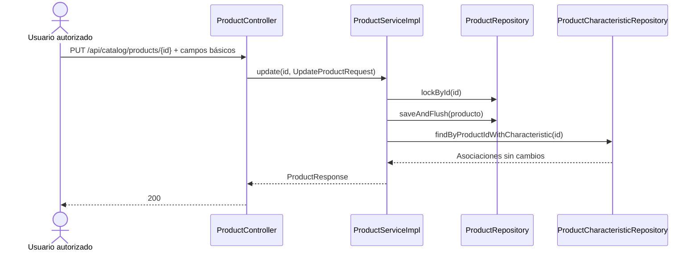
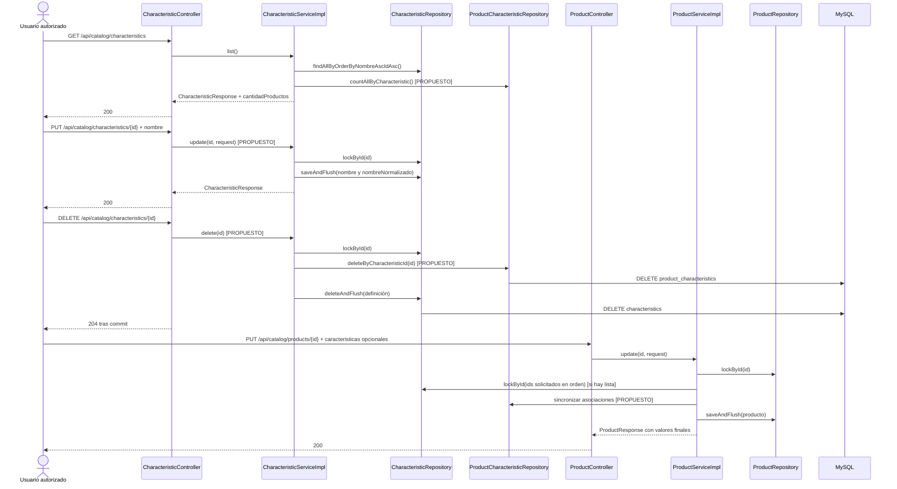
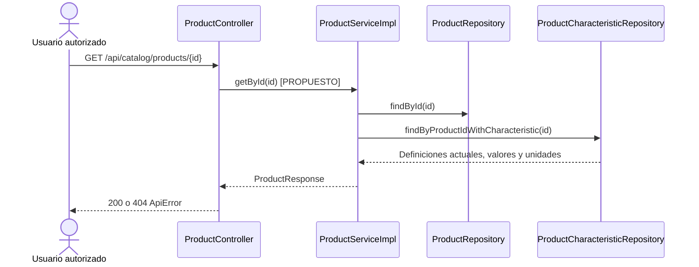
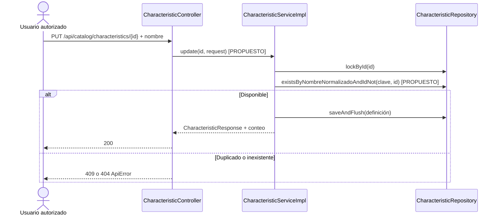
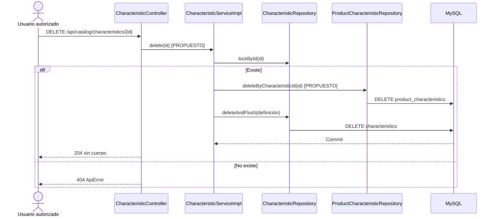
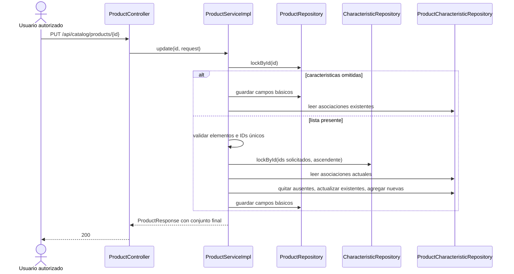

# S2 BE — Editar o eliminar característica: plan de implementación

**Estado:** tandas 1–2 completas; tandas 3–4 planificadas.

**Fuentes:** [tarjeta BE](https://trello.com/c/4NeAHpsb), [tarjeta de creación de características](https://trello.com/c/uxJ6ZOVZ), `PROMPT_GENERAR_PLAN_IMPLEMENTACION.md` y decisiones técnicas acordadas para esta tarjeta. La tarjeta de frontend asociada es [S2 FE Editar o eliminar característica](https://trello.com/c/CWk4KFiC).

**Alcance:** consultas administrativas necesarias para mostrar el uso y precargar la edición; renombrado y eliminación física de características; edición atómica de valores y unidades de características del producto. No incluye frontend, listado general de productos, desactivación/reactivación de características, fotos, variantes ni ficha pública.

## Decisiones técnicas acordadas

| Tema | Contrato |
| --- | --- |
| Conteo | `CharacteristicResponse` incorpora `cantidadProductos` en alta, listado, consulta por ID y renombrado. Incluye productos activos e inactivos. Es informativo: puede variar entre consulta y confirmación. |
| Precarga | `GET /api/catalog/products/{id}` devuelve el `ProductResponse` existente con características, valores y unidades; también para productos inactivos. El listado general pertenece a otra tarjeta. |
| Renombrado | `PUT /api/catalog/characteristics/{id}` recibe solo `nombre` y devuelve 200 con el mismo ID y `CharacteristicResponse` actualizado. Conserva asociaciones. |
| Eliminación | `DELETE /api/catalog/characteristics/{id}` elimina asociaciones y luego definición en una sola transacción; devuelve 204 sin cuerpo. No borra ni modifica productos. |
| Edición de producto | En `PUT /api/catalog/products/{id}`, omitir `caracteristicas` conserva asociaciones; una lista representa el conjunto final; `[]` quita todas; `null` explícito se rechaza con 400. |
| Acceso y errores | `SUPER_ADMIN`, `ADMIN` y `USER`; mutaciones con CSRF. Reutilizar `ApiError`: validación 400, inexistencia 404, duplicado o conflicto de integridad 409. |

## Estado actual — COMPROBADO EN EL CÓDIGO

- `CharacteristicController` expone `create`, `list` y `getById`. `CharacteristicServiceImpl` recorta y normaliza nombres; `CharacteristicRepository.lockById` ya existe. `CharacteristicResponse` solo tiene `id` y `nombre`.
- Flyway `V7__create_characteristics.sql` crea `characteristics` y `product_characteristics`, con PK `(product_id, characteristic_id)`, FK e índice por característica. No hay `ON DELETE CASCADE` ni campo de estado para la definición.
- `ProductController` expone alta, edición básica y cambios de estado, pero no consulta por ID. `ProductServiceImpl.update` bloquea el producto, modifica cinco campos básicos y conserva las asociaciones. `ProductResponse` ya incluye `caracteristicas` con ID, nombre actual, valor y unidad.
- `ProductServiceImpl.create` valida duplicados y referencias, bloquea categoría y definiciones en orden ascendente, y guarda producto y asociaciones de forma transaccional. `ProductCharacteristicRepository.findByProductIdWithCharacteristic` permite construir la respuesta.
- `SecurityConfig` ya restringe ambas rutas de catálogo a los tres roles. `GlobalExceptionHandler` traduce validación a 400, recurso inexistente a 404 e integridad/nombre duplicado a 409. Hay tests HTTP, H2 y MySQL/Testcontainers.
- Al planificar existen cambios locales ajenos en `ProductController`, `ProductControllerTest` y documentación de edición básica. Preservarlos; no asumir que este plan los implementó.

### Flujo actual



### Flujo objetivo — COMPORTAMIENTO PROPUESTO

Los métodos marcados como **PROPUESTO** no existen todavía.



## Orden de implementación

| Tanda | Objetivo | Depende de | Estado |
| --- | --- | --- | --- |
| 1 | Conteo de asociaciones y consulta de producto por ID | Código actual | Completa |
| 2 | Renombrado de característica | Tanda 1 | Completa |
| 3 | Eliminación transaccional y concurrencia | Tanda 2 | Planificada |
| 4 | Edición atómica de valores de producto | Tanda 3 | Planificada |

```text
Tanda 1 → Tanda 2 → Tanda 3 → Tanda 4
```

La tanda 3 fija y verifica la coordinación con el alta antes de ampliar la edición para compartir el bloqueo de definiciones.

## Tanda 1 — Consultas para la administración

**Objetivo:** informar el alcance de una eliminación y entregar los datos necesarios para abrir la edición de producto.

**Depende de:** esquema y respuestas de la tarjeta de creación.

### Mapa de código

```text
[MODIFICADOS] CharacteristicController.list/getById
Backend/spring-starter/src/main/java/com/ashenox/starter/catalog/characteristic/controller/
        ↓
[MODIFICADOS] CharacteristicService.list/getById; CharacteristicServiceImpl
Backend/spring-starter/src/main/java/com/ashenox/starter/catalog/characteristic/service/
        ↓
[MODIFICADO] ProductCharacteristicRepository: conteos agrupados y por ID [PROPUESTOS]
Backend/spring-starter/src/main/java/com/ashenox/starter/catalog/characteristic/repository/
        ↓
[MODIFICADO] CharacteristicResponse: cantidadProductos
Backend/spring-starter/src/main/java/com/ashenox/starter/catalog/characteristic/dto/

[MODIFICADO] ProductController.getById [PROPUESTO]
Backend/spring-starter/src/main/java/com/ashenox/starter/catalog/product/controller/
        ↓
[MODIFICADOS] ProductService.getById; ProductServiceImpl.getById [PROPUESTOS]
Backend/spring-starter/src/main/java/com/ashenox/starter/catalog/product/service/
        ↓
ProductRepository.findById → ProductCharacteristicRepository.findByProductIdWithCharacteristic
        ↓
ProductResponse existente
```

### Clases/archivos nuevos

Ninguno previsto.

### Flujo de la tanda



Para características, `CharacteristicServiceImpl.list/getById` combina definiciones con conteos del repositorio. El listado usa una consulta agrupada para evitar una consulta por definición. El alta responde conteo cero; el renombrado de la tanda 2 devuelve el conteo vigente.

### Tests necesarios

- **Integración:** listado y consulta por ID muestran 0, 1 y varios productos; incluyen productos inactivos y reflejan asociaciones agregadas o quitadas.
- **HTTP y seguridad:** `GET /products/{id}` devuelve valores y unidades de un producto activo o inactivo; 404 si no existe; los tres roles acceden y anónimos/otros roles son rechazados.

### Qué NO queda probado

```text
NO PROBADO: renombrado, eliminación y edición de asociaciones.
RIESGO: el conteo mostrado puede quedar desactualizado antes de confirmar.
TRATAMIENTO: declararlo informativo; las tandas posteriores prueban la operación real.
```

### Commit sugerido

`feat: expose characteristic usage and product detail` — consultas, DTO y tests; no incluir mutaciones posteriores.

### Criterio de cierre

- [ ] Conteos y precarga verificados, incluidos productos inactivos.
- [ ] Permisos y 404 verificados.
- [ ] Tests faltantes y riesgos registrados.
- [ ] Resultado de ejecución y documentación actualizados.

### Resultado de ejecución

**Estado:** COMPLETA. [Detalle de la tanda 1](tanda-1-resultado.md).

**Cambios realizados:** `CharacteristicResponse` incorpora `cantidadProductos`; el servicio de características obtiene conteos agrupados para el listado, conteo por ID y devuelve cero en el alta. `ProductController.getById` y `ProductServiceImpl.getById` exponen el `ProductResponse` actual de productos activos e inactivos, con valores y unidades.

**Diferencias respecto del plan:** se añadió una prueba específica con MySQL 8.4 para verificar las consultas nuevas en la base de producción. No hubo cambios funcionales fuera de la tanda.

**Tests ejecutados y exitosos:** 23 tests HTTP/H2 y de regresión de características/producto; 10 tests de `ProductControllerTest` y 1 del flujo de producto con MySQL; 1 test nuevo de conteos y detalle con MySQL. Total: **35 tests, 0 fallos, 0 errores, 0 omitidos**.

**Tests fallidos:** ninguno. **Incidentes:** `INC-001`, entorno Maven sin `JAVA_HOME` inicial y red restringida; resuelto configurando el JDK 21 existente y ejecutando Maven con acceso a dependencias. No se modificó código ni tests por este incidente.

**Tests faltantes:** ninguno de los previstos para la tanda. No se midió rendimiento del listado con un catálogo grande; el conteo se obtiene en una consulta agrupada. **Riesgos residuales:** el conteo es informativo y puede variar antes de confirmar una eliminación; renombrado, borrado y edición de valores siguen pendientes de sus tandas.

**Decisiones pendientes descubiertas:** ninguna.

**Archivos modificados:** `CharacteristicResponse`, `ProductCharacteristicRepository`, `CharacteristicServiceImpl`, `ProductController`, `ProductService`, `ProductServiceImpl` y este plan. **Archivos nuevos:** `CharacteristicUsageQueryTest`, `CharacteristicUsageMySqlTest` y `tanda-1-resultado.md`. Los cambios locales preexistentes de edición básica permanecieron intactos.

## Tanda 2 — Renombrar característica

**Objetivo:** modificar la definición sin tocar sus asociaciones ni valores.

**Depende de:** tanda 1.

### Mapa de código

```text
[MODIFICADO] CharacteristicController.update [PROPUESTO]
Backend/spring-starter/src/main/java/com/ashenox/starter/catalog/characteristic/controller/
        ↓
[MODIFICADOS] CharacteristicService.update; CharacteristicServiceImpl.update [PROPUESTOS]
Backend/spring-starter/src/main/java/com/ashenox/starter/catalog/characteristic/service/
        ↓
[MODIFICADO] CharacteristicRepository:
lockById → existsByNombreNormalizadoAndIdNot [PROPUESTO] → saveAndFlush
Backend/spring-starter/src/main/java/com/ashenox/starter/catalog/characteristic/repository/
        ↓
CharacteristicResponse con cantidadProductos
```

### Clases/archivos nuevos

`UpdateCharacteristicRequest` en `characteristic/dto/`: solo `nombre`, obligatorio, no blanco y de máximo 160 caracteres.

### Flujo de la tanda



Recortar espacios y normalizar con `Locale.ROOT`, igual que el alta. Permitir cambios solo de capitalización en la misma definición. Conservar la restricción única de MySQL como protección ante carreras.

### Tests necesarios

- **Integración:** renombrar una definición usada por varios productos conserva ID, valores y unidades; las lecturas posteriores muestran el nombre nuevo.
- **Validación y seguridad:** blanco/largo excesivo → 400; duplicado → 409; ID inexistente → 404; tres roles admitidos y CSRF requerido.
- **MySQL:** la restricción única también resuelve una carrera entre nombres.

### Qué NO queda probado

```text
NO PROBADO: eliminación de definiciones y coordinación con escrituras de asociaciones.
RIESGO: la comprobación previa de nombre no serializa altas o renombrados concurrentes.
TRATAMIENTO: la restricción única y el manejador de integridad deben devolver 409; verificar en MySQL.
```

### Commit sugerido

`feat: rename characteristics` — request, endpoint, servicio, repositorio y tests.

### Criterio de cierre

- [ ] Nombre y clave normalizada coherentes; valores conservados.
- [ ] Errores, permisos y carrera de unicidad comprobados.
- [ ] Tests faltantes, riesgos y resultado registrados.

### Resultado de ejecución

**Estado:** COMPLETA. [Detalle de la tanda 2](tanda-2-resultado.md).

**Cambios realizados:** `PUT /api/catalog/characteristics/{id}` recibe `nombre`, valida el request y devuelve `CharacteristicResponse` con el mismo ID y `cantidadProductos`. El servicio bloquea la definición, recorta y normaliza el nombre, excluye el propio ID de la comprobación de duplicados y guarda la definición sin modificar asociaciones.

**Diferencias respecto del plan:** la prueba de carrera MySQL usa dos transacciones JDBC con comprobaciones previas separadas para forzar el caso de unicidad; el mapeo `DataIntegrityViolationException` → 409 se verifica mediante la regresión existente del manejador. No hay diferencia funcional.

**Tests ejecutados:** 3 tests nuevos HTTP/integración H2, 1 nuevo MySQL de carrera y 38 de regresión relacionada (características, consultas, producto y errores). **Tests exitosos:** 42. **Tests fallidos:** ninguno en la corrida final; un primer intento tuvo 1 fallo de preparación del test, corregido y registrado.

**Incidentes:** `INC-002`, Maven bloqueado por red del sandbox; `INC-003`, PUT anónimo sin CSRF en un test nuevo esperaba 401 y recibió 403. Ambos resueltos sin modificar código productivo por el incidente.

**Tests faltantes:** ninguno de los previstos. La carrera se comprueba en la restricción MySQL; no se fuerza un fallo de unicidad dentro de dos requests HTTP concurrentes. **Riesgos residuales:** el conteo sigue siendo informativo; el camino HTTP concurrente depende del manejador general de integridad, probado por separado. Eliminación y escrituras concurrentes de asociaciones corresponden a las tandas posteriores.

**Decisiones pendientes descubiertas:** ninguna.

**Archivos modificados:** `CharacteristicController`, `CharacteristicService`, `CharacteristicServiceImpl`, `CharacteristicRepository` y este plan. **Archivos nuevos:** `UpdateCharacteristicRequest`, `CharacteristicRenameTest`, `CharacteristicRenameMySqlTest` y `tanda-2-resultado.md`.

## Tanda 3 — Eliminar característica con sus asociaciones

**Objetivo:** quitar definición y todos sus valores en una transacción, conservando productos.

**Depende de:** tanda 2.

### Mapa de código

```text
[MODIFICADO] CharacteristicController.delete [PROPUESTO]
Backend/spring-starter/src/main/java/com/ashenox/starter/catalog/characteristic/controller/
        ↓
[MODIFICADOS] CharacteristicService.delete; CharacteristicServiceImpl.delete [PROPUESTOS]
Backend/spring-starter/src/main/java/com/ashenox/starter/catalog/characteristic/service/
        ↓
CharacteristicRepository.lockById
        ↓
[MODIFICADO] ProductCharacteristicRepository.deleteByCharacteristicId [PROPUESTO]
Backend/spring-starter/src/main/java/com/ashenox/starter/catalog/characteristic/repository/
        ↓
CharacteristicRepository.deleteAndFlush
        ↓
MySQL; commit único
```

### Clases/archivos nuevos

Ninguno previsto.

### Flujo de la tanda



`CharacteristicServiceImpl.delete` será `@Transactional`. Quitar explícitamente las asociaciones antes de la definición. Bloquear la fila de característica para coordinar con el alta, que ya bloquea definiciones: si el alta confirma primero, el borrado quita su asociación; si el borrado confirma primero, el alta rechaza el ID inexistente. Cualquier fallo revierte ambos pasos. No modificar V7 ni añadir cascadas.

### Tests necesarios

- **Integración MySQL:** borrar una definición usada por varios productos quita solo sus asociaciones; conserva productos y otras características. Una definición sin uso también devuelve 204.
- **Atomicidad:** inducir un fallo después de quitar asociaciones y antes del commit; comprobar que definición, valores y unidades permanecen.
- **Concurrencia MySQL:** verificar ambos órdenes entre alta y borrado, sin huérfanos ni cambios parciales.
- **HTTP y seguridad:** 404 para ID inexistente, 204 sin cuerpo, tres roles admitidos, CSRF y rechazo de anónimos.

### Qué NO queda probado

```text
NO PROBADO: reemplazo de valores durante la edición de producto.
RIESGO: esa escritura podría competir con el borrado.
TRATAMIENTO: probar ambos flujos concurrentes en la tanda 4.
```

### Commit sugerido

`feat: delete characteristics with product values` — endpoint, transacción, repositorio y tests.

### Criterio de cierre

- [ ] Borrado, rollback y conservación de productos demostrados en MySQL.
- [ ] Carreras con alta verificadas.
- [ ] Permisos, errores, riesgos y resultado registrados.

### Resultado de ejecución

**PENDIENTE DE EJECUCIÓN**

## Tanda 4 — Editar valores de características del producto

**Objetivo:** aplicar campos básicos y reemplazo opcional de asociaciones de manera atómica.

**Depende de:** tanda 3.

### Mapa de código

```text
[MODIFICADO] UpdateProductRequest: caracteristicas opcionales
Backend/spring-starter/src/main/java/com/ashenox/starter/catalog/product/dto/
        ↓
ProductController.update
        ↓
[MODIFICADO] ProductServiceImpl.update
Backend/spring-starter/src/main/java/com/ashenox/starter/catalog/product/service/
        ↓
ProductRepository.lockById
        ↓
CharacteristicRepository.lockById (IDs solicitados, orden ascendente)
        ↓
[MODIFICADO] ProductCharacteristicRepository: lectura y sincronización [PROPUESTA]
Backend/spring-starter/src/main/java/com/ashenox/starter/catalog/characteristic/repository/
        ↓
ProductRepository.saveAndFlush → ProductResponse
```

### Clases/archivos nuevos

Ninguno previsto: reutilizar `ProductCharacteristicRequest` y `ProductCharacteristicResponse`. Conservar compatibilidad de los constructores usados en tests al ampliar `UpdateProductRequest`.

### Flujo de la tanda



El request debe distinguir campo omitido de `null` explícito; rechazar este último con 400. Una lista presente es el estado final, no una lista de operaciones parciales. Aplicar reglas del alta: ID positivo/existente, valor no blanco de hasta 500 caracteres, unidad opcional de hasta 100, recorte de textos y unidad vacía como `null`; ID repetido → 400. Bloquear producto y luego definiciones solicitadas en orden ascendente antes de modificar asociaciones. La transacción existente de `update` cubre campos básicos y valores.

### Tests necesarios

- **Integración:** omisión conserva; `[]` elimina todas; una lista agrega, modifica y quita en un PUT; unidad vacía → `null`; GET por ID y respuesta de PUT muestran el conjunto final.
- **Rollback:** duplicado, ID inexistente, dato inválido o fallo de persistencia no alteran campos básicos ni asociaciones.
- **Concurrencia MySQL:** edición frente a eliminación de una definición y dos ediciones del mismo producto dejan un estado íntegro y serializado.
- **Regresión HTTP:** edición básica sin `caracteristicas`, creación, desactivación y reactivación conservan contratos y valores.

### Qué NO queda probado

```text
NO PROBADO: interfaz frontend y listado general de productos.
RIESGO: el conteo previo a una confirmación puede diferir del finalmente afectado.
TRATAMIENTO: aceptar conteo informativo; la tarjeta frontend refrescará las consultas tras cada mutación.
```

### Commit sugerido

`feat: edit product characteristic values` — contrato de PUT, sincronización transaccional y tests.

### Criterio de cierre

- [ ] Omisión, `null` y lista final comprobados.
- [ ] Rollback, concurrencia y regresión verificados.
- [ ] Tests faltantes, riesgos y resultado registrados.

### Resultado de ejecución

**PENDIENTE DE EJECUCIÓN**

## Registro global de decisiones pendientes

No hay decisiones pendientes al planificar. Si durante una tanda aparece una contradicción con el código o una alternativa que cambie contrato, seguridad o arquitectura, registrar `DECISIÓN PENDIENTE — DXX` con hallazgo, alternativas, consecuencias y tanda bloqueada antes de implementarla.

## Protocolo global de incidentes

Ante un defecto o test fallido relevante, registrar `INC-XXX` con tanda, contexto, comportamiento esperado y obtenido, clasificación, causa confirmada o hipótesis, resolución, cambios en código/tests/configuración, resultado posterior y riesgo residual. No modificar un test solo para hacerlo pasar ni alterar silenciosamente el contrato. Omitir errores triviales de edición sin impacto técnico.

## Flujo total acumulado

```text
IMPLEMENTADO TRAS TANDA 1
Alta y consulta de características → alta de producto con valores
                                   → edición básica que conserva valores
                                   → conteo de uso y GET de producto por ID

OBJETIVO PENDIENTE
Renombrado que conserva asociaciones
        ↓
Eliminación transaccional de definición y asociaciones
        ↓
Edición atómica del conjunto de valores del producto
```

## Resumen final

### Orden de implementación

Consultas → renombrado → eliminación → edición de valores.

### Decisiones pendientes

Ninguna al planificar.

### Riesgos globales

Las carreras entre escrituras y eliminación requieren pruebas MySQL/Testcontainers. El conteo antes de confirmar un borrado es informativo y puede variar.

### Validación final

Crear una característica y asociarla a varios productos; consultar el conteo y precargar uno; renombrarla sin perder valores; editar, agregar y quitar valores; eliminar la definición y verificar que desaparecen sus asociaciones, mientras los productos y sus demás características permanecen. Repetir fallos inducidos para demostrar que no quedan cambios parciales.
