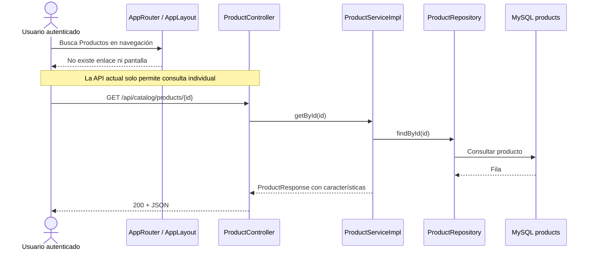
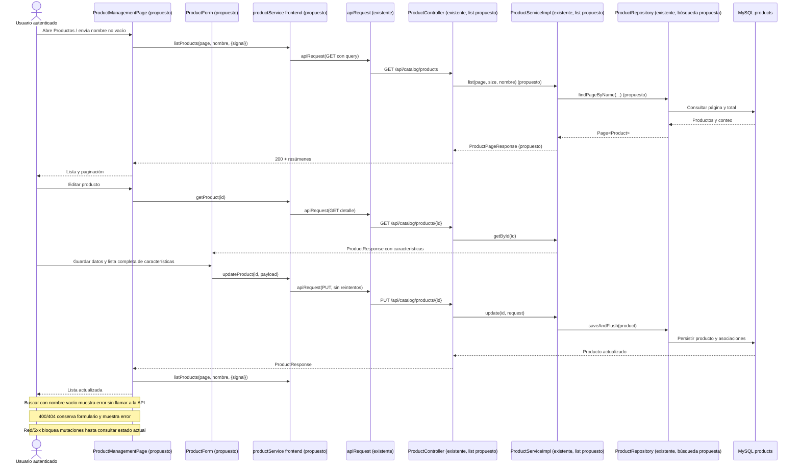
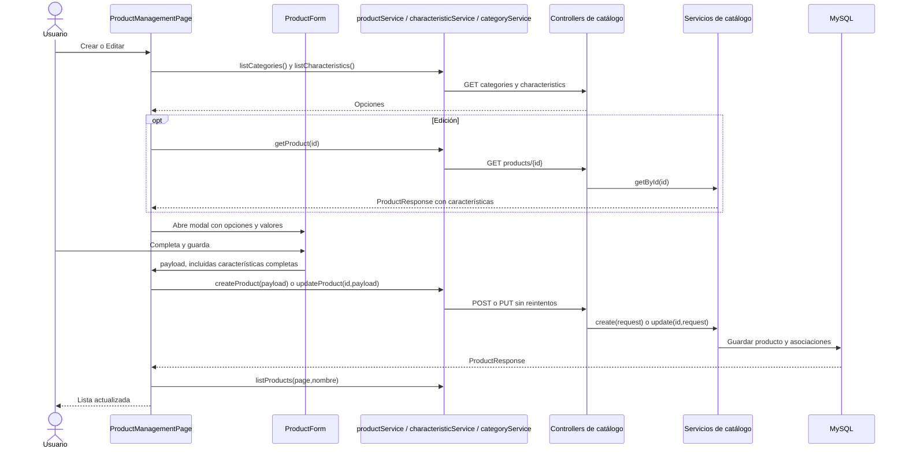
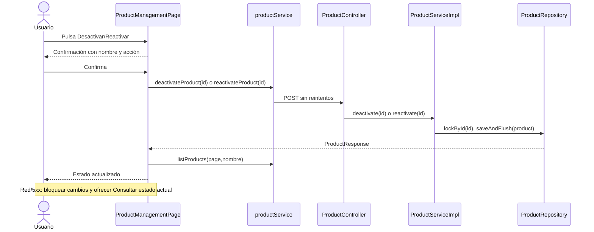

# S2 BE Listar productos para administración — plan de implementación

**Estado:** planificación completa; tandas 1 a 4 ejecutadas y completas.

**Fuentes:** decisión de esta tarjeta, `PROMPT_GENERAR_PLAN_IMPLEMENTACION.md`, código actual del catálogo y pantalla existente de categorías.

## Propósito y decisiones cerradas

Incorporar la gestión de productos a `/app/catalog/products`, accesible para `SUPER_ADMIN`, `ADMIN` y `USER` autenticados. El navegador tendrá un enlace **Productos**; la pantalla mostrará una lista paginada de activos e inactivos, búsqueda solo por nombre, botón **Crear producto**, modal de alta, modal de edición y acciones **Editar**, **Desactivar** y **Reactivar**. La baja es lógica y ambas transiciones de estado requieren confirmación.

- `GET /api/catalog/products?page=0&size=20&nombre=...` devolverá `{content, page, size, totalElements, totalPages}`. Cada elemento será un resumen sin características: `id`, `nombre`, `categoriaId`, `descripcion`, `precioReferencia`, `disponible`, `activo`, `destacado`. `GET /api/catalog/products/{id}` seguirá devolviendo `ProductResponse` completo, incluidas las características, para abrir la edición.
- La búsqueda recortará espacios externos y encontrará subcadenas sin distinguir mayúsculas y minúsculas. No se exige normalización de tildes; su comparación seguirá la intercalación de la base de datos. `%` y `_` se buscarán literalmente. `nombre` omitido permitirá la carga inicial sin filtro; `nombre` presente pero vacío o compuesto solo por espacios devolverá 400 con error de validación. Orden: `nombre` ascendente e `id` ascendente. `page` inicia en 0; `size` predeterminado 20 y válido de 1 a 100; parámetros fuera de rango dan 400, y una página fuera del total devuelve `content: []` con los metadatos reales.
- El formulario editará nombre, categoría, descripción, precio de referencia, disponibilidad y cero o más características (`caracteristicaId`, `valor`, `unidad`). El alta ofrecerá solo categorías activas. Si el producto editado ya pertenece a una categoría inactiva, permitirá conservar esa selección; no ofrecerá otras categorías inactivas. Para editar se enviará siempre la lista completa de características, incluso `[]`, porque el backend distingue omitir el campo de reemplazarlo.
- La búsqueda se aplica al pulsar **Buscar**, no por cada tecla. Si el campo queda vacío tras recortar espacios, la pantalla mostrará un error junto al buscador, no modificará la URL ni enviará la solicitud. **Limpiar búsqueda** quitará `nombre` de la URL y volverá a la página 0 sin filtro. Las búsquedas válidas conservarán `nombre` y `page` en la URL; una nueva búsqueda vuelve a la página 0. Un enlace directo con `nombre=` mostrará el mismo error sin consultar la API. El tamaño de página de la interfaz será 20.
- Tras cada mutación exitosa se vuelve a consultar la página actual. Si queda vacía porque se alteró el total, se navega a la última página disponible y se consulta de nuevo. Se impiden envíos duplicados. Ante fallo de red o 5xx no se reintenta la mutación: se bloquean nuevas mutaciones hasta **Consultar estado actual**. Esta lectura permite revisar el estado, pero no demuestra por sí misma si la solicitud previa se aplicó.
- No se agregan filtros de categoría ni estado, búsqueda pública, imágenes, variantes, cambios de permisos o migraciones de esquema. `destacado` se muestra, pero esta pantalla no lo edita.

## Estado actual

### COMPROBADO EN EL CÓDIGO ACTUAL

- `ProductController` expone `POST /api/catalog/products`, `GET /{id}`, `PUT /{id}`, `POST /{id}/deactivate` y `POST /{id}/reactivate`; no expone `GET` de colección. `ProductService`/`ProductServiceImpl` implementan esas cinco operaciones. `ProductRepository` ofrece `lockById` y las operaciones heredadas de `JpaRepository`, sin consulta paginada por nombre.
- `ProductResponse` incluye datos básicos, estado `destacado` y lista de características. `CreateProductRequest` acepta características opcionales; `UpdateProductRequest` distingue si la propiedad `caracteristicas` está presente. Si está presente, la actualización reemplaza el conjunto; `null` se rechaza. `ProductCharacteristicRepository.findByProductIdWithCharacteristic(...)` se usa al armar la respuesta completa por ID.
- `products` tiene índice por `category_id` y clave primaria; no hay índice específico para búsqueda parcial por nombre. La categoría inactiva impide el alta de producto, mientras que la edición permite conservar una categoría inactiva existente. Los productos activos e inactivos permanecen en la misma tabla.
- `SecurityConfig` y `@PreAuthorize` admiten `SUPER_ADMIN`, `ADMIN` y `USER` en `/api/catalog/products/**`. El frontend usa cookies, CSRF, errores estructurados y `apiRequest`. `categoryService.js` evita reintentos automáticos en mutaciones. `CategoryManagementPage.jsx` ya usa un modal nativo de alta/edición, confirmación de estado y consulta después de resultados inciertos.
- `AppRouter.jsx` y `AppLayout.jsx` solo enlazan categorías y otras pantallas existentes; no hay ruta o enlace de productos. `CategoryController.list()` y `CharacteristicController.list()` aportan los datos necesarios para los selectores. El listado de usuarios aporta el precedente de respuesta `{content, page, size, totalElements, totalPages}` y parámetros de paginación.
- Existen tests de controller, servicio, persistencia y concurrencia para las operaciones actuales de productos; tests de Vitest/React Testing Library para categorías y navegación. Ninguno verifica todavía el listado administrativo de productos ni una pantalla de productos.

### COMPORTAMIENTO PROPUESTO

La página solicitará resúmenes paginados y mostrará categoría, precio, disponibilidad y estado. El detalle completo se consultará al seleccionar **Editar**; el formulario cargará categorías y definiciones de características. Las operaciones existentes del backend persistirán altas, ediciones y cambios de estado. Cada cambio exitoso recargará la lista del servidor para reflejar su orden y sus valores canónicos.

## Mapa global de flujos

### Flujo actual



### Flujo objetivo

Los componentes y métodos señalados como **propuestos** todavía no existen.



El alta reemplaza `getProduct/updateProduct` por `createProduct` → `ProductController.create` → `ProductServiceImpl.create`. La desactivación y reactivación siguen `ProductManagementPage` → `productService` → `ProductController.deactivate/reactivate` → `ProductServiceImpl` → `ProductRepository.lockById/saveAndFlush` → MySQL, con recarga posterior.

## Orden de implementación

| Tanda | Objetivo | Depende de | Estado |
| --- | --- | --- | --- |
| 1 | API paginada de resúmenes con búsqueda por nombre | API de productos actual | Completa |
| 2 | Adaptador frontend, ruta, navegación y listado | 1 | Completa |
| 3 | Alta y edición en modales con características | 2 | Completa |
| 4 | Desactivación, reactivación y recorrido integral | 3 | Completa |

```text
Tanda 1 → Tanda 2 → Tanda 3 → Tanda 4
```

---

## Tanda 1 — API de listado administrativo

**Objetivo:** exponer una página de resúmenes ordenada y filtrada por nombre sin cargar las características de cada producto.

**Depende de:** API y esquema actuales de productos.

### Mapa de código

```text
[MODIFICADO] ProductController.java
Backend/spring-starter/src/main/java/com/ashenox/starter/catalog/product/controller/ProductController.java
└── list(page, size, nombre) [PROPUESTO]: recibe GET de colección
        ↓
[MODIFICADO] ProductService.java / ProductServiceImpl.java
Backend/spring-starter/src/main/java/com/ashenox/starter/catalog/product/service/
└── list(page, size, nombre) [PROPUESTO]: valida y normaliza; transforma Page<Product>
        ↓
[MODIFICADO] ProductRepository.java
Backend/spring-starter/src/main/java/com/ashenox/starter/catalog/product/repository/ProductRepository.java
└── findPageByName(...) [PROPUESTO]: consulta filtrada y ordenada con conteo
        ↓
MySQL products

[NUEVOS] ProductSummaryResponse.java / ProductPageResponse.java
Backend/spring-starter/src/main/java/com/ashenox/starter/catalog/product/dto/
└── Proyectan los campos del resumen y metadatos de página; no incluyen características
```

### Clases/archivos nuevos

- `ProductSummaryResponse.java`: serializa los ocho campos básicos del producto; usado por `ProductServiceImpl.list(...)`.
- `ProductPageResponse.java`: agrupa resúmenes y metadatos de paginación; usado por `ProductController.list(...)`.

### Flujo de la tanda

```mermaid
sequenceDiagram
    actor U as Usuario autenticado
    participant C as ProductController
    participant S as ProductServiceImpl
    participant R as ProductRepository
    participant DB as MySQL products
    U->>C: GET products?page=0&size=20&nombre=arena
    C->>S: list(0, 20, "arena") (propuesto)
    S->>S: validar página y tamaño; normalizar nombre
    S->>R: findPageByName("arena", pageable) (propuesto)
    R->>DB: SELECT paginado + COUNT
    DB-->>R: Productos y total
    R-->>S: Page<Product>
    S-->>C: ProductPageResponse con resúmenes
    C-->>U: 200 + página
    Note over S,U: nombre presente vacío u otros parámetros inválidos: BusinessException → 400
```

### Cambios de persistencia/configuración

No se altera el esquema. La consulta debe aplicar `LOWER` a nombre y parámetro, escapar `%`, `_` y el propio carácter de escape para que la búsqueda sea literal, y ordenar por nombre e ID. Usar una consulta de página con `countQuery` compatible con paginación y evitar un `fetch join` de colecciones. Verificar el comportamiento en H2 y MySQL antes de considerar un índice o migración adicional; la búsqueda `contains` no aprovecharía un índice B-tree simple por nombre.

### Tests necesarios

**Integración de lectura:** página vacía, página llena, página fuera del total, empates de nombre resueltos por ID y presencia de activos e inactivos; demuestra orden, metadatos y ausencia de filtrado implícito por estado.

**Búsqueda:** `ArEnA` encuentra `arena`, `%` y `_` se interpretan literalmente y espacios externos se recortan; `nombre` omitido lista todos, mientras que `nombre=` y solo espacios devuelven 400. Demuestra la diferencia entre carga inicial y búsqueda vacía.

**Seguridad y validación HTTP:** los tres roles permitidos obtienen 200, sin sesión se obtiene 401, otro rol obtiene 403 y `page < 0` o `size` fuera de 1–100 da 400; demuestra permisos y límites.

**Costo de consulta:** comprobar mediante estadísticas SQL o contador de consultas que el listado no invoca `ProductCharacteristicRepository.findByProductIdWithCharacteristic` por fila; demuestra que los resúmenes evitan el patrón N+1 de características.

### Qué NO queda probado

```text
NO PROBADO: uso del endpoint desde React y rendimiento a escala de producción.
RIESGO: la consulta puede degradarse con un catálogo muy grande.
TRATAMIENTO: cubrir integración frontend en tanda 2; medir consulta si el volumen real lo requiere.
```

### Commit sugerido

`feat: add paginated admin product listing` — controller, servicio, repositorio, DTO y tests de lectura. Sin cambios frontend.

### Criterio de cierre

- [ ] Contrato, filtros, orden, permisos y errores comprobados.
- [ ] Tests de la tanda ejecutados; costo de consulta revisado.
- [ ] Incidentes y riesgos residuales registrados.

### Resultado de ejecución

**Estado:** COMPLETA

**Cambios realizados:** `GET /api/catalog/products` devuelve una página de resúmenes con los ocho campos acordados y metadatos. El servicio valida `page`, `size` y `nombre`, recorta el nombre y escapa `!`, `%` y `_`. El repositorio aplica búsqueda sin distinguir mayúsculas, orden por nombre e ID, y `countQuery`. La lista no lee características.

**Diferencias respecto del plan:** ninguna funcional. Se agregó una prueba específica de la consulta en MySQL 8.4.

**Tests ejecutados:** `ProductListingTest` (3 tests HTTP con H2: lectura, búsqueda, seguridad y validación), `ProductListingMySqlTest` (1 test de persistencia MySQL 8.4), `ProductControllerTest` (10 tests de regresión) y `ProductServiceIntegrationTest` (4 tests de regresión). Comando: `mvnw.cmd -q '-Dtest=ProductListingTest,ProductListingMySqlTest,ProductControllerTest,ProductServiceIntegrationTest' test` con Java 21.

**Tests exitosos:** 18/18. La lectura verificó página vacía, llena, fuera del total, empate por ID, activos e inactivos, metadatos y ausencia de `caracteristicas`. La búsqueda verificó recorte, caso y literales `%`, `_`, `!`. Seguridad y validación verificaron 200 para los tres roles, 401, 403, errores 400 y límites 1–100. Un spy comprobó que el listado no llama `findByProductIdWithCharacteristic` por producto. MySQL verificó escape literal, conteo y páginas. La regresión comprobó las operaciones existentes de productos.

**Tests fallidos:** ninguno en la corrida final. La primera corrida de MySQL falló por un dato erróneo del test; ver INC-001.

**Incidentes:** INC-001 documentado en el resultado separado de esta tanda. También se requirió configurar `JAVA_HOME` localmente y permitir a Maven obtener dependencias para correr la suite; no hubo cambios de configuración del proyecto.

**Tests faltantes:** ninguno de los grupos previstos para la tanda. La verificación de costo usa un spy sobre el repositorio de características; no mide el tiempo ni el número total de sentencias SQL con un catálogo grande.

**Riesgos residuales:** rendimiento de búsqueda `contains` y paginación a escala de producción sin medición con datos reales. El endpoint aún no tiene consumidor React; corresponde a la tanda 2.

**Decisiones pendientes descubiertas:** ninguna.

**Archivos modificados:** `ProductController.java`, `ProductService.java`, `ProductServiceImpl.java`, `ProductRepository.java`; nuevos `ProductSummaryResponse.java`, `ProductPageResponse.java`, `ProductListingTest.java` y `ProductListingMySqlTest.java`. Documento vivo y resultado separado de tanda 1.

**Criterio de cierre:**

- [x] Contrato, filtros, orden, permisos y errores comprobados.
- [x] Tests de la tanda ejecutados; costo de consulta revisado para evitar la carga de características por fila.
- [x] Incidentes y riesgos residuales registrados.

---

## Tanda 2 — Navegación y listado React

**Objetivo:** permitir abrir y consultar Productos desde la aplicación, con búsqueda y paginación en la URL.

**Depende de:** tanda 1.

### Mapa de código

```text
[MODIFICADO] AppLayout.jsx / AppRouter.jsx
Frontend/react-starter/src/app/
└── enlace Productos y ruta /app/catalog/products
        ↓
[NUEVO] ProductManagementPage.jsx
Frontend/react-starter/src/catalog/products/pages/
└── lee URL; envía búsqueda; muestra estados, lista y navegación entre páginas
        ↓
[NUEVO] productService.js / [MODIFICADO] endpoints.js
Frontend/react-starter/src/catalog/products/services/ / Frontend/react-starter/src/services/
└── listProducts(page, nombre, {signal}) [PROPUESTO]
        ↓
[EXISTENTE] apiClient.js: apiRequest(...)
Frontend/react-starter/src/services/apiClient.js
        ↓
ProductController.list(...) de la tanda 1
```

### Clases/archivos nuevos

- `productService.js`: adaptador HTTP del catálogo de productos; en esta tanda incorpora `listProducts`.
- `ProductManagementPage.jsx`: página dueña del listado, búsqueda aplicada y página actual.
- Tests del servicio y la página junto a sus módulos.

### Flujo de la tanda

```mermaid
sequenceDiagram
    actor U as Usuario
    participant P as ProductManagementPage
    participant A as productService
    participant H as apiRequest
    participant C as ProductController
    U->>P: Abre Productos o pulsa Buscar
    alt Buscar con nombre vacío tras trim
        P-->>U: Error junto al buscador; conserva URL y lista; no envía GET
    else Nombre válido o carga inicial sin filtro
        P->>P: lee nombre/page de URL; búsqueda nueva fija page=0
        P->>A: listProducts(page, nombre, {signal})
        A->>H: apiRequest(GET con URLSearchParams)
        H->>C: GET /api/catalog/products
        C-->>P: ProductPageResponse
        P-->>U: Lista, vacío o error; Anterior/Siguiente
    end
```

### Tests necesarios

**Contrato HTTP:** `listProducts` omite `nombre` en la carga sin filtro, codifica el nombre no vacío y la página, mantiene `size=20`, usa cookies y propaga `AbortSignal`; demuestra uso correcto del endpoint.

**Interfaz:** enlace/ruta para los tres roles, carga, vacío, error con reintento, página anterior/siguiente, búsqueda al enviar, URL recuperable y reinicio de página al buscar; un campo vacío o `nombre=` en la URL muestra error sin solicitud y **Limpiar búsqueda** recupera el listado sin filtro. Demuestra navegación, validación visible y estado compartible.

**Regresión:** gestión de categorías y acceso exclusivo a usuarios de `SUPER_ADMIN`; demuestra que la nueva ruta no altera las existentes.

### Qué NO queda probado

```text
NO PROBADO: creación, edición y cambio de estado desde la pantalla.
RIESGO: se puede consultar el catálogo sin poder administrarlo desde React.
TRATAMIENTO: cubrir en tandas 3 y 4.
```

### Commit sugerido

`feat: add product management list` — ruta, navegación, servicio de lectura, página y tests.

### Criterio de cierre

- [ ] Listado y búsqueda navegables con los roles previstos.
- [ ] Tests de contrato, interfaz y regresión ejecutados.
- [ ] Incidentes y riesgos residuales registrados.

### Resultado de ejecución

**Estado:** COMPLETA.

**Cambios realizados:** se agregó el enlace y la ruta protegida `/app/catalog/products`, el adaptador `listProducts` y la pantalla de resúmenes con búsqueda por nombre, paginación en la URL, estados de carga/vacío/error y reintento. La ruta usa el `ProtectedRoute` existente: requiere sesión y permite `SUPER_ADMIN`, `ADMIN` y `USER`. La búsqueda vacía no llama a la API; `nombre=` en un enlace directo muestra validación y permite limpiar el filtro.

**Diferencias respecto del plan:** ninguna funcional. No se modificó el backend ni se abrió una ruta pública.

**Tests ejecutados:** 12 pruebas nuevas de contrato HTTP, interfaz y rutas; suite completa del frontend (`npm test -- --maxWorkers=2`), `npm run lint` y `npm run build`.

**Tests exitosos:** 179/179 en la suite final. Los tests nuevos comprobaron codificación, cookies, señal de cancelación, resúmenes activos/inactivos, búsqueda y URL, paginación, error/reintento y entrada directa protegida para los tres roles. La suite incluyó regresión de categorías, usuarios y autenticación. Lint y build finalizaron sin errores.

**Tests fallidos:** ninguno en la corrida final. Dos fallos iniciales provinieron de la preparación del test nuevo; una corrida completa mostró una falla intermitente de sincronización en un test MFA existente, que pasó aislado y en la suite final.

**Incidentes:** INC-001, INC-002 e INC-003 documentados en el resultado separado de la tanda 2. La primera invocación de Vitest también requirió ejecutarse fuera del sandbox por una restricción de lectura del entorno.

**Tests faltantes:** ninguno de los grupos previstos. No se hizo una prueba manual con backend y navegador reales; la pantalla se comprobó con tests de componentes y contrato HTTP simulado.

**Riesgos residuales:** la prueba MFA observada puede volver a fallar bajo alta concurrencia por su comprobación inmediata de navegación. El rendimiento real del listado depende del volumen de catálogo y sigue sin medición de producción.

**Decisiones pendientes descubiertas:** ninguna.

**Archivos modificados:** `AppRouter.jsx`, `AppLayout.jsx`, `endpoints.js`, el plan vivo; nuevos `ProductManagementPage.jsx`, `productService.js`, tres archivos de tests y el resultado separado de tanda 2.

**Criterio de cierre:**

- [x] Listado y búsqueda navegables con los roles previstos y sin acceso anónimo.
- [x] Tests de contrato, interfaz, seguridad de rutas y regresión ejecutados.
- [x] Incidentes y riesgos residuales registrados.

---

## Tanda 3 — Modales de alta y edición

**Objetivo:** crear y editar todos los campos básicos y las características desde la lista.

**Depende de:** tanda 2 y endpoints existentes de categorías, características y productos.

### Mapa de código

```text
[MODIFICADO] ProductManagementPage.jsx
Frontend/react-starter/src/catalog/products/pages/ProductManagementPage.jsx
└── abrir alta; getProduct(id) antes de editar; recargar lista después de guardar
        ↓
[NUEVO] ProductForm.jsx
Frontend/react-starter/src/catalog/products/components/ProductForm.jsx
└── construir payload de campos básicos y lista completa de características
        ↓
[MODIFICADO] productService.js
Frontend/react-starter/src/catalog/products/services/productService.js
└── getProduct/createProduct/updateProduct [PROPUESTOS]
        ↓
[EXISTENTE] apiClient.js: apiRequest(...)
Frontend/react-starter/src/services/apiClient.js
        ↓
[EXISTENTES] ProductController.create/getById/update → ProductServiceImpl → repositorios
Backend/spring-starter/src/main/java/com/ashenox/starter/catalog/product/

[EXISTENTE] categoryService.listCategories(...)
Frontend/react-starter/src/catalog/categories/services/categoryService.js
[NUEVO] characteristicService.listCharacteristics(...) [PROPUESTO]
Frontend/react-starter/src/catalog/products/services/characteristicService.js
└── Alimentan selectores desde GET categories y GET characteristics
```

### Clases/archivos nuevos

- `ProductForm.jsx`: formulario reutilizado para alta y edición, con filas de características sin IDs duplicados.
- `characteristicService.js`: lectura de definiciones desde `GET /api/catalog/characteristics`; incorporar su endpoint a `endpoints.js`.
- Tests del formulario y servicios junto a sus módulos.

### Flujo de la tanda



### Tests necesarios

**Formulario:** nombre obligatorio hasta 160, descripción hasta 1000, precio positivo con dos decimales y límite del contrato, categoría y disponibilidad obligatorias; valor de característica obligatorio hasta 500, unidad hasta 100 e IDs sin duplicar. Demuestra que el navegador anticipa las reglas del backend sin reemplazarlas.

**Alta/edición:** alta con cero o varias características; edición que conserva, agrega y elimina asociaciones enviando la lista completa, incluido `[]`; categoría inactiva actual conservable; `destacado` y `activo` no enviados. Demuestra que el formulario no borra datos por omisión ni cambia campos administrados por el servidor.

**Errores y concurrencia de interfaz:** 400 por campo y 404 por categoría/característica/producto conservan el formulario; cancelar cierra sin escritura; envío pendiente impide cierre y duplicación. Demuestra que errores y acciones repetidas no generan cambios accidentales.

### Qué NO queda probado

```text
NO PROBADO: confirmación de cambios de estado y resultado incierto de esas transiciones.
RIESGO: la edición funciona, pero la baja lógica no es operable desde la pantalla.
TRATAMIENTO: cubrir en tanda 4.
```

### Commit sugerido

`feat: add product create and edit modals` — formulario, lecturas auxiliares, servicios de mutación y tests.

### Criterio de cierre

- [ ] Alta y edición completas funcionan con características y categorías elegibles.
- [ ] Errores, cancelación y envíos duplicados comprobados.
- [ ] Tests y regresión de lectura ejecutados; incidentes registrados.

### Resultado de ejecución

**Estado:** COMPLETA.

**Cambios realizados:** `ProductForm` de alta y edición, lectura de detalle y selectores, servicios `GET`/`POST`/`PUT`, recarga de lista tras guardar y retorno a la última página disponible. La edición envía siempre la lista completa de características. Categorías activas disponibles para alta; en edición también se conserva la categoría inactiva actual. En errores 400/404 el formulario queda abierto; durante el envío se impiden duplicados y cierre. Red/5xx bloquea nuevas mutaciones hasta consultar el estado actual. Las rutas de catálogo permanecen bajo `ProtectedRoute` y las de usuarios siguen limitadas a `SUPER_ADMIN`.

**Diferencias respecto del plan:** ninguna funcional. El precio se envía como cadena decimal JSON para preservar la precisión del contrato `BigDecimal`.

**Tests ejecutados:** pruebas de formulario, página, contrato de servicios y seguridad de rutas; suite completa frontend, ESLint y build. Detalle en `s2-be-listar-productos-administracion-tanda-3-resultado.md`.

**Tests exitosos:** suite completa final: 190/190; corrida focal de productos y rutas: 23/23. `npm run lint` y `npm run build` finalizaron correctamente.

**Tests fallidos:** ninguno pendiente.

**Incidentes:** INC-301 (consulta ambigua en test), INC-302 (etiqueta accesible ante error), INC-303 (validación inicial de precio fraccionario), INC-304 (restricción de sandbox para Vitest/build). Documentados en el resultado separado.

**Tests faltantes:** prueba manual con backend y navegador reales. No se ejecutó una prueba de rendimiento ni de concurrencia entre sesiones, que excede esta tanda.

**Riesgos residuales:** un cambio concurrente del producto entre detalle y guardado no tiene control de versión; un resultado incierto requiere revisión humana tras consultar el estado. Las transiciones de estado son de tanda 4.

**Decisiones pendientes descubiertas:** ninguna.

**Archivos modificados:** `ProductManagementPage.jsx`, `productService.js`, `endpoints.js` y tests asociados; nuevos `ProductForm.jsx`, `ProductForm.test.jsx`, `characteristicService.js` y resultado separado de tanda 3.

**Criterio de cierre:**

- [x] Alta y edición completas con características y categorías elegibles.
- [x] Errores, cancelación y envíos duplicados comprobados.
- [x] Tests de lectura, seguridad de rutas y regresión ejecutados; incidentes registrados.

---

## Tanda 4 — Estados y validación integral

**Objetivo:** completar la administración mediante desactivación/reactivación y verificar el recorrido integral.

**Depende de:** tanda 3.

### Mapa de código

```text
[MODIFICADO] ProductManagementPage.jsx
Frontend/react-starter/src/catalog/products/pages/ProductManagementPage.jsx
└── solicitar confirmación, bloquear duplicados, consultar estado actual y recargar lista
        ↓
[MODIFICADO] productService.js / endpoints.js
Frontend/react-starter/src/catalog/products/services/ / Frontend/react-starter/src/services/
└── deactivateProduct(id) / reactivateProduct(id) [PROPUESTOS]
        ↓
[EXISTENTE] apiClient.js: apiRequest(POST, retryAuth:false, retryCsrf:false)
Frontend/react-starter/src/services/apiClient.js
        ↓
[EXISTENTES] ProductController.deactivate/reactivate → ProductServiceImpl.deactivate/reactivate
Backend/spring-starter/src/main/java/com/ashenox/starter/catalog/product/
        ↓
[EXISTENTE] ProductRepository.lockById/saveAndFlush → MySQL products
```

### Clases/archivos nuevos

No se prevén clases productivas nuevas. Agregar pruebas al servicio y la página existentes.

### Flujo de la tanda



### Tests necesarios

**Estado:** cancelar no llama a la API; confirmar usa el endpoint correcto y recarga la lista; activo pasa a inactivo y viceversa sin borrar la fila. Demuestra el cambio lógico visible.

**Seguridad de mutación:** CSRF y cookies presentes, ningún reintento automático tras 401, CSRF inválido, red o 5xx; botones bloqueados durante una operación. Demuestra que una respuesta incierta no duplica la solicitud.

**Recuperación y regresión:** ante red/5xx, **Consultar estado actual** recarga y habilita acciones solo tras lectura exitosa; recorrer buscar → crear → editar características → desactivar → reactivar, y repetir navegación a categorías. Demuestra uso integral y ausencia de regresión de catálogo.

### Qué NO queda probado

```text
NO PROBADO: rendimiento con el volumen de producción y cambios concurrentes entre cargar el detalle y guardar.
RIESGO: búsqueda lenta o edición basada en datos que cambiaron en otra sesión.
TRATAMIENTO: medir con datos reales cuando existan; registrar incidentes y decidir control de versión en una tarjeta posterior si aparece el conflicto.
```

### Commit sugerido

`feat: manage product status from admin list` — confirmación, transiciones, recuperación y tests; no incluye trabajo de tarjetas futuras.

### Criterio de cierre

- [ ] Alta, búsqueda, edición, desactivación y reactivación demostradas de punta a punta.
- [ ] Permisos, errores, resultado incierto y regresión de categorías verificados.
- [ ] Tests faltantes, incidentes y riesgos residuales visibles.

### Resultado de ejecución

**Estado:** COMPLETA.

**Cambios realizados:** se agregaron los endpoints y servicios de desactivación/reactivación con POST sin reintentos, confirmación con nombre y acción, bloqueo de acciones durante la solicitud, recarga de la página actual y consulta explícita del estado tras fallos de red/5xx. La fila permanece al alternar estado. Se verificó que Productos y Categorías estén bajo `ProtectedRoute` y Usuarios, además, bajo `requiredRole="SUPER_ADMIN"`.

**Diferencias respecto del plan:** ninguna funcional. Las rutas ya estaban protegidas por la implementación anterior, por lo que no hubo que cambiar `AppRouter`.

**Tests ejecutados:** contrato HTTP de transiciones y ausencia de reintentos ante 401, CSRF inválido, red y 503; interfaz de confirmación/cancelación, bloqueo, recuperación y recorrido buscar → crear → editar característica → desactivar → reactivar; regresión de rutas, categorías y suite frontend completa. Tras agregar una prueba de navegación Productos → Categorías, se ejecutó nuevamente ese archivo (6/6). ESLint y build de producción.

**Tests exitosos:** 198/198 pruebas en 21 archivos en la suite completa y 6/6 en la corrida focal posterior de rutas; `npm run lint` y `npm run build` correctos. El acceso anónimo no consulta productos; los tres roles autenticados sí, y Usuarios conserva `SUPER_ADMIN` exclusivo.

**Tests fallidos:** ninguno pendiente. El primer test nuevo de red esperaba `status: null` cuando el contrato real de `ApiClientError` es `status: 0`; se corrigió esa expectativa tras comprobar la causa.

**Incidentes:** INC-401 (expectativa incorrecta del test) e INC-402 (sandbox impidió inicialmente iniciar Vitest y build). Detalle en `s2-be-listar-productos-administracion-tanda-4-resultado.md`.

**Tests faltantes:** prueba manual con navegador y backend reales, medición de rendimiento con volumen de producción y concurrencia entre sesiones. El recorrido integral automatizado usa servicios simulados.

**Riesgos residuales:** rendimiento de búsqueda con catálogo grande; edición concurrente sin versión; tras respuesta incierta la lectura posterior permite revisar el estado, pero no prueba por sí sola si la solicitud anterior se aplicó.

**Decisiones pendientes descubiertas:** ninguna.

**Archivos modificados:** `ProductManagementPage.jsx` y su test, `productService.js` y su test, `endpoints.js`, este plan y el resultado separado de tanda 4.

**Criterio de cierre:**

- [x] Búsqueda, alta, edición de características, desactivación y reactivación demostradas en el recorrido automatizado.
- [x] Permisos, errores, resultado incierto y regresión de categorías verificados.
- [x] Tests faltantes, incidentes y riesgos residuales documentados.

## Registro global de decisiones pendientes

| ID | Decisión | Alternativas | Bloquea |
| --- | --- | --- | --- |
| — | Ninguna al cerrar esta planificación | — | — |

Si durante la ejecución una diferencia de contrato, arquitectura, seguridad o negocio obliga a elegir otra conducta, agregar `DECISIÓN PENDIENTE — DXX` aquí con descubrimiento, alternativas, consecuencias y tanda condicionada antes de cambiar el plan.

## Protocolo global de incidentes

Registrar solo defectos o fallos técnicos relevantes, sin cambiar un test únicamente para que quede verde:

```text
INC-XXX — Nombre
Tanda:
Contexto y test/comportamiento afectado:
Esperado / obtenido:
Clasificación: implementación / test / contrato deliberado / entorno / datos / causa desconocida
Causa: confirmada o hipótesis
Resolución:
Código productivo modificado: sí/no
Tests modificados: sí/no
Configuración o migraciones modificadas: sí/no
Resultado posterior: PASS / FAIL / PENDIENTE
Riesgo o aprendizaje derivado:
```

Un cambio de contrato no respaldado por este plan exige registrar una decisión pendiente. Los resultados de ejecución de cada tanda conservarán los cambios hechos, diferencias con el plan, tests ejecutados, incidentes, tests faltantes, riesgos y estado `COMPLETA`, `PARCIAL` o `BLOQUEADA`.

## Flujo total acumulado

```text
ACTUAL
API de alta / detalle / edición / desactivación / reactivación de producto
Pantalla administrativa de categorías

OBJETIVO TRAS LAS CUATRO TANDAS
Nav Productos
  → búsqueda por nombre y página de resúmenes desde GET products
  → Crear: modal → POST products → recarga
  → Editar: GET products/{id} → modal con características → PUT products/{id} → recarga
  → Desactivar/Reactivar: confirmación → POST transición → recarga
  → Resultado incierto: bloquear mutaciones → consultar estado actual
```

## Resumen final

### Orden de implementación

Se ejecutaron en orden la API de listado, la lectura React, los modales y las transiciones de estado. Cada tanda conserva su resultado de ejecución.

### Decisiones pendientes

Ninguna.

### Riesgos globales

La búsqueda parcial puede requerir optimización al crecer el catálogo. La edición concurrente no tiene detección de versión. Las respuestas inciertas de mutaciones requieren revisión manual del estado antes de otra acción.

### Validación final

Con cada rol permitido, navegar a Productos, buscar sin sensibilidad a mayúsculas, recorrer páginas, crear con y sin características, editar agregando y quitando características, desactivar y reactivar. Verificar 400/401/403/404, CSRF, ausencia de reintentos de mutaciones, recuperación de resultado incierto y regresión de categorías.
