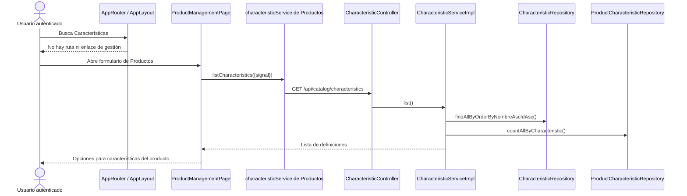

# S2 FE Gestionar características — plan de implementación

**Estado:** tanda 1 completa; tandas 2 a 4 pendientes de ejecución.

**Fuentes:** [tarjeta S2 FE Gestionar características](https://trello.com/c/vDSn5tdO), `PROMPT_GENERAR_PLAN_IMPLEMENTACION.md`, planes de gestión de categorías y productos, `docs/prompt-colores-cards-por-estado.md` y código vigente del repositorio.

## Propósito y decisiones cerradas

Incorporar en React la administración del catálogo reutilizable de características: listar, crear, renombrar y eliminar. La ruta `/app/catalog/characteristics` y el enlace **Características** estarán disponibles para `SUPER_ADMIN`, `ADMIN` y `USER` autenticados; el acceso anónimo se rechazará antes de consultar la API. La gestión de usuarios seguirá restringida a `SUPER_ADMIN`.

- El listado abrirá con todas las características en el orden entregado por la API (`nombre` ascendente, `id` como desempate), sin búsqueda ni paginación. Tendrá carga, vacío, error y reintento. El botón de alta se ubicará arriba a la derecha del contenedor de la lista: `+` en móvil y **Crear característica** en escritorio; será accesible también si la lista está vacía.
- Las cards serán neutras (fondo blanco y borde gris), sin rótulo ni colores de activo/inactivo: la entidad no tiene estado. Del patrón corregido de Productos se conservarán la edición azul pizarra `#1E293B`, la eliminación roja `#B42318`, el contraste, el hover y el foco de teclado visibles, la apariencia deshabilitada y los avisos breves de éxito de cuatro segundos. Los errores y avisos que requieren acción permanecerán visibles.
- Alta y edición usarán un modal centrado con un solo campo `nombre`. Para editar se consultará `GET /api/catalog/characteristics/{id}` antes de precargar el formulario, en vez de depender únicamente de la fila visible. El nombre será obligatorio, máximo 160 caracteres y se enviará recortado; la API conserva la autoridad de validación.
- Para eliminar, se consultará el mismo `GET` inmediatamente antes de abrir un diálogo compacto. Se mostrará el nombre y `cantidadProductos`, se advertirá que se quitarán los valores y unidades asociados sin borrar productos y se exigirá confirmación. El conteo incluye productos activos e inactivos; es informativo y puede cambiar entre consulta y eliminación. Escape y **Cancelar** cerrarán el diálogo sin escribir.
- No habrá toggle, desactivación ni reactivación. La selección y edición de valores/unidades dentro de un producto pertenece a la pantalla Productos.
- El cliente HTTP de características pasará del directorio de Productos a `catalog/characteristics/services/`. Productos actualizará su import de `listCharacteristics`; las funciones de alta, detalle, edición y eliminación residirán en el mismo servicio.
- Las mutaciones usarán `apiRequest` con cookies y CSRF, `retryAuth: false` y `retryCsrf: false`. Tras éxito se recargará el listado. Ante red o HTTP 5xx se bloquearán nuevas mutaciones hasta **Consultar estado actual** y completar una lectura correcta. Esa lectura permite revisar el resultado, pero no demuestra por sí sola si la solicitud anterior se aplicó.

No se prevén cambios de backend, base de datos, dependencias ni configuración.

## Estado actual

### COMPROBADO EN EL CÓDIGO ACTUAL

- `CharacteristicController` expone `GET` y `POST /api/catalog/characteristics`, y `GET`, `PUT` y `DELETE /api/catalog/characteristics/{id}`. `@PreAuthorize` permite los tres roles. `SecurityConfig` y el mecanismo CSRF protegen las mutaciones.
- `CharacteristicServiceImpl.list()` usa `CharacteristicRepository.findAllByOrderByNombreAscIdAsc()` y `ProductCharacteristicRepository.countAllByCharacteristic()`. `getById()` devuelve el conteo de uso. `CharacteristicResponse` tiene `id`, `nombre` y `cantidadProductos`.
- `CreateCharacteristicRequest` y `UpdateCharacteristicRequest` exigen nombre no vacío de hasta 160 caracteres. El servicio recorta y normaliza para detectar duplicados; 409 `RESOURCE_CONFLICT` indica nombre repetido. La validación devuelve 400, la inexistencia 404. `update()` conserva el ID y las asociaciones. `delete()` elimina asociaciones y definición en una transacción y el controller responde 204.
- El frontend solo tiene `listCharacteristics()` en `catalog/products/services/characteristicService.js`, usado por `ProductManagementPage`. No existe pantalla, ruta ni enlace de Características. `AppRouter` ya monta Productos y Categorías bajo `ProtectedRoute`, y `AppLayout` contiene sus enlaces.
- `apiRequest` gestiona cookies, CSRF, errores estructurados y posibles reintentos de autenticación/CSRF si el consumidor no los desactiva. `FormField`, `RequestError` y `fieldError` son reutilizables. Productos y Categorías muestran patrones de modal, recarga y recuperación de respuestas inciertas. Los tests frontend usan Vitest y React Testing Library.

### COMPORTAMIENTO PROPUESTO

`CharacteristicManagementPage` será dueña de la lectura, los diálogos, el estado de operación, los avisos y la recarga. `CharacteristicForm` recibirá valores iniciales, errores, estado de envío y callbacks por props. El servicio propio encapsulará los cinco endpoints. La API existente seguirá siendo la única fuente de verdad para nombres, orden y conteos.

## Mapa global del flujo

### Flujo actual



### Flujo objetivo

```mermaid
sequenceDiagram
    actor U as Usuario autorizado
    participant P as CharacteristicManagementPage [PROPUESTO]
    participant F as CharacteristicForm [PROPUESTO]
    participant S as characteristicService propio [PROPUESTO]
    participant H as apiRequest [EXISTENTE]
    participant C as CharacteristicController [EXISTENTE]
    participant B as CharacteristicServiceImpl [EXISTENTE]
    participant CR as CharacteristicRepository [EXISTENTE]
    participant PCR as ProductCharacteristicRepository [EXISTENTE]
    participant DB as MySQL

    U->>P: Abre /app/catalog/characteristics
    P->>S: listCharacteristics({signal})
    S->>H: apiRequest(GET characteristics)
    H->>C: list()
    C->>B: list()
    B->>CR: findAllByOrderByNombreAscIdAsc()
    B->>PCR: countAllByCharacteristic()
    CR->>DB: Leer definiciones
    PCR->>DB: Contar asociaciones
    B-->>P: List<CharacteristicResponse>
    P-->>U: Cards neutras con nombre y cantidadProductos

    U->>P: Editar o Eliminar fila
    P->>S: getCharacteristic(id) [PROPUESTO]
    S->>H: apiRequest(GET characteristic/{id})
    H->>C: getById(id)
    C->>B: getById(id)
    B->>CR: findById(id)
    B->>PCR: countByCharacteristic_Id(id)
    B-->>P: CharacteristicResponse reciente

    alt Editar
        P->>F: Abrir con nombre precargado
        U->>F: Guardar nombre
        F->>P: onSubmit({nombre})
        P->>S: updateCharacteristic(id,{nombre}) [PROPUESTO]
        S->>H: apiRequest(PUT, sin reintentos)
        H->>C: update(id,request)
        C->>B: update(id,request)
        B->>CR: lockById(id), saveAndFlush()
        CR->>DB: Persistir nuevo nombre
        B-->>P: CharacteristicResponse
    else Eliminar
        P-->>U: Confirmación con cantidad y consecuencia
        U->>P: Confirmar eliminación
        P->>S: deleteCharacteristic(id) [PROPUESTO]
        S->>H: apiRequest(DELETE, sin reintentos)
        H->>C: delete(id)
        C->>B: delete(id)
        B->>CR: lockById(id)
        B->>PCR: deleteByCharacteristicId(id)
        PCR->>DB: Borrar valores y unidades asociados
        B->>CR: delete(definición), flush()
        CR->>DB: Borrar definición
        C-->>P: 204
    end
    P->>S: listCharacteristics({signal})
    S-->>P: Lista canónica actualizada
    P-->>U: Éxito y lista recargada
    Note over P,U: 400/409: conservar formulario; 404: ofrecer actualizar lista
    Note over P,U: Red/5xx: bloquear mutaciones hasta consulta exitosa
```

El alta sigue `CharacteristicManagementPage → characteristicService.createCharacteristic` **[PROPUESTO]** `→ apiRequest → CharacteristicController.create → CharacteristicServiceImpl.create → CharacteristicRepository.saveAndFlush → MySQL`; recibe 201 y luego recarga el listado.

## Orden de implementación

| Tanda | Objetivo | Depende de | Estado |
| --- | --- | --- | --- |
| 1 | Centralizar y probar el contrato HTTP | API existente | Completa |
| 2 | Ruta, navegación y listado | 1 | Planificada |
| 3 | Alta y edición | 2 | Planificada |
| 4 | Eliminación y recorrido integral | 3 | Planificada |

```text
Tanda 1 → Tanda 2 → Tanda 3 → Tanda 4
```

## Tanda 1 — Contrato frontend de características

**Objetivo:** ofrecer un único cliente HTTP de características sin romper el selector de Productos.

**Depende de:** endpoints backend existentes.

### Mapa de código

```text
[NUEVO POR TRASLADO] catalog/characteristics/services/characteristicService.js
└── listCharacteristics({signal}) [EXISTENTE]
└── getCharacteristic(id,{signal}) [PROPUESTO]
└── createCharacteristic({nombre}) [PROPUESTO]
└── updateCharacteristic(id,{nombre}) [PROPUESTO]
└── deleteCharacteristic(id) [PROPUESTO]
       ↓
[MODIFICADO] services/endpoints.js
└── CATALOG.CHARACTERISTIC(id) [PROPUESTO]
       ↓
[EXISTENTE] services/apiClient.js: apiRequest(...)
       ↓
[EXISTENTE] CharacteristicController: list/getById/create/update/delete

[MODIFICADOS] catalog/products/pages/ProductManagementPage.jsx y tests de Productos
└── importar listCharacteristics desde catalog/characteristics/services/

[ELIMINADO POR TRASLADO] catalog/products/services/characteristicService.js
```

Todas las rutas anteriores son relativas a `Frontend/react-starter/src/`, salvo los componentes backend. El nuevo servicio enviará únicamente `{nombre}` en POST/PUT, desactivará reintentos de mutaciones y comprobará 204 para DELETE. La lectura aceptará `AbortSignal`.

### Clases/archivos nuevos

`characteristicService.js` en el nuevo módulo y `characteristicService.test.js` para su contrato. El archivo homónimo de Productos se retira después de actualizar todos sus imports y mocks.

### Flujo de la tanda

La capa nueva delega cada operación a `apiRequest`, que envía cookies y CSRF. `CharacteristicController` entrega la operación a `CharacteristicServiceImpl` y devuelve JSON para GET/POST/PUT o cuerpo vacío para DELETE. No se cambia backend.

### Tests necesarios

- **Contrato HTTP:** URL codificada para ID, método, cuerpo `{nombre}`, señal en GET y respuesta 204 de DELETE. Demuestra correspondencia con el backend.
- **Seguridad de mutación:** cookies y token CSRF presentes; una solicitud mutante no se repite ante 401, CSRF inválido, red o 5xx. Demuestra que un resultado incierto no duplica operaciones.
- **Regresión:** lectura de características desde el formulario Productos tras el traslado. Demuestra que el selector mantiene el servicio correcto.

### Qué NO queda probado

```text
NO PROBADO: interfaz de gestión y permisos de su ruta.
RIESGO: el servicio existe, pero la administración aún no es operable.
TRATAMIENTO: tandas 2 a 4.
```

### Commit sugerido

`refactor: centralize characteristic API service` — traslado, endpoints, imports y tests de contrato.

### Criterio de cierre

- [ ] Contrato HTTP y ausencia de reintentos comprobados.
- [ ] Productos sigue leyendo características mediante el nuevo import.
- [ ] Tests ejecutados, incidentes y riesgos registrados.

### Resultado de ejecución

**Estado:** COMPLETA.

**Cambios realizados:** servicio de características trasladado a `catalog/characteristics/services/`, con listado, detalle, alta, edición y eliminación; endpoint de detalle codificado; Productos consume el nuevo import. [Resultado detallado de la tanda 1](s2-fe-gestionar-caracteristicas-tanda-1-resultado.md).

**Diferencias respecto del plan:** ninguna funcional. Se registró el resultado también en un archivo separado, como se solicitó.

**Tests ejecutados:** `characteristicService.test.js` (15), `productService.test.js` (8), `ProductManagementPage.test.jsx` (18) y `apiClient.test.js` (14). Además, `npm run lint` y `npm run build`.

**Tests exitosos:** 55/55; lint y build correctos. El contrato verifica URLs, métodos, cookies, CSRF, cuerpos, señales, 204 y ausencia de reenvío de POST/PUT/DELETE ante 401, 403, red y 5xx. La regresión de Productos conserva la lectura del selector.

**Tests fallidos:** ninguno de comportamiento. El primer arranque de Vitest y build falló por lectura denegada a esbuild dentro del sandbox; ambos pasaron fuera de él.

**Incidentes:** INC-001, restricción de lectura del entorno de pruebas. Detalle en el resultado separado.

**Tests faltantes:** ninguno de los planificados para esta tanda. No se hizo un recorrido con backend real; las pruebas HTTP usan `fetch` simulado.

**Riesgos residuales:** la interfaz de gestión y los permisos de su ruta siguen sin comprobar ni implementar, según las tandas 2 a 4. La integración en un navegador con backend real queda para el recorrido integral.

**Decisiones pendientes descubiertas:** ninguna.

**Archivos modificados:** `services/endpoints.js`; `catalog/characteristics/services/characteristicService.js` y su test; imports de `ProductManagementPage.jsx`, su test y `productService.test.js`; retiro de `catalog/products/services/characteristicService.js`; este plan y el resultado separado.

**Criterio de cierre:**

- [x] Contrato HTTP y ausencia de reintentos comprobados.
- [x] Productos sigue leyendo características mediante el nuevo import.
- [x] Tests ejecutados, incidente y riesgos registrados.

## Tanda 2 — Acceso y listado

**Objetivo:** hacer visible la gestión de características para los roles permitidos y mostrar la lista con sus estados de consulta.

**Depende de:** tanda 1.

### Mapa de código

```text
[MODIFICADO] app/AppRouter.jsx
└── ruta /app/catalog/characteristics bajo ProtectedRoute
       ↓
[NUEVO] catalog/characteristics/pages/CharacteristicManagementPage.jsx
└── listCharacteristics({signal}), retry() [PROPUESTO]
       ↓
[EXISTENTE] catalog/characteristics/services/characteristicService.js
└── listCharacteristics({signal})
       ↓
[EXISTENTE] apiRequest → CharacteristicController.list()

[MODIFICADO] app/AppLayout.jsx
└── enlace Características para los tres roles
```

### Clases/archivos nuevos

`CharacteristicManagementPage.jsx` y `CharacteristicManagementPage.test.jsx`. Actualizar los tests de rutas y navegación.

### Flujo de la tanda

El usuario autenticado entra por ruta directa o navegación. La página inicia `listCharacteristics({signal})`, muestra carga, renderiza las cards en el orden recibido o muestra vacío/error. Reintentar repite solo el GET; desmontar cancela la lectura. El anónimo no monta la página ni solicita la lista.

### Tests necesarios

- **Listado:** carga, vacío, error y reintento; nombre y `cantidadProductos`; orden recibido intacto. Demuestra la representación de la respuesta canónica.
- **Interfaz:** cards neutras y botón de alta arriba a la derecha, texto completo en escritorio y `+` en móvil, disponible en vacío. Demuestra la disposición acordada sin atribuir estado activo.
- **Seguridad:** acceso directo para `SUPER_ADMIN`, `ADMIN` y `USER`; anónimo redirigido sin GET; Usuarios sigue exclusivo de `SUPER_ADMIN`. Demuestra los límites de acceso.

### Qué NO queda probado

```text
NO PROBADO: alta, edición y eliminación.
RIESGO: la pantalla todavía es de solo lectura.
TRATAMIENTO: tandas 3 y 4.
```

### Commit sugerido

`feat: add characteristic management list` — página de lectura, ruta, navegación y tests.

### Criterio de cierre

- [ ] Ruta protegida, navegación y listado operables.
- [ ] Carga, vacío, error y reintento comprobados.
- [ ] Tests ejecutados, incidentes y riesgos registrados.

### Resultado de ejecución

**PENDIENTE DE EJECUCIÓN**

## Tanda 3 — Alta y edición

**Objetivo:** crear y renombrar definiciones desde formularios modales sin perder asociaciones de productos.

**Depende de:** tanda 2.

### Mapa de código

```text
[MODIFICADO] CharacteristicManagementPage.jsx
└── openCreate(), openEdit(id), submit(values), reviewCurrentState() [PROPUESTOS]
       ↓
[NUEVO] catalog/characteristics/components/CharacteristicForm.jsx
└── precarga nombre; onSubmit({nombre})
       ↓
[EXISTENTE] characteristicService.js
└── getCharacteristic/createCharacteristic/updateCharacteristic
       ↓
[EXISTENTE] apiRequest → CharacteristicController.getById/create/update
       ↓
[EXISTENTE] CharacteristicServiceImpl → CharacteristicRepository → MySQL
```

### Clases/archivos nuevos

`CharacteristicForm.jsx` y tests focales del formulario. Reutilizar `FormField`, `RequestError` y `fieldError`; no añadir biblioteca de formularios ni estado global.

### Flujo de la tanda

**Crear:** abrir modal, validar nombre, enviar POST una vez, cerrar al éxito y recargar. **Editar:** consultar por ID con estado de carga/error, abrir con el nombre de esa respuesta, enviar PUT una vez y recargar. Mientras la solicitud esté pendiente se bloquean cierre y duplicados. Un error 400/409 deja el modal y el valor ingresado; 404 exige refrescar la lista. Red/5xx bloquea nuevas mutaciones hasta lectura correcta de **Consultar estado actual**.

### Tests necesarios

- **Formulario:** nombre obligatorio, solo espacios inválidos, máximo 160 y envío recortado. Demuestra validación anticipada sin reemplazar la API.
- **Alta/edición:** precarga obtenida por ID, POST 201, PUT 200, ID correcto, recarga y asociaciones conservadas por contrato backend. Demuestra que se opera sobre la definición elegida.
- **Errores y operación:** 400 por campo y 409 mantienen el formulario; 404 al consultar o guardar orienta a recargar; cancelar/Escape no escriben; pendiente impide duplicados y cierre; red/5xx requiere consulta posterior. Demuestra recuperación sin cambios accidentales.
- **Avisos:** éxito temporal de cuatro segundos, reinicio del plazo ante aviso nuevo y limpieza al desmontar; error persistente. Demuestra la conducta visual acordada.

### Qué NO queda probado

```text
NO PROBADO: confirmación de eliminación y alcance informado al usuario.
RIESGO: todavía no se puede retirar una definición desde la pantalla.
TRATAMIENTO: tanda 4.
```

### Commit sugerido

`feat: create and rename characteristics` — formulario, modal, operaciones y tests.

### Criterio de cierre

- [ ] Alta y edición con precarga correcta funcionan para los roles permitidos.
- [ ] Validación, errores, cancelación y resultado incierto comprobados.
- [ ] Tests ejecutados, incidentes y riesgos registrados.

### Resultado de ejecución

**PENDIENTE DE EJECUCIÓN**

## Tanda 4 — Eliminación y recorrido integral

**Objetivo:** permitir eliminación física con advertencia de impacto y verificar el flujo completo.

**Depende de:** tanda 3.

### Mapa de código

```text
[MODIFICADO] CharacteristicManagementPage.jsx
└── requestDelete(id), confirmDelete(), reviewCurrentState() [PROPUESTOS]
       ↓
[EXISTENTE] characteristicService.js
└── getCharacteristic(id), deleteCharacteristic(id), listCharacteristics()
       ↓
[EXISTENTE] apiRequest → CharacteristicController.getById/delete
       ↓
[EXISTENTE] CharacteristicServiceImpl.delete(id)
       ├── ProductCharacteristicRepository.deleteByCharacteristicId(id)
       └── CharacteristicRepository.delete()/flush()
       ↓
MySQL: product_characteristics y characteristics
```

### Clases/archivos nuevos

No se prevén componentes productivos nuevos; el diálogo compacto de confirmación pertenece a la página. Ampliar sus tests y los de regresión de rutas.

### Flujo de la tanda

Al pulsar **Eliminar**, la página consulta `getCharacteristic(id)`. Solo después abre el diálogo centrado sobre la lista con nombre, cantidad de productos y efecto sobre valores/unidades. Cancelar o Escape no llaman a DELETE. Confirmar envía una sola solicitud y espera 204; luego recarga. Un 404 de la consulta o del DELETE deja claro que el registro ya no está y ofrece actualizar la lista. Red/5xx deja una advertencia persistente y bloquea mutaciones hasta consulta exitosa.

### Tests necesarios

- **Impacto:** conteos cero y mayores que cero; GET por ID antes del diálogo; texto sobre valores/unidades y productos no eliminados. Demuestra que el usuario conoce el efecto.
- **Confirmación:** cancelar/Escape sin DELETE, confirmar una vez, bloqueo durante el envío y recarga después de 204. Demuestra eliminación deliberada.
- **Errores:** 404 y fallos de API visibles; red/5xx sin repetición, revisión posterior antes de habilitar acciones. Demuestra recuperación prudente.
- **Visual y accesibilidad:** card neutral, edición azul pizarra, eliminación y confirmación rojas, hover/foco/deshabilitado, diálogo compacto centrado y lista visible detrás. Demuestra el patrón corregido de Productos adaptado a una entidad sin estado.
- **Regresión integral:** listar → crear → renombrar → eliminar → volver a Productos y Categorías; roles y anónimo. Demuestra que la navegación y el catálogo previo siguen funcionando.

### Qué NO queda probado

```text
NO PROBADO: cantidad exacta de asociaciones al instante del DELETE bajo cambios concurrentes.
RIESGO: el conteo informativo puede variar tras abrir la confirmación.
TRATAMIENTO: consultar justo antes del diálogo y explicitar que la cantidad puede cambiar; el backend mantiene el borrado transaccional.

NO PROBADO: rendimiento con datos de producción y recorrido manual con backend/navegador reales si no están disponibles.
RIESGO: diferencias de volumen o entorno fuera de los tests automatizados.
TRATAMIENTO: registrar la limitación y verificar manualmente cuando exista ese entorno.
```

### Commit sugerido

`feat: delete characteristics with impact confirmation` — confirmación, recuperación, pruebas y documentación de resultados.

### Criterio de cierre

- [ ] Eliminación confirmada y lista actualizada sin borrar productos.
- [ ] Permisos, errores, resultado incierto y regresión comprobados.
- [ ] Tests faltantes, incidentes y riesgos residuales registrados.

### Resultado de ejecución

**PENDIENTE DE EJECUCIÓN**

## Registro global de decisiones pendientes

| ID | Decisión | Alternativas | Bloquea |
| --- | --- | --- | --- |
| — | Ninguna: cards neutras, formularios modales y servicio propio acordados | — | — |

Si durante la ejecución surge una diferencia de contrato, arquitectura, seguridad o negocio, registrarla como `DECISIÓN PENDIENTE — DXX` con descubrimiento, alternativas, consecuencias y tanda condicionada antes de cambiar el comportamiento.

## Protocolo global de incidentes

Registrar solo fallos técnicos relevantes, sin modificar tests únicamente para obtener verde:

```text
INC-XXX — Nombre
Tanda:
Contexto y comportamiento/test afectado:
Esperado / obtenido:
Clasificación: implementación / test / contrato deliberado / entorno / datos / desconocida
Causa: confirmada o hipótesis
Resolución:
Código productivo modificado: sí/no
Tests modificados: sí/no
Configuración o migraciones modificadas: sí/no
Resultado posterior: PASS / FAIL / PENDIENTE
Riesgo o aprendizaje derivado:
```

Al ejecutar cada tanda, conservar su planificación y reemplazar **PENDIENTE DE EJECUCIÓN** por resultado, tests ejecutados y faltantes, diferencias, incidentes, riesgos y estado `COMPLETA`, `PARCIAL` o `BLOQUEADA`.

## Flujo total acumulado

```text
IMPLEMENTADO AL PLANIFICAR
API backend de características: listar, consultar, crear, renombrar y eliminar
Frontend Productos: lectura de características para su selector

OBJETIVO TRAS LAS CUATRO TANDAS
Ruta protegida y enlace Características
  → listado completo con cantidadProductos
  → Crear: modal → POST → recarga
  → Editar: GET por ID → modal precargado → PUT → recarga
  → Eliminar: GET por ID → confirmación de impacto → DELETE → recarga
  → Resultado incierto: bloqueo → Consultar estado actual
```

## Resumen final

### Orden de implementación

Centralizar el servicio, abrir ruta y listado, agregar alta/edición y cerrar con eliminación y regresión. Cada tanda deja un cambio coherente y revisable.

### Decisiones pendientes

Ninguna.

### Riesgos globales

El conteo de uso puede variar entre consulta y borrado. Una respuesta incierta exige revisión del estado antes de otra mutación. La API no expone control de versión para detectar cambios concurrentes entre la precarga y el guardado.

### Validación final

Con cada rol permitido, entrar por ruta directa, listar, crear, renombrar y eliminar una característica usada por productos; confirmar la advertencia y que los productos permanezcan. Verificar anónimo, 400/404/409, CSRF, ausencia de reintentos de mutaciones, recuperación de resultados inciertos, accesibilidad de ambos modales y regresión de Productos/Categorías. Ejecutar tests frontend relevantes y suite completa, lint y build; registrar aparte cualquier verificación manual no realizada.
