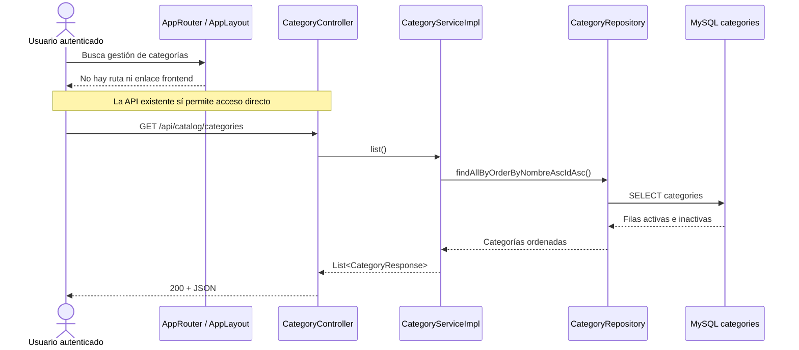
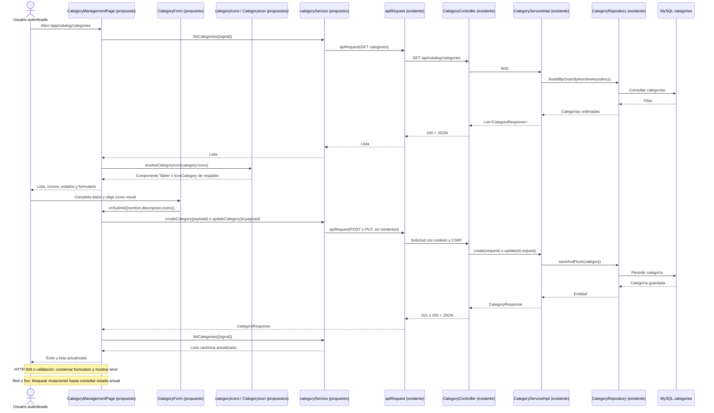
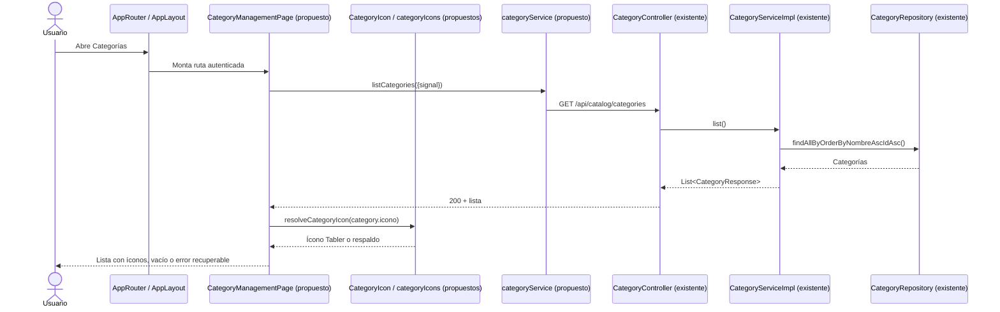
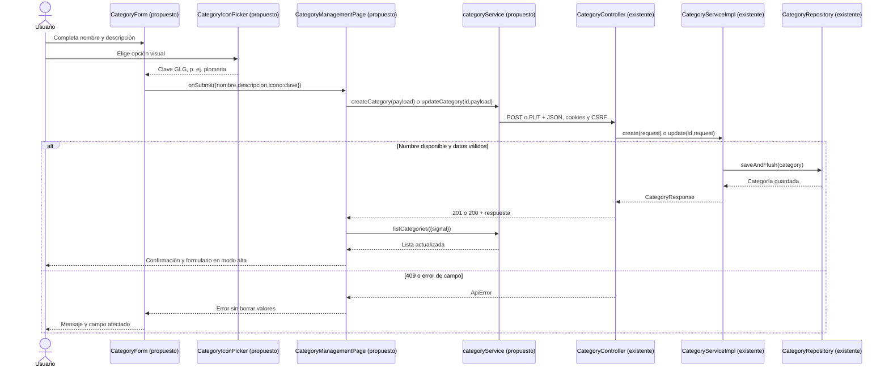

# S2 FE Gestionar categorías — plan de implementación

**Estado:** tanda 1 completa; tandas 2 a 4 pendientes.

## Propósito y decisiones cerradas

Incorporar en React la gestión de categorías que ya ofrece el backend: consultar activas e inactivas, crear, editar, desactivar y reactivar. La pantalla vivirá en `/app/catalog/categories` y estará disponible para `SUPER_ADMIN`, `ADMIN` y `USER` autenticados. La gestión de cuentas en `/app/admin/users` conservará su restricción a `SUPER_ADMIN`.

- `icono` seguirá siendo un `String` obligatorio en la API, pero contendrá una **clave estable de GLG** (`plomeria`, `herramientas`, etc.), no un nombre de export de Tabler ni SVG/HTML/URL. React resolverá esa clave mediante un registro local de componentes de `@tabler/icons-react`.
- El formulario ofrecerá un selector visual curado y agrupado por rubro; no cargará todos los íconos de Tabler ni permitirá escribir claves arbitrarias. Cada opción mostrará dibujo y etiqueta. El registro inicial tendrá: `materiales` → `IconBuilding`, `herramientas` → `IconTools`, `plomeria` → `IconPipeline`, `electricidad` → `IconPlug`, `gas` → `IconFlame`, `agua` → `IconDroplet`, `ceramicos` → `IconGridDots`, `pintura` → `IconPaint`. Las opciones se agruparán en **Construcción y acabados** (`materiales`, `ceramicos`, `pintura`), **Herramientas** (`herramientas`) e **Instalaciones** (`plomeria`, `electricidad`, `gas`, `agua`). Agregar opciones futuras exigirá ampliar el registro frontend, sin modificar categorías ya guardadas.
- Si el backend devuelve una clave que no está en el registro (por ejemplo, datos previos como `cemento` o `bolsa`), React mostrará `IconCategory` como respaldo y, en el panel administrativo, indicará la clave desconocida. Al editar, se conservará esa clave hasta que el usuario elija otra opción; el formulario no cambiará el dato silenciosamente.
- La baja será lógica mediante el endpoint existente; la pantalla no ofrecerá eliminación física.
- El listado conservará el orden recibido de la API (`nombre` ascendente, `id` como desempate), sin ordenarlo de nuevo en el navegador. No habrá paginación ni búsqueda en esta tarjeta.
- El formulario compartido tendrá `nombre` obligatorio (máximo 160 caracteres), `descripcion` opcional (máximo 1000) e `icono` obligatorio (una clave del registro para altas, hasta 100 caracteres según la API). La validación HTML anticipará los límites; la API seguirá siendo la autoridad. Se enviará `nombre.trim()`, la clave elegida y la descripción tal como fue ingresada, usando `''` para la descripción vacía. Al editar una clave desconocida, se añadirá una opción seleccionada **Conservar ícono actual** con esa clave; podrá conservarse o reemplazarse sin perder el dato.
- El alta y la edición se harán en un panel de la misma pantalla. Seleccionar **Editar** cargará los valores de esa categoría; **Cancelar edición** volverá al formulario de alta sin modificar datos. El formulario se deshabilitará durante el envío.
- Una desactivación requerirá confirmación explícita con el nombre visible. La reactivación también mostrará confirmación para que ambas transiciones tengan un resultado verificable. Se deshabilitarán acciones duplicadas mientras haya una solicitud pendiente.
- Ante una mutación con resultado incierto (fallo de red o HTTP 5xx), no se repetirá automáticamente. Se bloquearán nuevas mutaciones, se ofrecerá **Consultar estado actual** y se recargará el listado. Esa consulta permite revisar el estado, pero no prueba por sí sola si la operación anterior se aplicó.

No se requieren cambios de backend, migraciones ni un estado global de catálogo. Se agregará únicamente la dependencia frontend `@tabler/icons-react`.
Esta decisión aplica solo a categorías: no agrega un campo `icono` a características.

Referencia de la biblioteca y de la estrategia de importación estática: [Tabler Icons para React](https://tabler.io/icons/packages) y [guía oficial sobre nombres dinámicos y tamaño del bundle](https://tabler.io/guides/how-to-use-svg-icons-in-react).

## Estado actual

### COMPROBADO EN EL CÓDIGO ACTUAL

- `CategoryController` expone `GET` y `POST /api/catalog/categories`, `PUT /api/catalog/categories/{id}` y `POST` a `/{id}/deactivate` y `/{id}/reactivate`. Su autorización permite los tres roles indicados.
- `CategoryServiceImpl.list()` lee `CategoryRepository.findAllByOrderByNombreAscIdAsc()` y devuelve tanto categorías activas como inactivas. `create()`, `update()`, `deactivate()` y `reactivate()` persisten en `categories`; el cambio de estado no borra registros. `nombre` se normaliza para detectar duplicados, incluidos los inactivos.
- `CategoryResponse` contiene `id`, `nombre`, `descripcion`, `icono` y `activo`. `CreateCategoryRequest` y `UpdateCategoryRequest` tienen los mismos tres campos editables y los límites indicados arriba. Un nombre duplicado devuelve HTTP 409 con `RESOURCE_CONFLICT`; las validaciones devuelven errores por campo.
- Actualmente `icono` es texto persistido sin un catálogo de claves ni validación semántica en el backend. Por eso puede haber valores anteriores que el nuevo registro frontend no conozca.
- El frontend tiene `apiRequest()` con cookies, CSRF, refresco de sesión y errores estructurados. `adminUserService.js` muestra el patrón para impedir reintentos automáticos de mutaciones; `UserDetailPage.jsx` muestra el patrón de consultar después de una respuesta incierta.
- `AppRouter.jsx` solo monta perfil y gestión de usuarios; `AppLayout.jsx` solo enlaza perfil y, para `SUPER_ADMIN`, usuarios. No existe un módulo frontend de categorías. `ProtectedRoute.jsx` permite cualquier rol autenticado cuando no se pasa `requiredRole`.
- Los tests existentes usan Vitest y React Testing Library. La seguridad y persistencia del backend de categorías ya tienen pruebas propias; esta tarjeta añade pruebas del contrato y la interacción frontend.

### COMPORTAMIENTO PROPUESTO

Una categoría se administrará desde la nueva pantalla autenticada. El servicio frontend encapsulará la API y la página mostrará la lista completa, íconos de Tabler resueltos desde claves de GLG, estados de carga/vacío/error, formulario de alta/edición con selector visual y confirmación para los cambios de estado. Tras una respuesta exitosa, se recargará el listado para respetar el orden y estado canónicos del servidor.

## Mapa global del flujo

### Flujo actual



### Flujo objetivo



El cambio de estado usa el mismo tramo `Page → categoryService → apiRequest → CategoryController → CategoryServiceImpl → CategoryRepository → MySQL`, con `deactivate(id)` o `reactivate(id)` y una recarga posterior del listado.

## Organización prevista

```text
Frontend/react-starter/src/catalog/categories/
├── pages/
│   ├── CategoryManagementPage.jsx       [NUEVO]
│   └── CategoryManagementPage.test.jsx  [NUEVO]
├── components/
│   ├── CategoryForm.jsx                 [NUEVO]
│   ├── CategoryIcon.jsx                 [NUEVO]
│   └── CategoryIconPicker.jsx           [NUEVO]
├── icons/
│   ├── categoryIcons.js                 [NUEVO]
│   └── categoryIcons.test.js            [NUEVO]
└── services/
    ├── categoryService.js               [NUEVO]
    └── categoryService.test.js          [NUEVO]

Frontend/react-starter/src/services/endpoints.js  [MODIFICADO]
Frontend/react-starter/src/app/AppRouter.jsx       [MODIFICADO]
Frontend/react-starter/src/app/AppLayout.jsx       [MODIFICADO]
Frontend/react-starter/src/admin/AdminAccess.test.jsx [MODIFICADO]
Frontend/react-starter/package.json / package-lock.json [MODIFICADOS]
```

`CategoryManagementPage` será dueña del listado y del estado de la operación; `CategoryForm` recibirá valores, errores, estado de envío y callbacks por props. `categoryIcons.js` será la fuente única de claves, etiquetas, grupos y componentes Tabler; hará importaciones estáticas de los íconos usados, sin `import * as Icons`. `CategoryIcon` resolverá claves de la API y mostrará un respaldo si faltan. `CategoryIconPicker` ofrecerá opciones agrupadas como controles de selección accesibles por teclado, con dibujo y nombre visible. No se añadirá un provider ni una librería de formularios. `FormField`, `RequestError` y `fieldError` se reutilizarán; `descripcion` usará un `<textarea>` accesible porque `FormField` solo renderiza `<input>`.

## Orden de implementación

| Tanda | Objetivo | Depende de | Estado |
| --- | --- | --- | --- |
| 1 | Endpoints y servicio frontend, con contrato HTTP probado | API de categorías existente | Completa |
| 2 | Tabler, registro de claves, ruta, navegación y listado con carga, vacío y error | 1 | Planificada |
| 3 | Alta y edición con selector visual, validaciones y conflictos | 2 | Planificada |
| 4 | Desactivación/reactivación, consulta de resultados inciertos y recorrido integral | 3 | Planificada |

```text
Tanda 1 → Tanda 2 → Tanda 3 → Tanda 4
```

---

## Tanda 1 — Contrato frontend de categorías

**Objetivo:** dejar encapsuladas las cinco operaciones HTTP sin introducir interfaz todavía.

**Depende de:** API de categorías existente.

### Mapa de código

```text
[NUEVO] services/categoryService.js
listCategories({signal}) ─┐
createCategory(payload) ──┤
updateCategory(id,payload) ├──→ [EXISTENTE] services/apiClient.js: apiRequest(...)
deactivateCategory(id) ────┤                     ↓
reactivateCategory(id) ────┘             CategoryController (backend existente)

[MODIFICADO] services/endpoints.js
ENDPOINTS.CATALOG.CATEGORIES / CATEGORY(id) / CATEGORY_DEACTIVATE(id) / CATEGORY_REACTIVATE(id)
```

### Clases/archivos nuevos

- `categoryService.js`: único punto de acceso frontend a categorías. Las mutaciones usarán `{retryAuth:false, retryCsrf:false}`; `GET` aceptará `AbortSignal`.
- `categoryService.test.js`: verifica método, URL, body, credenciales/CSRF y ausencia de reintento de mutaciones.

### Flujo de la tanda

Es un adaptador HTTP sin interfaz de usuario ni flujo secuencial nuevo. El flujo completo de red está representado en el mapa global; duplicarlo en otro diagrama no aporta una decisión adicional.

### Tests necesarios

**Contrato HTTP:** `GET` devuelve la lista; `POST` y `PUT` envían solo `nombre`, `descripcion` e `icono`; las dos transiciones usan `POST` sin body. Demuestra que el frontend respeta el contrato existente.

**Seguridad de envío:** las mutaciones llevan cookies y CSRF; ante 401, CSRF inválido o 5xx no se emite una segunda mutación automática. Demuestra que una respuesta incierta no duplica acciones.

### Qué NO queda probado

```text
NO PROBADO: navegación, presentación de categorías e interacción del formulario.
RIESGO: el servicio podría estar correcto sin ser usable desde la aplicación.
TRATAMIENTO: cubrir en las tandas 2 a 4.
```

### Commit sugerido

`feat: add category frontend service` — endpoints, servicio y sus tests. No incluir pantalla ni navegación.

### Criterio de cierre

- [x] Las cinco operaciones tienen endpoint y método correctos.
- [x] Los tests de contrato y no reintento pasan.
- [x] Riesgos y cualquier incidente relevante quedan registrados.

### Resultado de ejecución

**Estado:** COMPLETA

**Cambios realizados:** `ENDPOINTS.CATALOG` define colección, detalle y transiciones; `categoryService.js` encapsula las cinco llamadas. `POST` y `PUT` envían solo `nombre`, `descripcion` e `icono`; todas las mutaciones desactivan reintentos de auth y CSRF. No se creó ninguna pantalla ni se instaló Tabler.

**Diferencias respecto del plan:** ninguna funcional. El servicio proyecta explícitamente los tres campos editables para no enviar propiedades ajenas del formulario.

**Tests ejecutados y exitosos:** 18 casos nuevos en `categoryService.test.js` cubren GET con `AbortSignal`, altas/ediciones, cambios de estado, cookies/CSRF y ausencia de reintentos tras 401, 403 CSRF, 5xx y fallo de red. Regresión relacionada: `apiClient.test.js` (14) y `adminUserService.test.js` (4). `npm run lint` y `npm run build` terminaron correctamente.

**Tests fallidos:** ninguno en la ejecución válida. Los primeros intentos de Vitest y Vite dentro del sandbox no pudieron leer `vite.config.js`; `INC-001` describe el incidente de entorno y su reejecución exitosa.

**Incidentes:** `INC-001` (restricción de lectura del sandbox; resuelto al ejecutar tests/build fuera de él, sin cambios de código).

**Tests faltantes:** ninguno de los previstos para esta tanda. No se hizo prueba integrada contra backend/MySQL real ni interacción de pantalla, que pertenecen a validación final y tandas 2 a 4.

**Riesgos residuales:** el servicio todavía no es navegable; el backend real podría diferir de las respuestas simuladas. El cliente HTTP puede renovar el token CSRF para un futuro intento manual tras 403, pero no repite la mutación.

**Decisiones pendientes descubiertas:** ninguna.

**Archivos modificados:** `Frontend/react-starter/src/services/endpoints.js`, `Frontend/react-starter/src/catalog/categories/services/categoryService.js`, `Frontend/react-starter/src/catalog/categories/services/categoryService.test.js`, este plan y `tanda-1-resultado.md`.

---

## Tanda 2 — Acceso y listado

**Objetivo:** abrir una pantalla útil para los tres roles, con lista completa, íconos Tabler resueltos por clave y estados de lectura.

**Depende de:** tanda 1.

### Mapa de código

```text
[MODIFICADO] app/AppRouter.jsx
AppRouter() → ruta /app/catalog/categories bajo ProtectedRoute sin requiredRole
       ↓
[MODIFICADO] app/AppLayout.jsx
AppLayout() → enlace Categorías visible para los tres roles autenticados
       ↓
[NUEVO] catalog/categories/pages/CategoryManagementPage.jsx
CategoryManagementPage() → carga inicial / recarga mediante listCategories({signal})
       ├──→ [NUEVO] catalog/categories/services/categoryService.js
       │    listCategories({signal}) → apiRequest(GET) → CategoryController.list()
       ↓ para cada categoría recibida
[NUEVO] catalog/categories/components/CategoryIcon.jsx
CategoryIcon({name}) → resolveCategoryIcon(name)
       ↓
[NUEVO] catalog/categories/icons/categoryIcons.js
Registro de claves GLG → componentes importados de @tabler/icons-react

[MODIFICADO] package.json / package-lock.json
@tabler/icons-react como dependencia de producción
```

### Clases/archivos nuevos

- `CategoryManagementPage.jsx`: muestra `nombre`, `descripcion`, ícono resuelto, estado activo/inactivo e ID; maneja carga, vacío, error y **Reintentar**. Cancela o ignora lecturas obsoletas al desmontarse o iniciar una recarga.
- `categoryIcons.js`: define el registro curado, grupos y `resolveCategoryIcon(name)`; importa directamente cada componente Tabler usado y `IconCategory` como respaldo. La clave del backend queda desacoplada del nombre del componente.
- `CategoryIcon.jsx`: dibuja el componente resuelto con tamaño/trazo consistentes; el nombre de la categoría aporta el texto accesible en el listado. Si la clave es desconocida, muestra también una indicación textual para el administrador.
- `categoryIcons.test.js`: comprueba claves únicas, resolución conocida y respaldo desconocido.
- `CategoryManagementPage.test.jsx`: cubre representación y estados de lectura.

### Flujo de la tanda



### Tests necesarios

**Acceso:** `SUPER_ADMIN`, `ADMIN` y `USER` ven ruta/enlace; un anónimo va a login. La ruta de usuarios sigue exclusiva de `SUPER_ADMIN`. Demuestra que catálogo y gestión de cuentas tienen permisos distintos.

**Presentación:** carga, lista vacía, activa/inactiva, orden conservado, ícono correcto para clave conocida, respaldo y clave visible para valor desconocido, y error con reintento. Demuestra que los datos previos no rompen la pantalla.

**Registro:** claves únicas y mapeo estático a los componentes elegidos; verificar que el build incluye solo los imports declarados. Demuestra que el contrato de claves no depende de importar el paquete completo.

### Qué NO queda probado

```text
NO PROBADO: alta, edición y cambios de estado desde la pantalla.
RIESGO: la pantalla todavía solo consulta categorías.
TRATAMIENTO: completar en las tandas 3 y 4.
```

### Commit sugerido

`feat: show categories with Tabler icons` — dependencia, registro curado, ruta, navegación, listado y tests de acceso/presentación.

### Criterio de cierre

- [ ] Los tres roles acceden y un anónimo no.
- [ ] Lista, vacío, carga y error son visibles y verificables.
- [ ] Claves conocidas se dibujan; una clave antigua o desconocida usa respaldo sin cambiar el dato.
- [ ] La gestión de usuarios conserva su autorización anterior.
- [ ] Tests, lint y build del frontend pasan; incidentes y riesgos quedan registrados.

### Resultado de ejecución

**PENDIENTE DE EJECUCIÓN**

---

## Tanda 3 — Alta y edición

**Objetivo:** crear y modificar categorías desde la misma pantalla, conservando los valores del formulario cuando la API rechaza la solicitud y bloqueando nuevos envíos si el resultado es incierto.

**Depende de:** tanda 2.

### Mapa de código

```text
[NUEVO] catalog/categories/components/CategoryForm.jsx
CategoryForm({initialValues,onSubmit,onCancel,pending,error})
       ↓ selector de icono
[NUEVO] catalog/categories/components/CategoryIconPicker.jsx
CategoryIconPicker({value,onChange,disabled,error}) → categoryIcons.js
       ↓ clave GLG y datos normalizados al enviar
[MODIFICADO] catalog/categories/pages/CategoryManagementPage.jsx
handleCreate(payload) / handleUpdate(id,payload) [PROPUESTOS]
       ↓
[NUEVO] catalog/categories/services/categoryService.js
createCategory(payload) / updateCategory(id,payload)
       ↓
[EXISTENTE] CategoryController.create/update → CategoryServiceImpl.create/update
       ↓
CategoryRepository.saveAndFlush(...) → MySQL categories
```

### Clases/archivos nuevos

- `CategoryForm.jsx`: formulario controlado para alta y edición; usa `FormField` para nombre, `CategoryIconPicker` para ícono, `<textarea>` para descripción, `fieldError` para los tres campos y `RequestError` para el error general. Los valores se reinician al cambiar entre alta y edición.
- `CategoryIconPicker.jsx`: presenta las ocho opciones iniciales por grupo como radios accesibles con etiqueta e ícono; nunca carga los miles de íconos de la biblioteca. Si el valor editado no figura en el registro, agrega un radio seleccionado **Conservar ícono actual** con la clave anterior y el ícono de respaldo; elegir otra opción la sustituye.

### Flujo de la tanda



### Tests necesarios

**Formulario:** requeridos, máximos, descripción opcional, selector agrupado accesible por teclado, modo alta/edición, cancelación y doble envío. Demuestra que se envía la clave elegida, no el nombre del componente Tabler, y no se pierde trabajo del usuario.

**Compatibilidad:** editar una categoría con clave desconocida sin tocar el selector conserva la clave; elegir una opción la reemplaza. Demuestra que el nuevo frontend no modifica datos anteriores silenciosamente.

**Flujo:** alta y edición exitosas recargan el listado; 409 por nombre duplicado y validación por campo mantienen el formulario. Demuestra que la pantalla refleja la persistencia y permite corregir errores.

**Incertidumbre:** una respuesta de red o 5xx no repite el alta/edición y exige consultar el listado antes de otro envío. Demuestra que el usuario puede revisar el estado sin duplicar una solicitud cuyo resultado se desconoce.

### Qué NO queda probado

```text
NO PROBADO: desactivación/reactivación y su confirmación.
RIESGO: la gestión todavía no permite cambiar el estado activo.
TRATAMIENTO: completar en la tanda 4.
```

### Commit sugerido

`feat: manage category details` — formulario, alta, edición y tests de interacción. No incluir cambios de estado.

### Criterio de cierre

- [ ] Crear y editar actualizan el listado y mantienen su orden del servidor.
- [ ] El selector guarda claves GLG y permite reemplazar o conservar un valor anterior desconocido.
- [ ] Conflictos y errores por campo se muestran sin borrar entradas.
- [ ] Una respuesta incierta bloquea nuevos envíos hasta consultar el estado actual.
- [ ] No ocurre un doble envío; tests, lint y build pasan.
- [ ] Incidentes y riesgos restantes quedan registrados.

### Resultado de ejecución

**PENDIENTE DE EJECUCIÓN**

---

## Tanda 4 — Estado y recorrido completo

**Objetivo:** permitir desactivar/reactivar sin borrado físico y aplicar a estas acciones el manejo de respuestas inciertas ya introducido en la tanda 3.

**Depende de:** tanda 3.

### Mapa de código

```text
[MODIFICADO] catalog/categories/pages/CategoryManagementPage.jsx
handleStatusChange(id,active) / reviewCurrentState() [PROPUESTOS]
       ↓ confirmación y bloqueo mientras haya solicitud pendiente
[NUEVO] catalog/categories/services/categoryService.js
deactivateCategory(id) / reactivateCategory(id) / listCategories({signal})
       ↓
[EXISTENTE] CategoryController.deactivate/reactivate/list
       ↓
CategoryServiceImpl.deactivate/reactivate/list
       ↓
CategoryRepository.lockById/saveAndFlush/findAllByOrderByNombreAscIdAsc
       ↓
MySQL categories
```

### Clases/archivos nuevos

No se agregan archivos productivos: se amplían la página y sus pruebas.

### Flujo de la tanda

```mermaid
sequenceDiagram
    actor U as Usuario
    participant P as CategoryManagementPage (propuesto)
    participant CS as categoryService (propuesto)
    participant C as CategoryController (existente)
    participant S as CategoryServiceImpl (existente)
    participant Repo as CategoryRepository (existente)
    U->>P: Elige desactivar o reactivar
    P-->>U: Solicita confirmación con nombre
    U->>P: Confirma
    P->>CS: deactivateCategory(id) o reactivateCategory(id)
    CS->>C: POST /{id}/deactivate o /reactivate
    C->>S: deactivate(id) o reactivate(id)
    S->>Repo: lockById(id), saveAndFlush(category)
    alt Respuesta confirmada
        Repo-->>S: Categoría actualizada
        S-->>C: CategoryResponse
        C-->>P: 200 + estado nuevo
        P->>CS: listCategories({signal})
        CS-->>P: Lista canónica
        P-->>U: Estado actualizado
    else Red o HTTP 5xx
        CS-->>P: Resultado incierto
        P-->>U: Bloquea mutaciones y ofrece Consultar estado actual
        U->>P: Consulta estado actual
        P->>CS: listCategories({signal})
        CS-->>P: Estado actual o error de lectura
        P-->>U: Estado consultado; no afirma resultado previo
    end
```

Si la recarga falla después de una respuesta de mutación exitosa, mantener la confirmación recibida, señalar que el listado está desactualizado y ofrecer reintento de lectura; no ejecutar de nuevo la mutación. Una respuesta 404/409 de mutación se mostrará como error cierto y permitirá consultar el listado.

### Tests necesarios

**Estado:** cancelar confirmación no llama a la API; confirmar usa el endpoint correspondiente; la respuesta y recarga muestran activo/inactivo y no aparece `DELETE`. Demuestra baja lógica reversible.

**Incertidumbre:** fallo de red/5xx no reintenta la mutación, bloquea nuevas acciones y habilita revisión; la revisión fallida mantiene el bloqueo. Demuestra que el usuario no duplica una operación cuyo resultado se desconoce.

**Recorrido integral:** crear → editar → desactivar → reactivar con respuestas simuladas; comprobar que cada estado visible coincide con la lista posterior. Demuestra la interacción completa del frontend. Ejecutar `npm test`, `npm run lint` y `npm run build` desde `Frontend/react-starter`.

### Qué NO queda probado

```text
NO PROBADO: persistencia real MySQL y concurrencia entre navegadores desde este test frontend.
RIESGO: los datos pueden cambiar entre la lista y la acción; un 404/409 puede aparecer por cambios externos.
TRATAMIENTO: mostrar el error y permitir recargar; la persistencia y reglas de backend se cubren en sus pruebas existentes. Una validación manual integrada puede confirmar el recorrido en entorno local.
```

### Commit sugerido

`feat: manage category status` — confirmaciones, recuperación de estado incierto, pruebas y documentación de cierre. No incluir otros módulos de catálogo.

### Criterio de cierre

- [ ] El recorrido completo funciona para los tres roles autorizados.
- [ ] La desactivación es reversible y no usa borrado físico.
- [ ] Los resultados inciertos no provocan reintentos automáticos.
- [ ] Tests, lint y build pasan; validación manual y límites se registran.
- [ ] Incidentes, diferencias del plan y riesgos residuales quedan visibles.

### Resultado de ejecución

**PENDIENTE DE EJECUCIÓN**

## Registro global de decisiones pendientes

| ID | Decisión | Alternativas | Bloquea |
| --- | --- | --- | --- |
| — | Ninguna para el alcance acordado | — | — |

Si durante la implementación se detecta un contrato o necesidad arquitectónica nueva, registrar `DECISIÓN PENDIENTE — DXX` aquí con hallazgo, alternativas, consecuencias y tanda condicionada antes de cambiar el diseño.

## Protocolo global de incidentes

Registrar solo fallos relevantes como `INC-XXX`: tanda, contexto, test o comportamiento, esperado, obtenido, clasificación (implementación, test, contrato, entorno, datos o causa desconocida), causa confirmada o hipótesis, resolución, archivos productivos/tests/configuración modificados, resultado posterior y riesgo derivado. No cambiar un test solo para hacerlo pasar. Si cambia el contrato, crear una decisión pendiente antes de adaptar la expectativa.

## Flujo total acumulado

```text
IMPLEMENTADO TRAS LA TANDA 1
Login y sesión → AppLayout → perfil / gestión de usuarios
Backend de categorías → MySQL categories
ENDPOINTS.CATALOG → categoryService → apiRequest → API de categorías

PENDIENTE (TANDAS 2 A 4)
Login y sesión → AppLayout → /app/catalog/categories
  → listado de activas e inactivas
  → clave icono del backend → registro GLG → componente Tabler o respaldo
  → alta / edición / desactivación / reactivación
  → categoryService → apiRequest → CategoryController
  → CategoryServiceImpl → CategoryRepository → MySQL categories
  → respuesta + recarga de lista canónica
```

## Resumen final

### Orden de implementación

Servicio HTTP → ruta/listado → alta/edición → estados y recuperación; cerrar cada tanda antes de continuar.

### Decisiones pendientes

Ninguna al generar este plan. Registrar las que aparezcan sin resolverlas silenciosamente.

### Riesgos globales

Una respuesta de red incierta no revela si la mutación se aplicó; la interfaz debe consultar antes de permitir otra. Claves de ícono previas o desconocidas usarán un respaldo visible hasta que se editen. Las pruebas de interfaz no sustituyen una validación con backend y base de datos reales.

### Validación final

Con una cuenta de cada rol, abrir Categorías, elegir un ícono visual, crear una categoría y verificar que la API guarda la clave GLG. Editarla, desactivarla y reactivarla; comprobar el ícono correcto y el respaldo de una clave desconocida, además de campos, orden, estados, errores y permisos. Confirmar que gestión de usuarios sigue restringida a `SUPER_ADMIN` y registrar los resultados reales en cada tanda.
