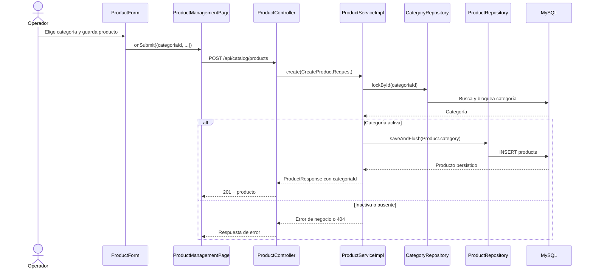
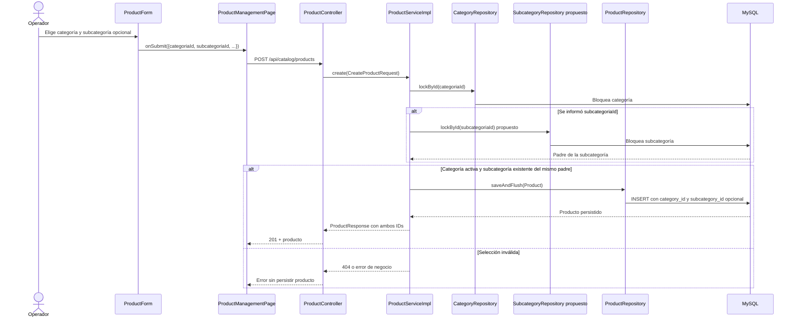
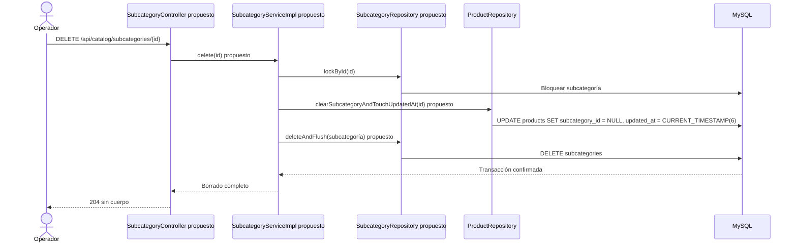

# Subcategorías — plan de implementación

**Propuesta de diseño:** `docs/Diagrama ECOMMERCE.drawio`, actualizado para incluir `SUBCATEGORIA`, y decisiones acordadas en esta conversación. **Estado:** planificación; ninguna tanda fue ejecutada. Este documento sigue `PROMPT_GENERAR_PLAN_IMPLEMENTACION.md`.

## Decisiones funcionales acordadas

- Un solo nivel: `Categoría → Subcategoría → Producto`. Una subcategoría no puede tener hijas. Ejemplo: `Siderometalúrgico → Chapas → Chapa Canaleta`.
- La subcategoría es opcional. Un producto siempre conserva su categoría directa; los existentes no requieren reclasificación. `Galvanizada` es una característica o futura variante, según si distingue una opción con precio y disponibilidad propios.
- El nombre de una subcategoría es único dentro de su categoría mientras existe. Su categoría padre se fija al crearla; eliminarla libera ese nombre para un alta posterior.
- La subcategoría se elimina físicamente, sin desactivación ni reactivación. Antes de confirmar, el operador ve cuántos productos están asociados y un aviso de que perderán esa clasificación. El borrado desvincula esos productos y actualiza su `updated_at` en la misma transacción; cada producto conserva `categoria_id`. Una categoría padre inactiva vuelve inelegibles sus subcategorías para nuevas asignaciones, sin borrar ni desvincular productos existentes.
- Esta implementación cubre persistencia, API y administración. La navegación del catálogo público se diseñará al construir ese catálogo.

## Estado actual — comprobado en el código

- Flyway V5 crea `categories` con nombre normalizado único global; V6 crea `products.category_id` obligatorio y su FK; V7 crea características y asociaciones por producto. No existe tabla, entidad, ruta ni pantalla de subcategorías.
- `CategoryController` expone `/api/catalog/categories`; `CategoryServiceImpl` crea, lista, edita y cambia el estado sin modificar productos. Las tres funciones de catálogo requieren sesión y admiten `SUPER_ADMIN`, `ADMIN` y `USER`.
- `ProductController` expone `/api/catalog/products`. `ProductServiceImpl.create(...)` bloquea y valida que la categoría esté activa; `update(...)` permite actualmente seleccionar una categoría inactiva. `ProductRepository.findPageByName(...)` filtra solo por nombre. `ProductResponse` y `ProductSummaryResponse` exponen `categoriaId`, sin subcategoría.
- `CategoryManagementPage` gestiona categorías planas. `ProductManagementPage` carga categorías y características al abrir el formulario; `ProductForm` ofrece un único selector de categoría. `AppRouter` no tiene catálogo público.
- Hay tests H2/MySQL para categorías, productos, características, permisos y concurrencia; los tests React cubren formularios, páginas y servicios. Los cambios locales ya presentes en páginas de catálogo y sus tests deben preservarse.
- `docs/modelo-inicial.md` describe producto, categoría, característica y futura variante, pero todavía no menciona subcategoría; deberá quedar sincronizado con el diagrama durante la tanda documental correspondiente.

## Flujo actual



## Flujo objetivo — después de todas las tandas

Los nombres `SubcategoryController`, `SubcategoryServiceImpl`, `SubcategoryRepository` y sus métodos son **propuestos**; no existen hoy.



El borrado propuesto sigue `SubcategoryController.delete(...) → SubcategoryServiceImpl.delete(...) → SubcategoryRepository.lockById(...) → ProductRepository.clearSubcategoryAndTouchUpdatedAt(...) → SubcategoryRepository.delete(...) → MySQL`. La desvinculación y el borrado ocurren en una transacción. La FK `products.subcategory_id → subcategories.id` conserva la integridad y no usa `ON DELETE SET NULL`: el `UPDATE` explícito permite actualizar también `products.updated_at`, que de otro modo no cambiaría mediante el callback JPA. Alta/edición de productos que asignen una subcategoría y el borrado bloquean esa misma fila para serializar la carrera; las lecturas no usan bloqueos explícitos. En la edición que asigne una subcategoría, el bloqueo de esta debe adquirirse antes del bloqueo del producto, adaptando el orden actual de `ProductServiceImpl.update(...)`.

## Orden de implementación

| Tanda | Objetivo | Depende de | Estado |
| --- | --- | --- | --- |
| 1 | Persistencia y mapeo de subcategoría opcional | Diagrama revisado | Completa |
| 2 | Administración API de subcategorías y borrado con desvinculación | 1 | Planificada |
| 3 | Asignación, lectura y filtros de productos | 2 | Planificada |
| 4 | Gestión React de subcategorías y selección en productos | 3 | Planificada |

```text
Diagrama y propuesta revisados → Tanda 1 → Tanda 2 → Tanda 3 → Tanda 4
```

## Tanda 1 — Persistencia y mapeo

**Objetivo:** guardar subcategorías y permitir que los productos tengan una subcategoría nullable sin alterar sus categorías ni los datos existentes.

**Depende de:** revisión del diagrama de diseño.

### Mapa de código

```text
[NUEVO] V8__create_subcategories.sql (nombre propuesto)
Backend/spring-starter/src/main/resources/db/migration/
└── CREATE subcategories; ALTER products ADD subcategory_id NULL
        ↓
[NUEVO] Subcategory / SubcategoryRepository
Backend/spring-starter/src/main/java/com/ashenox/starter/catalog/subcategory/
└── Mapeo JPA; lockById(...), consultas por padre/nombre
        ↓
[MODIFICADO] Product
Backend/spring-starter/src/main/java/com/ashenox/starter/catalog/product/model/Product.java
└── ManyToOne opcional hacia Subcategory
```

### Clases/archivos nuevos

- `V8__create_subcategories.sql` **propuesto**: `subcategories(id, category_id, nombre, nombre_normalizado, descripcion, created_at, updated_at)`; FK a `categories`, `UNIQUE(category_id, nombre_normalizado)` e índice para consultar por padre. Añade a `products` un `subcategory_id BIGINT NULL`, FK e índice, con borrado restringido como protección si quedaran vínculos. No modifica `category_id` ni rellena datos.
- `Subcategory` **propuesta**: padre `Category`, nombre visible/normalizado y descripción; sin campo `activo` ni relación de padre a otra subcategoría.
- `SubcategoryRepository` **propuesto**: búsqueda ordenada, verificación de nombre por padre y `lockById(...)` para borrado/asignaciones.

### Flujo de la tanda

Es estructural: Flyway crea tabla y columna; Hibernate valida los dos mapeos; las consultas del repositorio comprueban padre y unicidad. No hay entrada HTTP todavía, por lo que un diagrama de secuencia añadiría pasos ficticios.

### Cambios de persistencia/configuración

`subcategory_id` permanece nullable. La FK simple a `subcategories` no garantiza por sí sola que `products.category_id` coincida con el padre de la subcategoría; el servicio lo validará en tanda 3. El nombre normalizado usa el mismo criterio vigente de categorías (`strip().toLowerCase(Locale.ROOT)`), con la restricción única como garantía final de concurrencia.

### Tests necesarios

- Integración H2 y MySQL: Flyway aplica V8 y `ddl-auto=validate` acepta los mapeos; demuestra compatibilidad de esquema.
- MySQL: rechaza duplicados bajo un mismo padre y permite el mismo nombre en padres distintos; demuestra la unicidad real.
- Persistencia: un producto existente o creado sin subcategoría conserva categoría y `subcategory_id = NULL`; demuestra migración sin reclasificación.

### Qué NO queda probado

```text
NO PROBADO: reglas de negocio, API, desvinculación y formulario.
RIESGO: un acceso directo a repositorio podría guardar un par categoría/subcategoría incompatible.
TRATAMIENTO: validar en servicios y pruebas de las tandas 2 y 3.
```

### Commit sugerido

`feat: add subcategory persistence schema` — migración, entidades, repositorio y tests de persistencia. Excluir cambios locales ajenos.

### Criterio de cierre

- [ ] Migración y validación JPA pasan en H2/MySQL; productos actuales conservan datos.
- [ ] Restricciones e índices se verifican en MySQL.
- [ ] Tests faltantes, incidentes y riesgos quedan registrados.

### Resultado de ejecución

**Estado:** COMPLETA. Detalle e incidente en [tanda-1-resultado.md](tanda-1-resultado.md).

**Cambios realizados:** V8 crea `subcategories` y la FK nullable `products.subcategory_id`; `Subcategory` y `SubcategoryRepository` agregan el mapeo y las consultas; `Product` incorpora la relación opcional. La migración V7→V8 deja los productos existentes con su categoría original y subcategoría nula.

**Diferencias respecto del plan:** ninguna funcional. El `ALTER TABLE` se dividió en sentencias para ser compatible con H2 y MySQL. Se agregó una prueba explícita de actualización V7→V8.

**Tests ejecutados y exitosos:** 13/13: 6 H2 (mapeo de subcategorías y regresión de categorías/productos), 6 MySQL (restricciones, índices, productos y regresión) y 1 actualización V7→V8 en MySQL. Flyway V8 y `ddl-auto=validate` pasaron en ambos motores.

**Tests fallidos:** la primera ejecución H2 tuvo 6 errores de carga de contexto por sintaxis de V8; tras corregirla, 0 fallidos.

**Incidentes:** INC-001, sintaxis de `ALTER TABLE` incompatible con H2; resuelto y revalidado.

**Tests faltantes:** ninguno de los planificados para esta tanda.

**Riesgos residuales:** la FK no garantiza que el padre de la subcategoría coincida con `products.category_id`; la validación corresponde a la tanda 3. Reglas de negocio, API y borrado quedan pendientes de las tandas 2 y 3.

**Decisiones pendientes descubiertas:** ninguna.

**Archivos modificados:** `V8__create_subcategories.sql`, `Subcategory.java`, `SubcategoryRepository.java`, `Product.java`, tres clases de test y este documento. Detalle en el resultado enlazado.

**Cierre:** [x] migración y mapeos H2/MySQL; [x] conservación de productos V7; [x] índices y unicidad MySQL; [x] incidente y riesgo registrados.

## Tanda 2 — API y borrado de subcategorías

**Objetivo:** administrar subcategorías y desvincular sus productos de forma atómica al eliminarlas.

**Depende de:** tanda 1.

### Mapa de código

```text
[NUEVO] SubcategoryController
Backend/spring-starter/src/main/java/com/ashenox/starter/catalog/subcategory/controller/
└── create/list/getById/update/delete(...) [PROPUESTOS]
        ↓
[NUEVO] SubcategoryService + SubcategoryServiceImpl
Backend/spring-starter/src/main/java/com/ashenox/starter/catalog/subcategory/service/
└── Validación del padre y nombre único; borrado transaccional
        ↓
[NUEVO] SubcategoryRepository / [MODIFICADO] CategoryRepository, ProductRepository
Backend/spring-starter/src/main/java/com/ashenox/starter/catalog/
└── Bloqueo puntual y clearSubcategoryAndTouchUpdatedAt(...) [PROPUESTO]
        ↓
MySQL: subcategories + products
```

### Clases/archivos nuevos

- DTOs `CreateSubcategoryRequest`, `UpdateSubcategoryRequest`, `SubcategoryResponse` y `SubcategoryDetailResponse` **propuestos** en `catalog/subcategory/dto/`; la creación recibe `categoriaId`, nombre y descripción; la edición recibe nombre y descripción. La respuesta básica incluye ID, `categoriaId`, nombre y descripción. Solo el detalle añade `productosAsociados`, calculado con `ProductRepository.countBySubcategoryId(...)` [PROPUESTO], para mostrar la cantidad antes de confirmar el borrado sin contar productos por cada fila del listado.
- `SubcategoryController`, `SubcategoryService`, `SubcategoryServiceImpl` y excepción de conflicto **propuestos**; siguen las convenciones de categorías.

### Flujo de la tanda



### Cambios de persistencia/configuración

- Rutas **propuestas**: `GET/POST /api/catalog/subcategories`, `GET/PUT/DELETE /api/catalog/subcategories/{id}`; mismo esquema de sesión, roles y CSRF que categorías. GET de lista devuelve todas las subcategorías existentes, ordenadas por padre, nombre e ID; `categoriaId` opcional filtra por padre. GET de detalle devuelve `SubcategoryDetailResponse` con el recuento usado por la confirmación.
- Crear exige categoría existente y activa; el padre es inmutable. Editar no permite renombrar hacia un nombre ocupado. Al borrar, el nombre queda libre dentro de su categoría. `DELETE` exitoso devuelve 204 y un ID inexistente 404.
- En una transacción, bloquear la fila de subcategoría, ejecutar `UPDATE products SET subcategory_id = NULL, updated_at = CURRENT_TIMESTAMP(6) WHERE subcategory_id = :id` y borrar la subcategoría. Si cualquiera de los pasos falla, se revierten ambos. `category_id`, productos y demás datos permanecen. La FK sin acción `SET NULL` impide dejar referencias por un camino que omita el servicio.

### Tests necesarios

- Servicio/HTTP: alta, listado, detalle con cantidad asociada, edición, borrado, duplicado por padre, padre ausente/inactivo, validaciones y respuestas 201/200/204/400/404/409; demuestra contrato y reglas.
- Seguridad: los tres roles habilitados, anónimo y mutaciones sin CSRF, incluido DELETE; demuestra el mismo acceso que categorías.
- Integración MySQL: borrar una subcategoría sin productos y otra con varios deja `subcategory_id = NULL`, actualiza `updated_at`, mantiene cada `category_id` y elimina solo la subcategoría; un fallo entre UPDATE y DELETE revierte todo; demuestra atomicidad.
- Concurrencia MySQL: dos altas del mismo nombre bajo un padre producen una fila; demuestra garantía del índice único.

### Qué NO queda probado

```text
NO PROBADO: asignación por la API de productos y carrera asignación/borrado.
RIESGO: hasta la tanda 3, la nueva columna solo puede poblarse por acceso directo a datos.
TRATAMIENTO: cubrir ambos recorridos en la tanda 3 antes de usar la función en React.
```

### Commit sugerido

`feat: manage and delete subcategories` — API, servicio, repositorios y tests de borrado.

### Criterio de cierre

- [ ] API cumple validación, permisos y unicidad por padre.
- [ ] Borrado atómico preserva categoría y actualiza `updated_at` de los productos afectados.
- [ ] Regresión de categorías pasa; faltantes, incidentes y riesgos quedan visibles.

### Resultado de ejecución

**PENDIENTE DE EJECUCIÓN**

## Tanda 3 — Productos con subcategoría opcional

**Objetivo:** asignar, leer y filtrar productos por subcategoría sin exigirla a productos actuales o nuevos.

**Depende de:** tanda 2.

### Mapa de código

```text
[MODIFICADO] ProductController + CreateProductRequest / UpdateProductRequest
Backend/spring-starter/src/main/java/com/ashenox/starter/catalog/product/
└── categoriaId y subcategoriaId opcional; filtros GET [PROPUESTOS]
        ↓
[MODIFICADO] ProductServiceImpl
.../catalog/product/service/ProductServiceImpl.java
└── create/update/list(...): validar padre y coordinar asignación con borrado
        ↓
[MODIFICADO] CategoryRepository, SubcategoryRepository, ProductRepository
└── Bloquear subcategoría al asignarla, antes del producto en edición; filtro paginado
        ↓
[MODIFICADO] Product, ProductResponse, ProductSummaryResponse
└── Persistir y devolver ambos IDs
```

### Clases/archivos nuevos

No se prevén clases nuevas fuera de pruebas. `UpdateProductRequest` ya distingue presencia de `caracteristicas`; aplicar el mismo patrón de presencia a `subcategoriaId`: campo omitido conserva la asignación, `null` explícito la quita. En alta, omitido o `null` significan producto sin subcategoría.

### Flujo de la tanda

El camino feliz completo de alta está en el **flujo objetivo**. En edición, `ProductController.update(...)` pasa el request a `ProductServiceImpl.update(...)`. Si se asigna una subcategoría, el servicio la bloquea antes de bloquear el producto; valida que exista y pertenezca a la categoría elegida. Si cambia `categoriaId`, debe enviarse `subcategoriaId = null` o una subcategoría del nuevo padre: nunca se conserva un vínculo incompatible. Una edición sin nueva asignación conserva el bloqueo de producto existente y no requiere bloqueo de subcategoría.

### Cambios de persistencia/configuración

- `ProductResponse` y `ProductSummaryResponse` añaden `subcategoriaId` nullable. `GET /api/catalog/products` admite filtros opcionales `categoriaId` y `subcategoriaId` además de `nombre`, manteniendo orden y paginación existentes; un filtro de subcategoría selecciona solo productos vinculados a ella. Si se informan ambos IDs, deben corresponder al mismo padre o responder 400.
- Alta o cambio de asignación rechaza subcategoría ausente, de otra categoría o cuyo padre esté inactivo. La edición que no cambia la asignación conserva el producto tal como está; el borrado de la tanda 2 será quien desvincule sus productos.
- Adaptar el orden de bloqueo de `ProductServiceImpl.update(...)` solo cuando asigne una subcategoría, para evitar ciclos con el borrado. El alta ya bloquea la categoría; si hay subcategoría, bloquea esa fila antes de guardar. Mantener los contratos de precio, disponibilidad y características actuales. Las lecturas no usan bloqueos explícitos.

### Tests necesarios

- Servicio/HTTP: alta sin subcategoría, alta con subcategoría válida, combinación inválida, edición con ID omitido/`null`/nuevo ID y cambio de categoría; demuestra semántica de compatibilidad.
- Listado: filtros por categoría/subcategoría/nombre combinados, paginación y respuestas con IDs; demuestra selección y contrato administrativo.
- Concurrencia MySQL: asignación simultánea con borrado termina antes y luego se desvincula, o termina después y se rechaza porque la subcategoría ya no existe; nunca queda una FK colgante. Verificar también ausencia de bloqueo circular con edición de producto.
- Regresión: creación/edición y características de producto sin `subcategoriaId` siguen funcionando; demuestra compatibilidad con clientes existentes.

### Qué NO queda probado

```text
NO PROBADO: selector React y navegación/filtros del catálogo público.
RIESGO: la clasificación existe en API, pero el operador todavía no puede usarla desde la interfaz.
TRATAMIENTO: administración React en tanda 4; catálogo público en su futura tarjeta.
```

### Commit sugerido

`feat: assign optional subcategories to products` — DTOs, servicio, filtros y tests, sin cambios de UI.

### Criterio de cierre

- [ ] Productos nuevos y existentes funcionan con o sin subcategoría.
- [ ] Asignación y borrado concurrentes conservan la integridad de las relaciones.
- [ ] Contratos, regresión, faltantes, incidentes y riesgos quedan documentados.

### Resultado de ejecución

**PENDIENTE DE EJECUCIÓN**

## Tanda 4 — Administración React

**Objetivo:** permitir administrar subcategorías y clasificarlas desde el formulario y listado de productos.

**Depende de:** tanda 3.

### Mapa de código

```text
[MODIFICADO] CategoryManagementPage
Frontend/react-starter/src/catalog/categories/pages/CategoryManagementPage.jsx
└── Mostrar subcategorías por padre y controles de gestión
        ↓
[NUEVO] SubcategoryForm + subcategoryService
Frontend/react-starter/src/catalog/subcategories/
└── Formularios y llamadas a /api/catalog/subcategories

[MODIFICADO] ProductManagementPage → ProductForm → productService
Frontend/react-starter/src/catalog/products/
└── Cargar subcategorías; selector dependiente y filtros de listado
```

### Clases/archivos nuevos

- `catalog/subcategories/services/subcategoryService.js` **propuesto**: listar, consultar detalle, crear, editar y eliminar mediante `apiRequest` y `ENDPOINTS.CATALOG`.
- `catalog/subcategories/components/SubcategoryForm.jsx` **propuesto**: nombre, descripción y categoría padre solo en el alta. Las pruebas correspondientes se ubican junto a servicio y formulario.

### Flujo de la tanda

```mermaid
sequenceDiagram
    actor A as Operador
    participant P as ProductManagementPage
    participant F as ProductForm
    participant SS as subcategoryService propuesto
    participant PS as productService
    participant API as API de catálogo
    A->>P: Abre producto
    P->>SS: listSubcategories(...) propuesto
    SS->>API: GET /api/catalog/subcategories
    API-->>P: Subcategorías existentes
    P->>F: categories, subcategories, product
    A->>F: Cambia categoría
    F->>F: Limpia subcategoriaId y filtra opciones del padre
    A->>F: Selecciona subcategoría o ninguna; guarda
    F->>P: onSubmit(payload)
    P->>PS: createProduct/updateProduct(...)
    PS->>API: POST/PUT /api/catalog/products
    API-->>P: Producto actualizado
    P-->>A: Lista y clasificación actualizadas
```

### Cambios de persistencia/configuración

Agregar rutas al mapa `ENDPOINTS.CATALOG`, sin nueva página pública. `CategoryManagementPage` muestra las subcategorías bajo cada padre. Al pulsar **Eliminar**, carga el detalle con `productosAsociados` y muestra una confirmación: cantidad **actualmente asociada**, pérdida irreversible de la subcategoría y conservación de los productos en la categoría padre. La cifra es una lectura previa y puede variar antes del DELETE; el servidor desvincula los vínculos existentes al ejecutarlo. Tras 204 refresca la lista de subcategorías y muestra una notificación de éxito; `ProductManagementPage` consulta la clasificación actual cuando se abre o se recarga. Ante resultado de red incierto, se consulta el estado antes de repetir el borrado. `ProductForm` permite `Sin subcategoría`, filtra por categoría y muestra la asignación actual durante edición. Al cambiar categoría limpia la subcategoría; el listado administrativo presenta la clasificación y los filtros disponibles.

### Tests necesarios

- Servicios React: rutas, payload, CSRF y errores; demuestra integración con contratos de API.
- Formularios: categoría sin subcategorías, selector opcional, cambio de padre que limpia selección y edición con estado actual; demuestra que no se envían pares incompatibles.
- Páginas: crear/editar/eliminar subcategoría, cantidad y aviso antes de confirmar, 204, refresco de lista y clasificación de productos, y filtros; demuestra el recorrido administrativo.
- Regresión de rutas y pantallas actuales de categorías, productos y características; demuestra que los cambios locales existentes no se pierden.

### Qué NO queda probado

```text
NO PROBADO: megamenú, búsqueda y filtros del catálogo público.
RIESGO: la clasificación todavía no participa en una experiencia pública inexistente.
TRATAMIENTO: incluirla al implementar el catálogo público; no simular esa UI en esta tanda.
```

### Commit sugerido

`feat: manage subcategories in catalog admin` — componentes, servicios, endpoints y tests React. Sin mezclar cambios locales ajenos ya presentes.

### Criterio de cierre

- [ ] Operador administra subcategorías y clasifica productos desde la UI.
- [ ] Confirmación y estado tras el borrado reflejan la desvinculación real.
- [ ] Tests y regresión relevante pasan; faltantes, incidentes y riesgos se registran.
- [ ] `docs/modelo-inicial.md` refleja el modelo aprobado y el diagrama continúa coherente.

### Resultado de ejecución

**PENDIENTE DE EJECUCIÓN**

## Decisiones pendientes

| ID | Decisión | Alternativas | Bloquea |
| --- | --- | --- | --- |
| — | Ninguna pendiente para las tandas descritas; el diseño del catálogo público se decidirá en su propia tarjeta. | — | — |

## Protocolo global de incidentes

Durante la ejecución, cada fallo relevante se registrará una sola vez como `INC-XXX`: tanda, contexto, comportamiento esperado/obtenido, clasificación (código, test, contrato, entorno, datos o causa desconocida), causa confirmada o hipótesis, resolución, archivos productivos/tests/configuración modificados, resultado posterior y riesgo residual. No se cambiará un test solo para dejarlo verde; un cambio de contrato sin respaldo del diseño abrirá una decisión pendiente.

## Flujo total acumulado

```text
IMPLEMENTADO TRAS TANDA 1
CategoryController → CategoryServiceImpl → CategoryRepository → categories
ProductForm → ProductController → ProductServiceImpl → products.category_id
ProductCharacteristic → characteristics + product_characteristics
Flyway V8 → subcategories + products.subcategory_id nullable
SubcategoryRepository → consultas y bloqueo de fila disponibles; sin API todavía

PENDIENTE: TANDAS 2–4
CategoryManagementPage → SubcategoryController → SubcategoryServiceImpl → subcategories
                                                  └→ eliminar: products.subcategory_id = NULL, updated_at actualizado
ProductForm → ProductController → ProductServiceImpl → products.category_id obligatorio
                                              └────────→ products.subcategory_id opcional
Catálogo público: futuro, fuera de estas tandas
```

## Resumen final

### Orden de implementación

Esquema y mapeo → API y borrado → asignación y filtros de productos → administración React. Cada tanda depende de la anterior.

### Decisiones pendientes

Ninguna para este plan; el catálogo público se diseñará por separado.

### Riesgos globales

- La columna nullable conserva datos, pero la concordancia categoría/subcategoría depende del servicio: verificar todas las rutas que cambian clasificación.
- El borrado y la asignación concurrente requieren el mismo bloqueo puntual de subcategoría y prueba MySQL; H2 no basta para demostrar la carrera.
- El borrado físico pierde la clasificación previa y libera el nombre; una nueva subcategoría con ese nombre tendrá otro ID y no recuperará asociaciones.

### Validación final

Crear dos categorías y subcategorías homónimas bajo padres distintos; clasificar productos con y sin subcategoría; listar y filtrar; confirmar y borrar una subcategoría con productos mientras se intenta asignar otro; comprobar 204, ausencia de la subcategoría, `updated_at` nuevo, categoría conservada y `subcategoriaId` vacío en productos y UI. Registrar resultados, incidentes y pruebas no ejecutadas antes de cerrar la última tanda.
