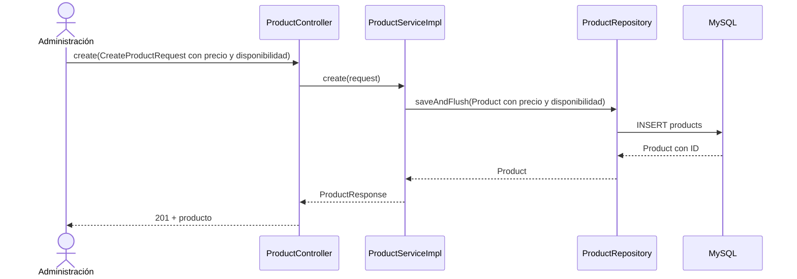
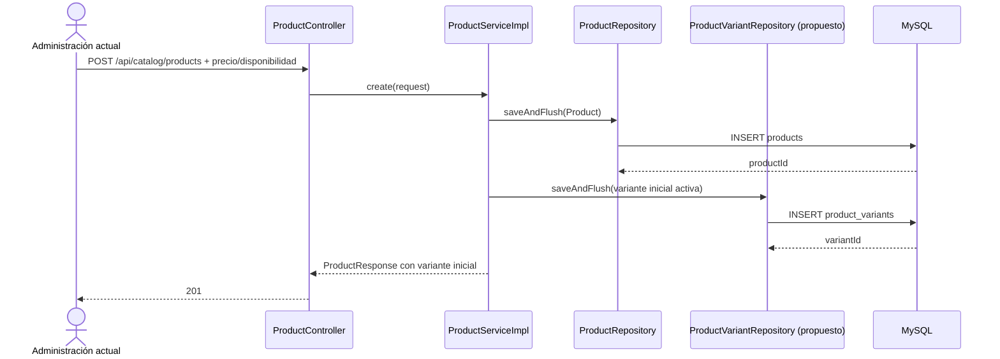
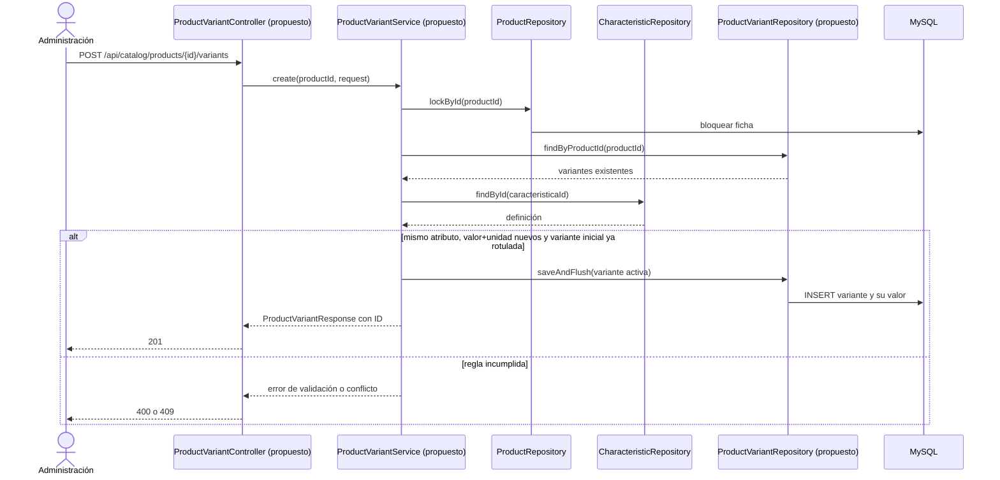

# S3 BE — Variantes de producto: plan de implementación

**Fuente funcional:** [S3 BE Variantes de producto](https://trello.com/c/uBmWofPG/58-s3-be-variantes-de-producto). **Diseño de referencia:** `docs/modelo-inicial.md` y `docs/Diagrama ECOMMERCE.drawio`. **Estado del documento:** planificado; ninguna tanda de este plan fue ejecutada. La tarjeta limita esta entrega a un atributo variable por producto, aunque el modelo inicial ejemplifique combinaciones de varios atributos.

## Decisiones acordadas para esta tarjeta

| ID | Decisión |
| --- | --- |
| D01 | Todo producto tiene al menos una variante activa. La variante inicial puede no tener valor diferenciador solo mientras sea la única. Se bloquea desactivar la última activa, incluso si el producto está inactivo. |
| D02 | Alta gradual: el alta de producto crea la variante inicial; se le asigna atributo y valor antes de agregar una segunda. Con varias variantes no se puede cambiar el atributo variable. |
| D03 | Un valor queda reservado aunque su variante esté inactiva. La identidad del valor compara texto y unidad normalizados; `20 L` y `20 kg` son distintos. El atributo variable no puede coexistir como característica compartida del producto. |
| D04 | El SKU es opcional y, cuando se informa, único en todo el catálogo. Se muestra en el detalle público, no en el listado. |
| D05 | Borrar una definición de característica usada por variantes devuelve conflicto. `CharacteristicResponse` añade `cantidadVariantes` y conserva `cantidadProductos`. |
| D06 | Se mantiene compatibilidad temporal con el formulario React actual para productos de una variante. Un `PUT` que incluya los campos heredados de precio o disponibilidad se rechaza cuando el producto tiene varias variantes; un `PUT` de datos comunes sin esos campos sí puede aceptarse. |
| D07 | La variante pública inicial es la activa y disponible de menor precio; si ninguna está disponible, la activa de menor precio. Los empates se resuelven por ID. El detalle público entrega solo variantes activas; administración incluye las inactivas. |

La regla D01 es más estricta que la posibilidad descrita en el modelo inicial de ocultar un producto sin variantes activas. Para esta tarjeta, esa situación no debe poder producirse mediante la API. El filtro público por existencia de variante activa se conserva como defensa para datos anómalos.

## COMPROBADO EN EL CÓDIGO ACTUAL

- `V6__create_products.sql` guarda `precio_referencia` y `disponible` en `products`; V7 agrega características compartidas, V8 subcategorías y V9 imágenes. No hay tablas ni clases de variantes. `Product` mapea los dos campos de precio/disponibilidad.
- `ProductController` delega alta, edición, consulta, listado y cambio de estado a `ProductService`/`ProductServiceImpl`. Este último valida categoría/subcategoría, mantiene `Producto_Caracteristica` y usa bloqueos de filas en mutaciones. `ProductRepository` pagina productos administrativos.
- `PublicProductController` expone dos GET. `PublicProductService.list(...)` pagina productos activos y carga las miniaturas principales en lote; `getById(...)` entrega características compartidas y galería. Ambos leen el precio y la disponibilidad de `Product`, sin concepto de variante.
- `CharacteristicServiceImpl.delete(...)` elimina asociaciones `product_characteristics` antes de borrar la definición. `CharacteristicResponse.cantidadProductos` solo cuenta usos compartidos.
- Spring Security permite únicamente los dos GET públicos de productos y exige rol `SUPER_ADMIN`, `ADMIN` o `USER` para `/api/catalog/products/**` y `/api/catalog/characteristics/**`. `Frontend/react-starter` aún envía y muestra precio/disponibilidad en la ficha administrativa.
- Hay pruebas de producto, características, imágenes, seguridad, H2/Flyway y algunas de concurrencia sobre MySQL/Testcontainers. Los recorridos de navegador y de staging requieren validación separada.

## COMPORTAMIENTO PROPUESTO

`Producto` conserva nombre, categoría, subcategoría, descripción, estado, destacado, características compartidas y fotos. `VarianteProducto` posee precio, disponibilidad, SKU y estado. Una fila opcional en `Variante_Caracteristica` expresa el único atributo y valor que distingue esa variante. La identidad pública y futura selección de carrito/presupuesto usarán el ID de variante; no se duplicará la ficha para distintos valores del mismo atributo.

### Flujo actual



La consulta pública actual sigue `PublicProductController.list/getById(...)` → `PublicProductService.list/getById(...)` → `ProductRepository` y repositorios de características/imágenes → DTO con precio y disponibilidad tomados de `Product`.

### Flujo objetivo completo

```mermaid
sequenceDiagram
    actor A as Administración
    participant PC as ProductController
    participant PS as ProductServiceImpl
    participant PR as ProductRepository
    participant VR as ProductVariantRepository (propuesto)
    participant DB as MySQL
    actor V as Visitante
    participant PPC as PublicProductController
    participant PPS as PublicProductService
    A->>PC: create(request + varianteInicial o campos heredados)
    PC->>PS: create(request)
    PS->>PR: saveAndFlush(producto común)
    PR->>DB: INSERT products
    DB-->>PR: producto ID
    PS->>VR: saveAndFlush(variante inicial activa)
    VR->>DB: INSERT product_variants
    DB-->>VR: variante ID
    PS-->>PC: ProductResponse + variante ID
    PC-->>A: 201 + ficha y variante
    V->>PPC: GET /api/public/products/{id}
    PPC->>PPS: getById(id)
    PPS->>PR: findByIdAndActivoTrue(id)
    PPS->>VR: findActiveByProductId(id) (propuesto)
    VR->>DB: variantes activas y valor
    DB-->>VR: variantes
    PPS->>PPS: elegir menor disponible, o menor activa; empate por ID
    PPS-->>PPC: PublicProductDetailResponse + variantes + selectedVariantId + galería
    PPC-->>V: 200 + ficha pública
```

Si una validación falla, el servicio devuelve error de dominio antes de persistir; una violación de unicidad de SKU detectada por MySQL se convierte en conflicto. Las fotos siguen resolviéndose desde `ProductImageRepository` y `ProductImageUrlService`, sin depender de la variante elegida.

## Orden de implementación

| Tanda | Objetivo | Depende de | Estado |
| --- | --- | --- | --- |
| 1 | Persistencia, backfill y variante inicial en flujos actuales | Código actual | Planificada |
| 2 | API administrativa de variantes y reglas con características | 1 | Planificada |
| 3 | Lectura pública desde variantes y retiro de columnas duplicadas | 2 | Planificada |

```text
Tanda 1 → Tanda 2 → Tanda 3
```

Las columnas antiguas permanecen hasta que todas las lecturas y escrituras backend usen variantes. Cada tanda debe dejar un estado compilable y verificable. Los commits sugeridos no incluyen trabajo de la tanda siguiente.

---

## Tanda 1 — Persistencia y variante inicial

**Objetivo:** crear el modelo persistente, migrar todos los productos y garantizar una variante inicial para nuevas altas, sin cambiar aún el contrato HTTP.

**Depende de:** código actual; decisiones D01, D04 y D06.

### Mapa de código

```text
[NUEVO] src/main/resources/db/migration/V10__create_product_variants.sql
  → CREATE product_variants y variant_characteristics; INSERT...SELECT desde products
        ↓
[NUEVO] catalog/product/variant/model/ProductVariant y VariantCharacteristic
  → mapear las dos tablas; una asociación de característica como máximo por variante
        ↓
[NUEVO] catalog/product/variant/repository/ProductVariantRepository y VariantCharacteristicRepository
  → consultas por producto y persistencia de variante/valor
        ↑
[MODIFICADO] catalog/product/service/ProductServiceImpl.create/update/response(...)
  → guardar y sincronizar la variante inicial en la misma transacción que Producto
        ↓
[MODIFICADO] catalog/product/dto/ProductResponse y ProductSummaryResponse
  → exponer ID de variante inicial sin quitar campos escalares actuales
```

Las rutas se entienden relativas a `Backend/spring-starter/src/main/java/com/ashenox/starter/`, excepto la migración. Los nombres de clases/repositorios de variante y sus métodos son **PROPUESTOS**; `ProductServiceImpl.create/update/response(...)` ya existen.

### Clases/archivos nuevos

- `V10__create_product_variants.sql`: tablas, claves foráneas, índices y backfill de una variante activa por cada fila de `products`, conservando precio y disponibilidad.
- `ProductVariant` y `VariantCharacteristic`: entidades JPA. `ProductVariant` contiene `id`, `product_id`, `sku` y `sku_normalizado` opcionales, precio positivo, disponibilidad, activo y auditoría. `VariantCharacteristic` contiene `variant_id` como clave primaria (máximo una fila), `characteristic_id`, valor y unidad con sus formas normalizadas.
- `ProductVariantRepository` y `VariantCharacteristicRepository`: persistencia y consultas acotadas por producto; índice único sobre `sku_normalizado` no nulo para SKU global.

### Flujo de la tanda



### Cambios de persistencia/configuración

V10 añade ambas tablas sin retirar todavía columnas de `products`. El backfill se ejecuta una vez por Flyway y copia precio/disponibilidad sin redondeos; SKU y característica quedan nulos, estado de variante activo. La restricción de precio positivo y la unicidad de SKU se comprueban en MySQL. Mientras existan columnas duplicadas, `create(...)` y `update(...)` para una única variante mantienen sincronizados ambos valores dentro de una transacción. Ninguna nueva variable de entorno es necesaria.

### Tests necesarios

- **Migración H2 y MySQL:** productos activos/inactivos y disponibles/no disponibles generan exactamente una variante activa con el mismo precio y disponibilidad; prueba el backfill y las FK.
- **Persistencia MySQL:** precio decimal exacto, precio no positivo rechazado, SKU normalizado único cuando está presente y varios SKU nulos permitidos; prueba restricciones reales del motor.
- **Integración/HTTP:** alta y edición actuales devuelven sus campos previos y dejan una variante sincronizada; prueba compatibilidad temporal y atomicidad.
- **Regresión:** tests existentes de producto, características e imágenes; prueba que V10 no altera los flujos ya implementados.

### Qué NO queda probado

```text
NO PROBADO: varias variantes por producto ni selección pública por precio.
RIESGO: las columnas duplicadas pueden divergir por escrituras ajenas al servicio.
TRATAMIENTO: no habilitar todavía mutaciones de varias variantes; retirar columnas en la tanda 3.
```

### Commit sugerido

`feat: persist initial product variants` — V10, entidades, repositorios, adaptación de alta/edición y pruebas de migración; sin endpoints de administración de variantes.

### Criterio de cierre

- [ ] V10 migra productos existentes y las altas nuevas crean una variante activa.
- [ ] Precio y disponibilidad del producto antiguo y la variante coinciden durante la transición.
- [ ] Tests H2/MySQL y regresión relacionada pasan; faltantes, incidentes y riesgos quedan registrados.

### Resultado de ejecución

**PENDIENTE DE EJECUCIÓN**

---

## Tanda 2 — Gestión administrativa de variantes

**Objetivo:** crear, consultar, editar y cambiar estado de variantes; aplicar todas las reglas de atributo, valor, SKU y característica compartida.

**Depende de:** tanda 1; decisiones D01–D06.

### Mapa de código

```text
[NUEVO] catalog/product/variant/controller/ProductVariantController
  → list/create/update/deactivate/reactivate(...) (PROPUESTOS)
        ↓
[NUEVO] catalog/product/variant/service/ProductVariantService
  → listByProduct/create/update/deactivate/reactivate(...) (PROPUESTOS)
        ├──→ ProductRepository.lockById(...), ya existente
        ├──→ CharacteristicRepository.findById(...), ya existente
        ├──→ ProductVariantRepository y VariantCharacteristicRepository, PROPUESTOS
        └──→ MySQL
[MODIFICADO] ProductController y ProductServiceImpl.update/getById/list(...)
  → aceptar edición común nueva; rechazar PUT heredado de producto multivariante
[MODIFICADO] CharacteristicServiceImpl.delete/list/getById(...) y CharacteristicResponse
  → impedir borrado en uso y mostrar cantidadVariantes
[MODIFICADO] ProductResponse/ProductSummaryResponse y request DTO de producto
  → variantes administrativas y compatibilidad temporal
```

### Clases/archivos nuevos

- `ProductVariantController` y `ProductVariantService`: endpoints administrativos bajo `/api/catalog/products/{productId}/variants`. GET colección, POST alta, PUT `/{variantId}`, POST `/{variantId}/deactivate` y POST `/{variantId}/reactivate`. Heredan los roles de catálogo; las mutaciones requieren CSRF.
- `CreateVariantRequest`, `UpdateVariantRequest` y `ProductVariantResponse`: SKU opcional, precio, disponibilidad y, cuando corresponda, `caracteristicaId`, valor y unidad; respuesta con ID y estado. El estado activo cambia mediante endpoints separados.
- Adaptación de `CreateProductRequest` para admitir **o bien** el par heredado precio/disponibilidad **o bien** `varianteInicial`; nunca fuentes contradictorias. Adaptación de `UpdateProductRequest` para distinguir campos heredados ausentes de presentes y permitir la edición nueva de datos comunes.

### Flujo de la tanda



### Cambios de persistencia/configuración

`variant_characteristics.variant_id` es único, por lo que una variante no puede tener dos atributos. El servicio bloquea la fila de producto antes de comprobar valores normalizados para serializar altas/ediciones concurrentes de esa ficha; la unicidad global de SKU normalizado se apoya además en el índice de MySQL. Valor y unidad se recortan y normalizan con `Locale.ROOT`; una unidad vacía se representa de forma consistente para comparar. Las variantes inactivas participan en la comprobación de duplicados.

La edición de un producto con varias variantes acepta solo campos comunes y características compartidas compatibles. Si llegan campos heredados de precio/disponibilidad, devuelve 409 sin modificar nada. Mientras V11 no se aplique, las mutaciones de un producto con una única variante mantienen sincronizadas las columnas antiguas; al pasar a varias, esas columnas quedan transitorias y ninguna regla ni respuesta se basa en ellas. `CharacteristicServiceImpl.delete(...)` comprueba asociaciones de variantes antes de borrar y la FK actúa como última defensa ante carreras; `cantidadVariantes` cuenta variantes activas e inactivas. Los errores de dominio usan el formato existente de `GlobalExceptionHandler`.

### Tests necesarios

- **Servicio/HTTP:** asignar Color a la variante inicial y crear Rojo, Blanco y Celeste con precios/disponibilidades distintos; prueba alta gradual e IDs estables.
- **Validación:** rechazar segundo atributo, valor/unidad duplicados incluso con variante inactiva, valor faltante al agregar la segunda, atributo compartido duplicado y desactivación de la última activa; prueba las decisiones D01–D03.
- **Concurrencia MySQL:** dos altas del mismo valor para un producto y dos SKU iguales en productos distintos dejan solo una operación exitosa; prueba bloqueo e índice único.
- **Características:** borrado de característica usada devuelve 409 sin perder datos y `cantidadVariantes` refleja altas, bajas y ediciones; prueba la dependencia con el catálogo existente.
- **Seguridad y compatibilidad:** roles permitidos, anónimo/rol ajeno rechazado, CSRF, edición heredada válida con una variante y rechazada con varias; prueba la API administrativa y el formulario actual.

### Qué NO queda probado

```text
NO PROBADO: selección pública por precio y retiro de columnas de products.
RIESGO: los campos persistidos antiguos siguen siendo una representación temporal del precio.
TRATAMIENTO: no leerlos para reglas nuevas; retirar la duplicación en la tanda 3.
```

### Commit sugerido

`feat: manage product variants in catalog API` — servicio/controller, DTO, integración con características, seguridad y pruebas administrativas.

### Criterio de cierre

- [ ] Las variantes se administran sin duplicar productos ni admitir dos atributos variables.
- [ ] Se preservan IDs, SKU único y al menos una variante activa.
- [ ] Borrado y conteos de características, concurrencia, HTTP y seguridad comprobados; riesgos visibles.

### Resultado de ejecución

**PENDIENTE DE EJECUCIÓN**

---

## Tanda 3 — Lectura pública y eliminación del precio duplicado

**Objetivo:** publicar precio y disponibilidad desde variantes, exponer selección inicial y galería compartida, y retirar los campos antiguos de `products`.

**Depende de:** tanda 2; decisión D07.

### Mapa de código

```text
[MODIFICADO] PublicProductController.list/getById(...)
  → mismos GET y paginación actuales
        ↓
[MODIFICADO] PublicProductService.list/getById(...)
  → seleccionar variante activa preferida y responder detalle
        ├──→ ProductRepository.findActivePage/findByIdAndActivoTrue(...), adaptados
        ├──→ ProductVariantRepository.find...(...) (PROPUESTO, carga por lote)
        ├──→ ProductImageRepository, ya existente
        └──→ ProductImageUrlService, ya existente
[MODIFICADO] PublicProductSummaryResponse/PublicProductDetailResponse
  → selectedVariantId, precio/disponibilidad derivados y variantes en detalle
[MODIFICADO] Product, ProductServiceImpl y DTO administrativos
  → dejar de persistir precio/disponibilidad en Producto; adaptación HTTP heredada
[NUEVO] V11__drop_product_price_availability.sql
  → retirar products.precio_referencia y products.disponible
```

### Clases/archivos nuevos

- `V11__drop_product_price_availability.sql`: elimina las dos columnas después de trasladar todas las lecturas y escrituras del backend.
- `PublicProductVariantResponse` si el DTO administrativo expone campos no aptos para el público; entrega ID, atributo/valor/unidad, SKU, precio y disponibilidad de variantes activas.

### Flujo de la tanda

```mermaid
sequenceDiagram
    actor V as Visitante
    participant C as PublicProductController
    participant S as PublicProductService
    participant PR as ProductRepository
    participant VR as ProductVariantRepository (propuesto)
    participant IR as ProductImageRepository
    participant DB as MySQL
    V->>C: GET /api/public/products?page=0&size=20
    C->>S: list(page, size)
    S->>PR: findActivePage(pageable) con variante activa
    PR->>DB: página y conteo de fichas elegibles
    DB-->>PR: productos
    S->>VR: findActiveByProductIds(ids) (propuesto)
    VR->>DB: variantes de la página
    DB-->>VR: variantes
    S->>IR: findPublishedPrimaryByProductIds(ids)
    IR-->>S: miniaturas principales
    S->>S: elegir disponible más barata; empate ID
    S-->>C: PublicProductPageResponse
    C-->>V: 200 + productos, selectedVariantId y miniaturas
```

`getById(...)` obtiene solo variantes activas, aplica la misma selección y conserva la carga de características compartidas y galería publicada. Un producto inactivo o con datos anómalos sin variante activa devuelve 404. Las variantes inactivas no se filtran al comprador.

### Cambios de persistencia/configuración

V11 elimina las columnas viejas; el despliegue de este cambio requiere ejecutar migración y backend correspondiente como una unidad, ya que la versión anterior del backend aún las espera. No se da por realizado ningún despliegue. Los DTO conservan escalares de compatibilidad **calculados**, sin guardar una segunda fuente de verdad. La consulta de listado pagina productos antes de cargar sus variantes e imágenes para evitar N+1 y páginas duplicadas por joins.

### Tests necesarios

- **Selección pública:** disponible más barata, alternativa no disponible más barata y desempate por ID; prueba la regla de precio del modelo inicial.
- **Visibilidad y paginación:** producto inactivo y dato anómalo sin variante activa no se publican; total de páginas cuenta productos, no variantes; prueba integridad del listado.
- **Detalle y galería:** muestra solo variantes activas con SKU e ID, conserva características compartidas y las mismas imágenes al elegir otra variante; prueba el contrato público sin cambiar almacenamiento de fotos.
- **Migración/regresión:** V11 deja precios solo en variantes; alta/edición de una variante conservan el contrato temporal; la administración multivariante rechaza el PUT heredado. Ejecutar suites backend y `package`, además de regresión frontend actual para detectar roturas del adaptador.

### Qué NO queda probado

```text
NO PROBADO: interfaz nueva de gestión de variantes, carrito y consulta de presupuesto; pertenecen a tarjetas posteriores.
RIESGO: un despliegue parcial con V11 y backend antiguo no arrancaría correctamente.
TRATAMIENTO: validar la secuencia de actualización en staging antes de desplegar; registrar evidencia por entorno.
```

### Commit sugerido

`feat: publish variant pricing and retire product price columns` — lectura pública, V11, eliminación del mapeo antiguo, DTO adaptados y pruebas.

### Criterio de cierre

- [ ] API pública selecciona y expone el ID correcto sin listar variantes inactivas.
- [ ] Precio/disponibilidad tienen una única fuente persistente; fotos siguen ligadas a la ficha.
- [ ] H2, MySQL, HTTP, seguridad, `test`, `package` y regresión pertinente quedan documentados con resultados y faltantes.

### Resultado de ejecución

**PENDIENTE DE EJECUCIÓN**

## Registro global de decisiones pendientes

No hay decisiones pendientes conocidas al generar este plan. Si una tanda descubre una decisión relevante nueva, registrarla como `DECISIÓN PENDIENTE — DXX`, indicar alternativas y detener solo la parte afectada según `PROMPT_EJECUTAR_TANDA.md`; no comenzar la tanda siguiente.

## Protocolo global de incidentes

Durante la ejecución, registrar cada incidente relevante como `INC-XXX` con tanda, contexto, test/comportamiento, esperado/obtenido, clasificación, causa confirmada o hipótesis, resolución, archivos productivos/tests/migraciones tocados, resultado posterior y riesgo residual. No modificar un test solo para volverlo verde; comprobar primero el contrato acordado. Los errores triviales de edición no requieren incidente.

## Flujo total acumulado

```text
IMPLEMENTADO HOY
Producto con precio/disponibilidad → API administrativa y pública → miniatura/galería del producto

OBJETIVO TRAS TANDA 1
Producto → variante inicial persistida y migrada; contrato HTTP actual compatible

OBJETIVO TRAS TANDA 2
Producto → variantes administrables con un atributo variable y reglas de identidad/estado

OBJETIVO TRAS TANDA 3
Producto → variantes como fuente única de precio/disponibilidad
         → selección pública estable + galería compartida
```

## Resumen final

### Orden de implementación

Tanda 1 establece datos y compatibilidad; tanda 2 habilita gestión administrativa; tanda 3 cambia lectura pública y retira la duplicación persistente. No ejecutar la siguiente hasta cerrar y revisar la anterior.

### Decisiones pendientes

Ninguna de las identificadas durante la planificación. Las decisiones D01–D07 están acordadas arriba.

### Riesgos globales

- Las migraciones V10/V11 y los mapeos JPA deben probarse en MySQL, no solo en H2.
- La compatibilidad temporal del frontend funciona para una variante; la administración visual de varias pertenece a la tarjeta FE.
- El corte de V11 requiere coordinar versión de backend y esquema; las pruebas locales no validan por sí solas staging o producción.

### Validación final

Migrar productos existentes; comprobar que conservan precio/disponibilidad en una variante inicial. Crear Pintura Acme 20 L, asignar Color a la primera variante, agregar Rojo/Blanco/Celeste con distintos precios y disponibilidad, rechazar otro Rojo y Color+Capacidad, desactivar y reactivar sin perder IDs, verificar SKU único y bloqueo de última activa. Confirmar respuesta administrativa, selección pública, miniatura/galería compartida, seguridad y compatibilidad temporal con el formulario actual. Ejecutar `.\mvnw.cmd test` y `.\mvnw.cmd package` desde `Backend/spring-starter`; correr la regresión frontend pertinente desde `Frontend/react-starter`. Registrar tests omitidos, incidentes y riesgos antes de declarar completa la última tanda.
