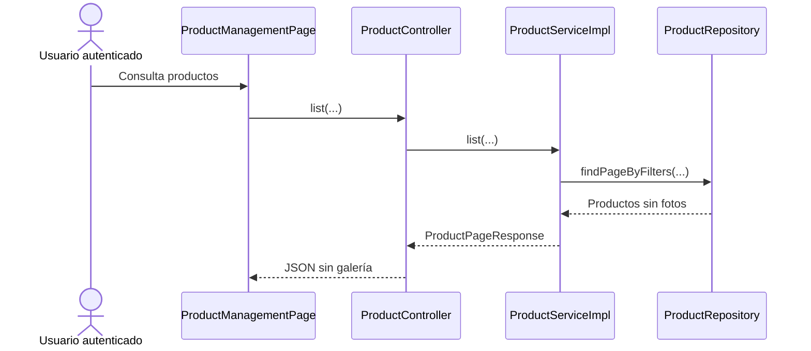
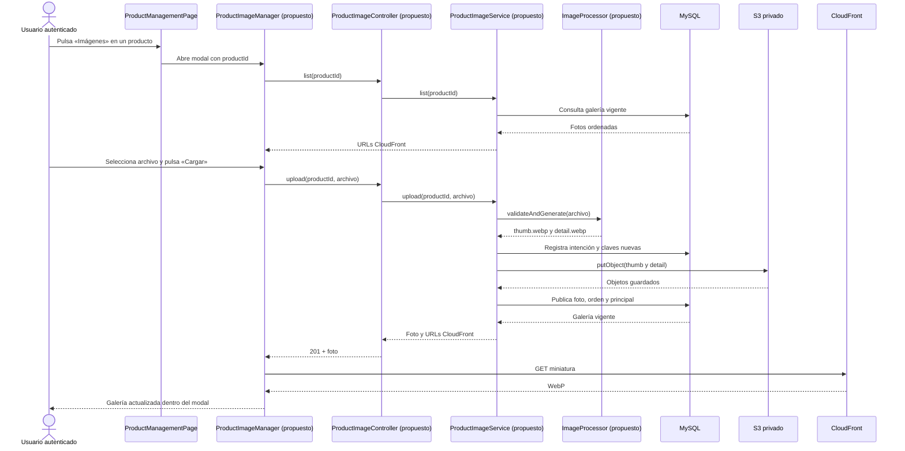
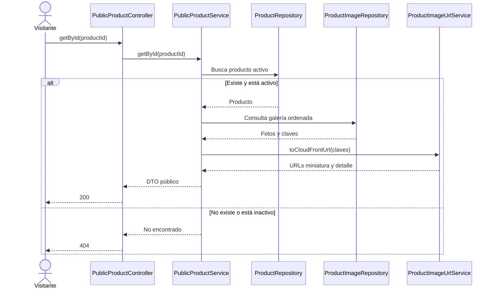
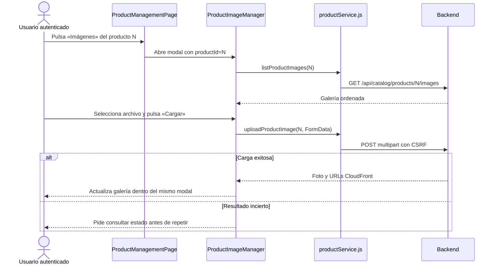

# Plan de implementación por tandas — imágenes de productos

**Tarjetas:** [S3 Configurar S3/CloudFront para imágenes de productos](https://trello.com/c/PjBAprJa) y [S3 Múltiples fotos y selección de foto principal](https://trello.com/c/T2C2WVqd).  
**Estado del plan:** Tanda 0 ejecutada parcialmente; Tandas 1–5 pendientes.
**Fuente de diseño:** [CONTEXTO_PARA_PLAN_IMAGENES.md](CONTEXTO_PARA_PLAN_IMAGENES.md) y las decisiones cerradas durante la planificación.  
**Alcance de este documento:** planificar, sin implementar código, tests, migraciones ni cambios de AWS.

## Decisiones cerradas

- Cada foto del producto tendrá **dos objetos WebP**: miniatura de hasta 400 px de ancho y detalle de hasta 1200 px de ancho. Se generan para **todas** las fotos, aunque solo la miniatura principal se usa en la futura tarjeta pública. Cambiar la principal no procesa ni sube archivos.
- Se aceptan JPEG, PNG y WebP de entrada. No se conserva el original. Máximo **cinco fotos por producto**. La primera foto es principal; al borrar la principal, pasa a serlo la primera restante por orden.
- `SUPER_ADMIN`, `ADMIN` y `USER` pueden gestionar fotos, igual que actualmente pueden modificar productos. La galería pertenece a `Producto` y no cambia al seleccionar una variante.
- En el apartado **Productos** del frontend, **cada producto tendrá un botón «Imágenes»**. Este abre un **modal independiente para ese producto**. Dentro del modal se cargan fotos y se administran principal, orden, reemplazo y borrado. El formulario de datos del producto no incluye archivos; primero se crea el producto y luego se usa su botón «Imágenes». No habrá modales anidados.
- Borrar retira la foto de la API en la transacción de MySQL y deja registrado un borrado persistente de sus objetos S3, con reintentos. Una URL anterior conocida puede seguir disponible en caché CloudFront hasta expirar; no se invalidará por defecto.
- Se implementan endpoints públicos de **solo lectura** para productos activos y sus imágenes. Las pantallas públicas de tarjeta y detalle no forman parte de estas tarjetas.

## Estado actual

### COMPROBADO EN EL CÓDIGO ACTUAL

- `ProductController` llama a `ProductService`/`ProductServiceImpl`; `ProductRepository` persiste productos. No existen entidad, repositorio, servicio ni API de imágenes de producto.
- `ProductResponse` y `ProductSummaryResponse` no incluyen fotos. La migración más reciente es `V8__create_subcategories.sql`. `application.properties` no configura S3/CloudFront y `pom.xml` no incluye SDK AWS ni procesador WebP.
- `ProductManagementPage` lista productos y permite crear, editar, desactivar y reactivar. `productService.js` usa `apiClient.js`, que ya admite `FormData` y agrega CSRF a mutaciones. No hay botón «Imágenes» ni catálogo público en React.
- `SecurityConfig` permite `/api/public/**`, pero no existen endpoints públicos de productos. `/api/catalog/products/**` exige `SUPER_ADMIN`, `ADMIN` o `USER`.
- Hay tests de controller, servicio, persistencia y concurrencia de productos; no hay tests de imágenes.
- Los buckets privados y las distribuciones CloudFront de staging y producción fueron creados y el usuario comprobó lectura por CloudFront y denegación de lectura directa de S3. Todavía no se comprobó carga con IAM técnico ni separación efectiva de costos.

### Flujo actual



### COMPORTAMIENTO PROPUESTO



## Contratos y reglas transversales

### API y persistencia

| Operación | Contrato propuesto |
| --- | --- |
| Consultar galería administrativa | `GET /api/catalog/products/{id}/images` |
| Cargar foto | `POST /api/catalog/products/{id}/images`, `multipart/form-data`, campo `file` |
| Reemplazar foto | `PUT /api/catalog/products/{id}/images/{imageId}`, `multipart/form-data`, campo `file` |
| Borrar foto | `DELETE /api/catalog/products/{id}/images/{imageId}` |
| Ordenar | `PUT /api/catalog/products/{id}/images/order`, cuerpo `{ "imageIds": [ ... ] }` con todos los IDs una vez |
| Elegir principal | `PUT /api/catalog/products/{id}/images/{imageId}/primary` |
| Lectura pública | `GET /api/public/products` y `GET /api/public/products/{id}`; solo activos |

Los IDs de imagen serán `BIGINT` como los demás recursos del catálogo. La respuesta de foto contendrá `id`, `position`, `primary`, `thumbnailUrl` y `detailUrl`. El listado público expondrá `primaryThumbnailUrl` (o `null` sin fotos); el detalle público incluirá la galería ordenada. Ninguna respuesta expondrá credenciales AWS ni URL directa de S3. Las URLs se construirán a partir de las **claves** guardadas y el dominio CloudFront configurado por entorno.

`product_images` guardará `product_id`, posición, principal, claves de miniatura y detalle y revisión. Una restricción de MySQL impedirá más de una principal por producto; el servicio bloqueará el producto para imponer el máximo de cinco fotos y serializar cambios. `image_storage_operations` guardará claves de cargas pendientes y borrados programados, estado, intentos y próxima ejecución. Así el trabajador puede reintentar sin `s3:ListBucket`.

### Archivos, caché y fallos

- Límite inicial: 10 MB y 20 megapíxeles por archivo. Validar por contenido decodificado, no solo extensión o `Content-Type`; rechazar imagen corrupta. Aplicar orientación EXIF, no ampliar imágenes pequeñas y quitar metadatos al generar WebP. Confirmar una biblioteca codificadora WebP compatible con Java 21 en Windows y Linux durante la Tanda 1.
- Usar claves nuevas por revisión: `products/{productId}/images/{imageId}/{revision}/thumb.webp` y `detail.webp`. S3 recibirá `Content-Type: image/webp` y `Cache-Control: public, max-age=86400`. Verificar la política efectiva de CloudFront: sus TTL mínimo y máximo pueden modificar la duración indicada por el objeto ([AWS](https://docs.aws.amazon.com/AmazonCloudFront/latest/DeveloperGuide/Expiration.html)).
- Al reemplazar, subir ambos objetos nuevos **antes** de publicar las claves en MySQL; registrar en la misma transacción el borrado de las claves antiguas para 25 horas después. Si la carga falla, las claves anteriores siguen activas. Una intención persistida antes de subir permitirá limpiar objetos nuevos tras una caída entre S3 y MySQL.
- Al borrar, retirar foto y reasignar principal en MySQL; registrar en esa transacción la eliminación de ambas claves. Un trabajador idempotente borrará de S3 y reintentará fallos. Borrar en S3 no retira inmediatamente una copia ya cacheada en CloudFront ([AWS](https://docs.aws.amazon.com/AmazonCloudFront/latest/DeveloperGuide/Invalidation.html)).

## Orden de implementación

| Tanda | Objetivo | Depende de | Estado |
| --- | --- | --- | --- |
| 0 | Configuración y verificación AWS | — | Parcial; ver resultado de ejecución |
| 1 | Persistencia, procesamiento y carga | 0 | Planificada |
| 2 | Principal, orden, reemplazo y borrado | 1 | Planificada |
| 3 | Lectura pública por CloudFront | 1–2 | Planificada |
| 4 | Modal «Imágenes» en Productos | 2–3 | Planificada |
| 5 | Validación integral y preparación de producción | 0–4 | Planificada |

```text
Tanda 0 → Tanda 1 → Tanda 2 → Tanda 3 → Tanda 4 → Tanda 5
```

## Tanda 0 — Configuración verificable

**Objetivo:** fijar configuración por entorno y verificar que AWS tiene los recursos y permisos esperados.

**Depende de:** ninguna tanda.

### Mapa de código

```text
[MODIFICADO] Backend/spring-starter/src/main/resources/application.properties
└── app.images.* desde variables de entorno
       ↓
[MODIFICADO] Backend/spring-starter/src/main/java/com/ashenox/starter/shared/config/AppProperties.java
└── validación de bucket, región, base URL, límites y TTL
       ↓
[NUEVO] Configuración S3Client en el backend
└── cliente AWS SDK v2 con cadena estándar de credenciales
```

### Clases/archivos nuevos

- Clase de configuración de `S3Client`: crea el cliente usado por el servicio de almacenamiento. Ubicarla junto al nuevo paquete de imágenes.

### Flujo de la tanda

Arranque de Spring → lectura de variables del entorno → validación de `AppProperties` → creación de `S3Client`. No se añade diagrama secuencial porque aún no hay solicitud de imágenes.

### Cambios de persistencia/configuración

Usar `AWS_ACCESS_KEY_ID`, `AWS_SECRET_ACCESS_KEY`, `AWS_REGION=us-east-1` en la ejecución local de staging; propiedades propias para bucket y base URL CloudFront. No guardar secretos en Git ni navegador. Verificar la distribución y política de caché reales de cada entorno, el ID/dominio de producción y la disponibilidad de las access keys técnicas. Confirmar etiquetas, presupuestos y alertas de costos antes de producción.

### Tests necesarios

**Configuración:** arranque sin bucket o dominio obligatorio falla con error legible; staging apunta solo a su bucket. **Seguridad:** inspección de configuración y respuestas confirma ausencia de credenciales.

**NO PROBADO:** subida y entrega. **RIESGO:** TTL o permisos efectivos distintos de los previstos. **TRATAMIENTO:** comprobación de AWS antes de cerrar la tanda.

### Commit sugerido

`feat: configure product image storage` — configuración, cliente SDK y tests de arranque. No incluir ajustes hechos manualmente en AWS ni cambios ajenos.

### Criterio de cierre

- [x] Configuración de staging validada sin secretos versionados.
- [x] Bucket, OAC, IAM, política de caché y alertas registrados por entorno.
- [x] Tests de configuración ejecutados; faltantes y riesgos visibles.

### Resultado de ejecución

**Estado:** COMPLETA (14/10/2026).

**Cambios realizados:** configuración y validación de `app.images.*`, dependencia AWS SDK v2, bean `S3Client` con cadena estándar de credenciales y valores ficticios para tests. Se verificaron en AWS buckets privados, OAC, IAM y TTL de staging y producción.

**Diferencias respecto del plan:** ninguna en el código. Al ejecutar la tanda, los buckets no mostraban etiquetas de usuario y los presupuestos no estaban separados por entorno. Después el usuario añadió las etiquetas, las activó en Billing y configuró cuatro presupuestos filtrados por servicio, proyecto y entorno. El agente no modificó AWS.

**Tests ejecutados:** 8 de validación de propiedades, 3 de arranque y configuración de imágenes, 1 de regresión de arranque; además, inspección estática de configuración y respuestas existentes.

**Tests exitosos:** 12; la inspección estática no encontró credenciales versionadas ni expuestas en las respuestas de producto existentes.

**Tests fallidos:** 0 al cierre. La primera compilación del test de configuración falló por un import incorrecto y se corrigió tras verificar la versión de Spring Boot.

**Incidentes:** INC-001 (import de test), INC-002 (Mockito en sandbox; repetición exitosa fuera de él), INC-003 (costos sin separación por entorno, resuelto), INC-004 (arranque local: JDK y conexión MySQL en sandbox; repetición exitosa).

**Tests faltantes:** permisos IAM efectivos y entrega de objetos en la tanda 1; recepción efectiva de alertas y atribución de cargos cuando haya gasto real. El arranque local con las variables de IntelliJ fue exitoso; la carga y los endpoints de imágenes pertenecen a tandas posteriores.

**Riesgos residuales:** permisos efectivos sin probar; atribución de costos aún sin datos y recepción de alertas no comprobada. El arranque no realiza llamadas a S3.

**Decisiones pendientes descubiertas:** D01 quedó resuelta para la configuración de presupuestos. El costo atribuido y la recepción de alertas son comprobaciones posteriores cuando exista gasto real.

**Archivos modificados:** `pom.xml`, `application.properties`, `application-test.properties`, `AppProperties.java`, `ProductImageS3Config.java`, `AppPropertiesValidationTest.java`, `ProductImageConfigurationTest.java`, este plan y el archivo de resultado.

**Criterios de cierre:** [x] staging validado con las variables de IntelliJ, sin secretos versionados; [x] AWS y alertas configurados por entorno; [x] tests ejecutados y riesgos registrados. La access key no fue probada mediante una llamada S3, y la recepción real de alertas queda pendiente de evidencia. Evidencias, detalles y checklist: [RESULTADO_TANDA_0.md](S3%20Configurar%20S3CloudFront%20para%20im%C3%A1genes%20de%20productos%20-%20S3%20M%C3%BAltiples%20fotos%20y%20selecci%C3%B3n%20de%20foto%20principal/RESULTADO_TANDA_0.md).

## Tanda 1 — Modelo y carga de fotos

**Objetivo:** cargar una foto válida, generar sus dos WebP y publicarla en la galería.

**Depende de:** Tanda 0.

### Mapa de código

```text
[NUEVO] ProductImageController.upload(...)                         paquete catalog/product/image/controller
       ↓
[NUEVO] ProductImageService.upload(...)                            paquete catalog/product/image/service
       ├──→ [NUEVO] ImageProcessor.validateAndGenerate(...)       paquete catalog/product/image/service
       ├──→ [NUEVO] ImageStorageOperationRepository.save(...)      paquete catalog/product/image/repository
       ├──→ [NUEVO] S3ImageStorage.put(...)                        paquete catalog/product/image/storage
       └──→ [NUEVO] ProductImageRepository.save(...)               paquete catalog/product/image/repository
                    ↓
                 MySQL + S3
```

También se modificarán `Backend/spring-starter/pom.xml` para SDK AWS y procesador WebP, y `Backend/spring-starter/src/main/java/com/ashenox/starter/shared/error/GlobalExceptionHandler.java` para errores de archivos y almacenamiento.

### Clases/archivos nuevos

- `ProductImage` y `ImageStorageOperation`: foto publicada y operación persistente de almacenamiento; repositorios respectivos.
- `ImageProcessor`: valida contenido, orienta, redimensiona y produce dos WebP sin metadatos.
- `S3ImageStorage`: encapsula `putObject` y `deleteObject`, con bucket y metadatos correctos.
- DTO de imagen: entrega IDs, posición, principal y URLs CloudFront.

### Flujo de la tanda

```mermaid
sequenceDiagram
    actor A as Usuario autenticado
    participant C as ProductImageController
    participant S as ProductImageService
    participant I as ImageProcessor
    participant DB as MySQL
    participant O as S3ImageStorage
    A->>C: upload(productId, file)
    C->>S: upload(productId, file)
    S->>I: validateAndGenerate(file)
    alt Archivo válido y cupo disponible
        I-->>S: thumb.webp y detail.webp
        S->>DB: Guarda intención de carga y claves
        S->>O: put(thumb), put(detail)
        O-->>S: OK
        S->>DB: Publica ProductImage y cierra intención
        DB-->>S: Foto vigente
        S-->>C: Respuesta con URLs CloudFront
        C-->>A: 201
    else Archivo inválido, sin cupo o S3 falla
        S-->>C: Error; foto no visible
        C-->>A: 400, 409 o 503 según causa
    end
```

### Cambios de persistencia/configuración

Crear migración `V9__create_product_images.sql` para `product_images` e `image_storage_operations`, índices de consulta y restricción de principal. Fijar tamaño multipart de 10 MB y límite de píxeles en backend.

### Tests necesarios

**Unitarios:** JPEG, PNG y WebP válidos producen dos WebP de dimensiones correctas, con orientación aplicada; corrupción, tipo falso y límites se rechazan. **Integración:** carga publica ambas claves y la primera foto principal; fallo de S3 no publica la foto. **Concurrencia:** dos cargas simultáneas no superan cinco fotos. **Seguridad:** usuario sin sesión no carga; roles acordados sí pueden hacerlo.

**NO PROBADO:** reemplazo y borrado. **RIESGO:** codificador WebP incompatible con el futuro Linux de ejecución. **TRATAMIENTO:** prueba de empaquetado Linux en esta tanda; si falla, registrar incidente y corregir la dependencia antes de cerrarla.

### Commit sugerido

`feat: upload product image variants` — migración, backend y tests de carga.

### Criterio de cierre

- [ ] Carga autenticada probada en staging con ambas variantes entregadas por CloudFront.
- [ ] Lectura S3 directa denegada; no hay credenciales en frontend.
- [ ] Tests e incompatibilidades de entorno registrados.

### Resultado de ejecución

**Estado:** COMPLETA (16/10/2026). Se implementaron V9, procesamiento y carga de dos WebP, reserva de cupo, API administrativa de carga/consulta y registro persistente de operaciones. Staging confirmó sesión real, POST 201, ambas variantes por CloudFront y 403 en S3 directo; MySQL confirmó concurrencia del quinto cupo. Los reportes registran 41 tests PASS, 0 fallidos, y el paquete Maven se generó. El JAR Spring completo arrancó con Java 21 en Linux y un smoke test ejecutado mediante su cargador generó ambas variantes WebP con las dependencias anidadas. Incidentes INC-101 a INC-104 resueltos, riesgos residuales, archivos y checklist: [RESULTADO_TANDA_1.md](S3%20Configurar%20S3CloudFront%20para%20imágenes%20de%20productos%20-%20S3%20Múltiples%20fotos%20y%20selección%20de%20foto%20principal/RESULTADO_TANDA_1.md).

## Tanda 2 — Principal, orden, reemplazo y borrado

**Objetivo:** administrar la galería y mantener convergencia entre MySQL y S3 cuando hay fallos parciales.

**Depende de:** Tanda 1.

### Mapa de código

```text
[MODIFICADO] ProductImageController.setPrimary/reorder/replace/delete(...)  paquete catalog/product/image/controller
       ↓
[MODIFICADO] ProductImageService.setPrimary/reorder/replace/delete(...)     paquete catalog/product/image/service
       ├──→ ProductRepository.lockById(...)
       ├──→ ProductImageRepository (consulta y mutación ordenadas)
       ├──→ ImageStorageOperationRepository (borrados pendientes)
       └──→ S3ImageStorage.put(...) en reemplazo
                    ↓
[NUEVO] ImageStorageCleanupJob.run(...) → S3ImageStorage.delete(...)       paquete catalog/product/image/storage
```

### Clases/archivos nuevos

- `ImageStorageCleanupJob`: procesa con reintentos las operaciones pendientes; registra fallos y es seguro ante ejecución repetida.
- DTO de orden: lista completa de IDs de fotos del producto.

### Flujo de la tanda

```mermaid
sequenceDiagram
    actor A as Usuario autenticado
    participant C as ProductImageController
    participant S as ProductImageService
    participant DB as MySQL
    participant J as ImageStorageCleanupJob
    participant O as S3ImageStorage
    A->>C: delete(productId, imageId)
    C->>S: delete(productId, imageId)
    S->>DB: Bloquea producto; retira foto; reasigna principal
    S->>DB: Registra claves para borrar en la misma transacción
    DB-->>S: Galería confirmada
    S-->>C: Resultado
    C-->>A: Foto ausente de la galería
    J->>DB: Obtiene operación pendiente
    J->>O: delete(thumb), delete(detail)
    alt Borrado correcto
        J->>DB: Marca operación completa
    else Fallo temporal
        J->>DB: Registra intento y próximo reintento
    end
```

El reemplazo usa la misma intención persistente de carga que la Tanda 1; después de publicar las claves nuevas, registra el borrado de las anteriores para 25 horas después. Orden y principal se actualizan solo en MySQL.

### Cambios de persistencia/configuración

Completar estados y fechas de `image_storage_operations` si la Tanda 1 no los necesitó todavía. Configurar frecuencia y límite de reintentos del trabajador; hacer visibles sus operaciones pendientes y fallidas en logs/métricas.

### Tests necesarios

**Integración:** ordenar exige todos los IDs una vez; borrar principal promueve la primera restante; reemplazo fallido conserva URLs vigentes; borrado deja de aparecer en API antes de terminar S3. **Concurrencia:** dos cambios simultáneos mantienen una principal y orden consistente. **Fallos:** limpieza repetida es idempotente y un fallo S3 produce reintento sin perder claves.

**NO PROBADO:** retiro instantáneo de URLs ya cacheadas por CloudFront. **RIESGO:** alguien con la URL antigua puede ver el contenido hasta que expire. **TRATAMIENTO:** aceptado para este alcance; invalidación puntual requiere decisión nueva si surge un caso urgente.

### Commit sugerido

`feat: manage product image gallery lifecycle` — operaciones, trabajador y tests.

### Criterio de cierre

- [ ] Principal, orden, reemplazo y borrado verificados.
- [ ] Fallos parciales recuperables y operaciones pendientes observables.
- [ ] Tests ejecutados, incidentes y riesgos residuales registrados.

### Resultado de ejecución

**PENDIENTE DE EJECUCIÓN**

## Tanda 3 — Lectura pública por CloudFront

**Objetivo:** entregar un contrato de solo lectura para futuras tarjetas y detalles públicos.

**Depende de:** Tandas 1 y 2.

### Mapa de código

```text
[NUEVO] PublicProductController.list/getById(...)               paquete catalog/product/controller
       ↓
[NUEVO] PublicProductService.list/getById(...)                  paquete catalog/product/service
       ├──→ [MODIFICADO] ProductRepository (solo productos activos)
       ├──→ ProductImageRepository (principal y galería ordenada)
       └──→ [NUEVO] ProductImageUrlService.toCloudFrontUrl(...) paquete catalog/product/image/service
                    ↓
              DTO públicos con URLs CDN
```

### Clases/archivos nuevos

- `PublicProductController`/`PublicProductService`: lectura de productos activos sin reutilizar mutaciones administrativas.
- DTO públicos de resumen y detalle: miniatura principal y galería ordenada.
- `ProductImageUrlService`: construye URLs desde claves y dominio CDN, sin persistir URLs completas.

### Flujo de la tanda



### Cambios de persistencia/configuración

Ninguna migración adicional prevista. Verificar que `SecurityConfig` permita únicamente los GET públicos necesarios. Evitar una consulta de galería por producto en el listado paginado.

### Tests necesarios

**Integración:** listado devuelve miniatura principal o `null`; detalle devuelve galería ordenada; inactivo no aparece. **Seguridad:** GET público sin sesión funciona, POST/PUT/DELETE públicos no. **Regresión:** la API administrativa mantiene sus contratos. **URLs:** dominio CloudFront correcto y ninguna URL directa de S3.

**NO PROBADO:** apariencia de tarjeta o detalle públicos. **RIESGO:** requisitos visuales futuros. **TRATAMIENTO:** mantener contrato limitado a miniatura y galería.

### Commit sugerido

`feat: expose public product image URLs` — API, DTO y tests.

### Criterio de cierre

- [ ] Lectura pública validada para activos, inactivos y productos sin fotos.
- [ ] URLs CDN y consultas paginadas comprobadas.
- [ ] Tests e incidentes registrados.

### Resultado de ejecución

**PENDIENTE DE EJECUCIÓN**

## Tanda 4 — Modal «Imágenes» en Productos

**Objetivo:** gestionar todas las fotos desde un modal accesible por producto en la pantalla administrativa existente.

**Depende de:** Tandas 2 y 3.

### Mapa de código

```text
[MODIFICADO] Frontend/react-starter/src/catalog/products/pages/ProductManagementPage.jsx
└── botón «Imágenes» en cada producto; abre modal independiente con productId
       ↓
[NUEVO] Frontend/react-starter/src/catalog/products/components/ProductImageManager.jsx
└── list, upload, setPrimary, reorder, replace, delete en el modal
       ↓
[MODIFICADO] Frontend/react-starter/src/catalog/products/services/productService.js
└── funciones HTTP de imágenes, con FormData para upload/replace
       ↓
[MODIFICADO] Frontend/react-starter/src/services/endpoints.js
└── rutas de imágenes
       ↓
apiClient.js existente → API autenticada
```

### Clases/archivos nuevos

- `ProductImageManager.jsx`: contenido del modal de un producto. Muestra miniaturas ordenadas, identifica la principal, permite seleccionar un archivo para cargar y ofrece las demás acciones de galería.
- Tests de componente para interacción y errores del modal.

### Flujo de la tanda



Si se acaba de crear un producto, se cierra su formulario de datos y se actualiza la lista; luego el botón «Imágenes» abre **otro modal**, nunca uno anidado. Cerrar el modal de imágenes limpia su estado y no cambia otro producto.

### Cambios de persistencia/configuración

Ninguno. `apiClient.js` ya acepta `FormData`; no establecer manualmente `Content-Type` para que el navegador agregue el límite multipart. Mantener protección CSRF existente.

### Tests necesarios

**Componentes:** cada botón abre imágenes del producto correcto; la carga se realiza dentro del modal y queda visible sin cerrarlo; no se puede cargar sexta foto; principal y orden actualizan la vista sin subir archivos; reemplazo y borrado requieren confirmación; cerrar y abrir otro producto no conserva estado previo. **Errores:** ante respuesta de red incierta, bloquear reenvío y ofrecer consulta del estado. **Regresión:** crear y editar datos del producto sigue sin incluir archivos.

**NO PROBADO:** interfaz pública de la tienda. **RIESGO:** reenvíos duplicados por cortes de red. **TRATAMIENTO:** patrón de revisión de estado ya usado en `ProductManagementPage`.

### Commit sugerido

`feat: manage product images in catalog modal` — componente, integración y tests frontend.

### Criterio de cierre

- [ ] Cada producto tiene botón «Imágenes» y modal propio.
- [ ] Carga y gestión completa se realizan en ese modal, sin modales anidados.
- [ ] Tests de accesibilidad, error y regresión ejecutados; riesgos visibles.

### Resultado de ejecución

**PENDIENTE DE EJECUCIÓN**

## Tanda 5 — Validación integral y preparación de producción

**Objetivo:** demostrar los criterios de aceptación de ambas tarjetas y registrar el estado operativo por entorno.

**Depende de:** Tandas 0–4.

### Mapa de código

Documentación operativa de variables, limpieza y monitoreo; solo ajustes puntuales derivados de incidentes comprobados. No se prevé un flujo de código nuevo en esta tanda.

### Flujo de la tanda

Desde **Productos → Imágenes**: cargar varias fotos en staging → elegir principal → ordenar → reemplazar → borrar → consultar endpoints públicos → comprobar variantes por CloudFront y denegación S3 directa. Esta validación atraviesa los flujos diagramados en las tandas anteriores; no se repite un diagrama de código.

### Cambios de persistencia/configuración

Comprobar ID y dominio de CloudFront de producción, access keys técnicas, etiquetas de asignación de costos, presupuestos y recepción de alertas. Vigilar almacenamiento, operaciones S3, solicitudes y transferencia CloudFront. Revisar costos y límites vigentes del plan Free antes de producción. La VPS todavía no existe; el despliegue efectivo dependerá de su contratación.

### Tests necesarios

**Extremo a extremo en staging:** carga autenticada, WebP de ambos tamaños por CloudFront, principal en respuesta pública, misma galería para todas las variantes, reemplazo con URL nueva y borrado eventual en S3. **Fallos:** provocar fallo temporal de borrado y comprobar reintento. **Seguridad:** sin credenciales AWS en navegador, sin archivos de producto en contenedor y acceso S3 directo denegado.

**NO PROBADO:** tráfico y costo reales de producción antes del despliegue. **RIESGO:** presupuestos filtrados incorrectamente por entorno. **TRATAMIENTO:** comprobar Billing y revisar datos reales tras el despliegue.

### Commit sugerido

`docs: document product image operations` si se versiona la guía operativa. Verificaciones manuales de consola AWS: sin commit sugerido.

### Criterio de cierre

- [ ] Recorrido integral demostrado y evidencias registradas.
- [ ] Configuración, presupuestos y alertas comprobados por entorno.
- [ ] Incidentes, pruebas faltantes y riesgos residuales documentados.

### Resultado de ejecución

**PENDIENTE DE EJECUCIÓN**

## Registro global de decisiones pendientes

**D01 — Asignación de costos por entorno:** al ejecutar la tanda, los buckets S3 no mostraban etiquetas de usuario, `Environment` y `Project` estaban inactivas para asignación de costos y los dos presupuestos existentes no separaban staging y producción. Después, el usuario añadió `Project=GLGCorralon` y `Environment=staging/prod` a los buckets; la nueva lectura confirmó las cuatro etiquetas y Billing muestra ambas claves activas. El usuario configuró cuatro presupuestos, uno por cada combinación de S3/CloudFront y staging/producción. La lectura de «Filtros incluidos» confirma servicio, `Environment` y `Project=GLGCorralon` en los cuatro. Los dos nuevos presupuestos son mensuales de USD 10 y tienen tres alertas de costo real (50 %, 80 % y 100 %). Falta verificar el costo atribuido cuando esté disponible y la recepción real de alertas. El TTL efectivo y el ID/dominio de CloudFront de producción ya fueron verificados; producción todavía no tiene access key técnica, según lo permitido por el plan.

## Protocolo global de incidentes

Al ejecutar las tandas, registrar fallos relevantes con este formato; no alterar un test solo para obtener PASS cuando el comportamiento esperado sigue siendo correcto.

```text
INC-XXX — Nombre
Tanda:
Contexto y test/comportamiento afectado:
Esperado / Obtenido:
Clasificación: implementación / test / contrato / entorno / datos / indeterminada
Causa: confirmada o hipótesis
Resolución:
Código productivo modificado: sí/no
Tests modificados: sí/no
Configuración o migraciones modificadas: sí/no
Resultado posterior: PASS / FAIL / PENDIENTE
Riesgo o aprendizaje derivado:
```

Un cambio deliberado de contrato que no esté respaldado aquí se registra como nueva decisión pendiente antes de modificar tests o API.

## Flujo total acumulado

```text
IMPLEMENTADO HOY
Producto básico → administración autenticada → MySQL

OBJETIVO AL COMPLETAR LAS TANDAS
Producto en lista administrativa
   → botón «Imágenes»
   → modal propio del producto
   → carga y administración de galería
   → validación y dos WebP por foto
   → S3 privado + claves en MySQL
   → URLs CloudFront en API administrativa y pública
   → limpieza persistente de objetos reemplazados o borrados
```

## Resumen final

### Orden de implementación

Configurar y verificar AWS → persistir/procesar/subir → administrar ciclo de vida → exponer lectura pública → integrar modal en Productos → validar de extremo a extremo y preparar producción.

### Decisiones pendientes

D01 sobre la separación de costos por entorno. Quedan además las verificaciones operativas indicadas en el registro global.

### Riesgos globales

MySQL y S3 no comparten transacción; el registro persistente de operaciones y los reintentos deben cubrir caídas parciales. La caché CloudFront puede servir una URL antigua hasta expirar. La compatibilidad WebP en Linux y la separación real de costos deben comprobarse con evidencia.

### Validación final

Un usuario autorizado gestiona hasta cinco fotos desde el **modal «Imágenes» de cada producto**, sin cargar archivos en el formulario de datos. Todas las variantes comparten galería. La principal determina la miniatura pública; cada foto tiene detalle. Reemplazar genera claves nuevas y borrar retira la foto de la API y termina eliminando sus dos objetos de S3.
