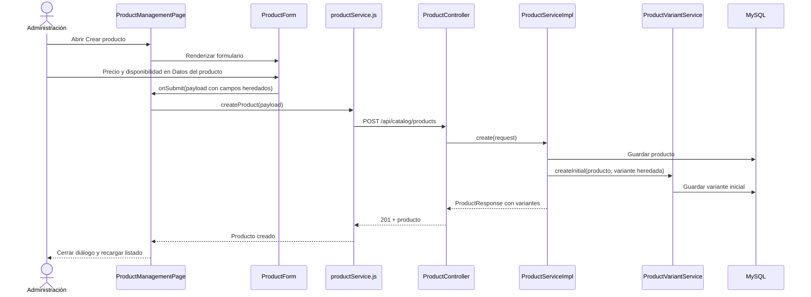
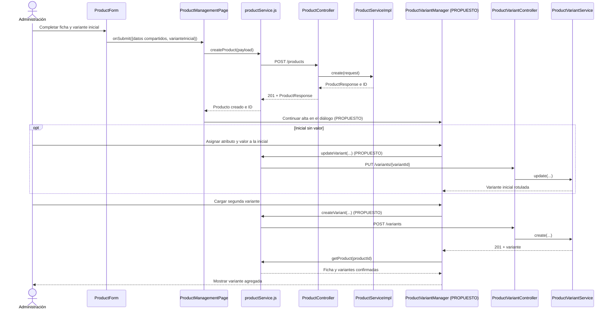

# S3 FE — Gestionar variantes de producto: plan de implementación

**Fuente funcional:** [S3 FE Gestionar variantes de producto](https://trello.com/c/m8FRqzpY/59-s3-fe-gestionar-variantes-de-producto) y acuerdos de esta planificación. **Dependencia implementada:** [S3 BE Variantes de producto](../S3%20BE%20Variantes%20de%20producto/s3-be-variantes-de-producto-plan-implementacion.md). **Diseño de referencia:** [modelo inicial](../../modelo-inicial.md). **Estado:** tanda 1 completa; tanda 2 planificada.

## Decisiones acordadas para esta tarjeta

| ID | Decisión |
| --- | --- |
| A01 | La administración de variantes vive dentro del diálogo de creación y edición del producto. Tras crear la ficha con su variante inicial, el mismo diálogo continúa abierto para agregar otras, una por operación. |
| A02 | Un producto con una sola variante puede no tener atributo ni valor diferenciador. Antes de agregar una segunda variante se asignan atributo y valor a la inicial. |
| A03 | En edición, los datos compartidos se guardan por separado; cada variante tiene sus propias acciones de guardar y de activar o desactivar. No se ofrece un guardado conjunto de varias mutaciones. |
| A04 | Por esta tarjeta, cada producto admite un único atributo variable reutilizable, elegido entre las características existentes. No se mezcla con características compartidas. Con varias variantes no se cambia ese atributo. |
| A05 | Las fotos son generales para el producto y no cambian al seleccionar una variante. El gestor actual de imágenes sigue siendo la vía de carga, incluso después del alta. |

El modelo inicial ejemplifica combinaciones de varios atributos variables; la tarjeta S3 y el backend vigente limitan esta entrega a **uno por producto**. Para necesitar Color y Capacidad variables a la vez, se crean fichas de producto separadas. La API compara valor **y unidad** normalizados, reserva también los valores de variantes inactivas, exige SKU único en todo el catálogo y no permite desactivar la última variante activa.

## COMPROBADO EN EL CÓDIGO ACTUAL

- `ProductManagementPage` abre un `ProductForm` en un diálogo; carga categorías, subcategorías, características y, al editar, `getProduct(...)`. `submitProduct(...)` llama a `createProduct(...)` o `updateProduct(...)`, cierra el diálogo tras el éxito y recarga el listado. La revisión actual de resultados inciertos recarga el listado, sin consultar el detalle de la ficha afectada.
- `ProductForm` presenta precio de referencia y disponibilidad en «Datos del producto» y los envía como campos superiores tanto en POST como en PUT. No lee `variantes`, no carga SKU ni gestiona estado de variantes. La sección «Características» corresponde a atributos compartidos.
- `productService.js` y `ENDPOINTS.CATALOG` no tienen operaciones ni rutas frontend para variantes. `apiRequest(...)` centraliza cookies y CSRF; los servicios de mutación de producto ya usan `retryAuth: false` y `retryCsrf: false`.
- `ProductController.create(...)` acepta `varianteInicial` **o** los campos heredados `precioReferencia`/`disponible`. `ProductServiceImpl.create(...)` crea la variante inicial en la misma transacción. El `ProductResponse` administrativo trae `varianteInicialId` y `variantes`; el listado también trae `variantes`. Los escalares administrativos de precio/disponibilidad representan la variante de menor ID, no una propiedad independiente de la ficha.
- `ProductController.update(...)` acepta datos compartidos sin precio/disponibilidad. `ProductServiceImpl.update(...)` rechaza esos campos heredados si hay más de una variante. `ProductVariantController` ofrece GET/POST en `/api/catalog/products/{productId}/variants`, PUT por ID y POST de desactivación/reactivación. `ProductVariantService` valida atributo único, duplicados, SKU y última activa. Las rutas requieren roles de catálogo y las mutaciones CSRF.
- Ya existen pruebas de `ProductForm`, `ProductManagementPage` y `productService` para el flujo anterior, además de pruebas backend del contrato de variantes. El resultado de S3 BE registra una falla intermitente ajena a productos en la suite frontend global; una ejecución posterior deberá informarla según su resultado real.

## COMPORTAMIENTO PROPUESTO

El diálogo muestra datos compartidos, características compartidas y una sección de variantes claramente separada. En alta se capturan precio, disponibilidad, SKU opcional y, opcionalmente, atributo/valor/unidad de la variante inicial. El POST usa exclusivamente `varianteInicial`. La respuesta con ID permite seguir dentro del diálogo: si la inicial aún no tiene atributo, primero se le asigna; luego se agregan las demás variantes una a una.

En edición se muestran todas las variantes, incluidas las inactivas, con ID, valor, unidad, SKU, precio, disponibilidad y estado. Un guardado de datos compartidos nunca envía precio/disponibilidad superiores. Cada acción de variante usa su endpoint y después consulta el detalle confirmado. Las fotos se identifican como generales y su selección no depende de la variante; continúa el acceso al gestor de imágenes existente.

### Flujo actual



La edición sigue `ProductForm.submit(...)` → `ProductManagementPage.submitProduct(...)` → `productService.updateProduct(...)` → `ProductController.update(...)` → `ProductServiceImpl.update(...)`. Actualmente incluye precio/disponibilidad superiores; con varias variantes el backend responde conflicto.

### Flujo objetivo completo

Los métodos frontend identificados como **PROPUESTO** todavía no existen. Los métodos del controller y servicios backend ya están implementados.

```mermaid
sequenceDiagram
    actor A as Administración
    participant P as ProductManagementPage
    participant F as ProductForm
    participant VM as ProductVariantManager (PROPUESTO)
    participant S as productService.js
    participant PC as ProductController
    participant PS as ProductServiceImpl
    participant VC as ProductVariantController
    participant VS as ProductVariantService
    participant DB as MySQL
    A->>F: Completar producto y variante inicial
    F->>P: onSubmit(datos compartidos + varianteInicial)
    P->>S: createProduct(payload)
    S->>PC: POST /api/catalog/products
    PC->>PS: create(request)
    PS->>DB: Guardar ficha y variante inicial en una transacción
    PS-->>PC: ProductResponse con ID y variantes
    PC-->>P: 201 + ProductResponse
    P->>VM: Continuar en el mismo diálogo (PROPUESTO)
    opt Inicial sin atributo ni valor
        A->>VM: Asignar atributo y valor inicial
        VM->>S: updateVariant(productId, variantId, payload) (PROPUESTO)
        S->>VC: PUT /variants/{variantId}
        VC->>VS: update(productId, variantId, request)
        VS->>DB: Guardar valor de variante inicial
        VC-->>VM: Variante actualizada
    end
    A->>VM: Agregar otra variante
    VM->>S: createVariant(productId, payload) (PROPUESTO)
    S->>VC: POST /variants
    VC->>VS: create(productId, request)
    VS->>DB: Validar atributo y unicidad; guardar variante
    VC-->>VM: 201 + variante
    VM->>S: getProduct(productId)
    S->>PC: GET /api/catalog/products/{id}
    PC->>PS: getById(id)
    PS-->>VM: ProductResponse con todas las variantes
    VM-->>A: Mostrar estado confirmado y mantener diálogo abierto
```

En edición, `ProductManagementPage` consulta `getProduct(...)`; `ProductForm` guarda solo datos comunes mediante `updateProduct(...)`, y `ProductVariantManager` (propuesto) usa `updateVariant(...)`, `deactivateVariant(...)` o `reactivateVariant(...)` (propuestos) por fila. Los errores de validación o conflicto mantienen el diálogo y los datos visibles. Si no se puede confirmar una mutación por red o error de servidor, se bloquea repetirla hasta consultar `getProduct(productId)`; la lista paginada por sí sola no confirma el cambio de una variante.

## Orden de implementación

| Tanda | Objetivo | Depende de | Estado |
| --- | --- | --- | --- |
| 1 | Contrato frontend y alta gradual con variante inicial y continuación en el mismo diálogo | API S3 BE vigente | Completa |
| 2 | Edición de datos compartidos y gestión individual de variantes, estados, recarga y errores | Tanda 1 | Planificada |

```text
Tanda 1 → Tanda 2 → validación integral
```

La primera tanda necesita una gestión mínima de variantes para completar el alta gradual; la segunda reutiliza esa sección para editar y cambiar el estado de todas las variantes de una ficha existente.

---

## Tanda 1 — Contrato frontend y alta gradual

**Objetivo:** crear una ficha con `varianteInicial` y permitir asignar valor a la inicial y agregar más variantes sin abandonar el diálogo de alta.

**Depende de:** API S3 BE vigente y decisiones A01, A02 y A04.

### Mapa de código

```text
[MODIFICADO] ProductManagementPage
Frontend/react-starter/src/catalog/products/pages/ProductManagementPage.jsx
├── openForm(...) y submitProduct(...): alta, conserva ID/respuesta y continúa en el diálogo
└── refreshProduct(...) [PROPUESTO]: consulta detalle después de cada variante
        ↓
[MODIFICADO] ProductForm
Frontend/react-starter/src/catalog/products/components/ProductForm.jsx
└── submit(...): arma datos compartidos + varianteInicial; valida campos y exclusión de atributo compartido
        ↓
[NUEVO] ProductVariantManager
Frontend/react-starter/src/catalog/products/components/ProductVariantManager.jsx
└── acciones propuestas para asignar valor inicial y agregar variantes, con estado confirmado
        ↓
[MODIFICADO] productService.js y ENDPOINTS.CATALOG
Frontend/react-starter/src/catalog/products/services/productService.js
Frontend/react-starter/src/services/endpoints.js
└── createProduct(...), getProduct(...), createVariant(...) y updateVariant(...) [los dos últimos PROPUESTOS]
        ↓
[EXISTENTE] ProductController.create/getById y ProductVariantController.create/update
        ↓
[EXISTENTE] ProductServiceImpl.create/getById y ProductVariantService.create/update
        ↓
MySQL: products, product_variants, variant_characteristics
```

### Clases/archivos nuevos

- `ProductVariantManager.jsx` **[NUEVO]**: sección reutilizable dentro del diálogo; muestra la variante inicial y ofrece asignación de atributo/valor y alta de otra variante. Lo usan `ProductManagementPage` y, en la tanda 2, el flujo de edición.
- `ProductVariantManager.test.jsx` **[NUEVO]**: pruebas de sus acciones y validaciones propias. Los tests existentes de formulario, página y servicio se adaptan en sus archivos actuales.

### Flujo de la tanda



### Cambios de contratos externos

- POST producto: enviar `varianteInicial: { sku, precioReferencia, disponible, caracteristicaId, valor, unidad }` y **omitir** `precioReferencia` y `disponible` superiores. Si no hay atributo, enviar los tres campos de característica como `null`; precio y disponibilidad siguen siendo obligatorios. La UI no permite seleccionar como variable una característica compartida.
- Agregar rutas y funciones frontend para POST/PUT variantes. Las mutaciones siguen la política actual de `apiRequest`: cookies/CSRF, sin reintento automático de la operación.
- No hay cambios backend, de persistencia, migración, configuración ni variables de entorno.

### Tests necesarios

- **Formulario y página:** el alta monovariante sin atributo envía únicamente `varianteInicial`; una alta con Color/Rojo mantiene el diálogo abierto con el ID devuelto. Demuestra el nuevo contrato y la continuidad del flujo.
- **Interacción y servicio:** asignar Color a una inicial sin valor antes de agregar Blanco; agregar Blanco y Celeste de forma individual; verificar rutas, métodos, CSRF y ausencia de reenvío automático. Demuestra que el flujo gradual usa los endpoints ya existentes.
- **Resultado incierto:** si el POST de producto no devuelve respuesta confirmada, conservar el bloqueo de reenvío y exigir revisar el listado antes de intentar otra alta; si ya hay ID, consultar `getProduct(productId)` antes de repetir una mutación de variante. Demuestra que una pérdida de respuesta no dispara duplicaciones automáticas.
- **Validación:** bloquear segunda variante sin valor en la inicial, dos atributos variables, reutilizar Color como compartida, precio no positivo, valor/unidad repetidos normalizados y longitudes fuera de contrato. El servidor conserva la autoridad ante SKU global duplicado o carreras.
- **Regresión:** alta existente de productos simples, selección de categoría/subcategoría y características compartidas. Demuestra que la separación de la variante no altera esos datos.

### Qué NO queda probado

```text
NO PROBADO
- Edición y cambio de estado de variantes en una ficha ya existente; pertenecen a la tanda 2.
- Transacción única para ficha y variantes adicionales: la API solo hace atómica la ficha con su inicial.
RIESGO
- El usuario puede cerrar tras crear la ficha y antes de completar otras variantes; la ficha ya existe.
TRATAMIENTO
- Mostrar el ID/estado de creación y permitir completar luego desde Editar; no intentar deshacer automáticamente la ficha.
```

### Commit sugerido

`feat: integrar variante inicial y alta gradual en productos` — contrato/frontend, diálogo de alta, sección inicial de variantes y pruebas de esta tanda. No incluir edición general de variantes.

### Criterio de cierre

- [ ] Alta con `varianteInicial` y continuación en el mismo diálogo comprobadas.
- [ ] Inicial sin atributo y asignación previa a segunda variante comprobadas.
- [ ] Pruebas dirigidas, lint y build de frontend ejecutados; resultados informados.
- [ ] Tests faltantes, incidentes y riesgos residuales documentados.

### Resultado de ejecución

**Estado:** COMPLETA

**Cambios realizados:** el alta envía `varianteInicial` y continúa en el mismo diálogo con el ID confirmado. La sección nueva permite asignar atributo y valor a la variante inicial y agregar otras de a una; cada mutación se confirma mediante `getProduct(id)`. Se añadieron POST/PUT de variantes con CSRF y sin reenvío automático.

**Diferencias respecto del plan:** ninguna de alcance. La edición de datos compartidos y de variantes existentes permanece para la tanda 2. El registro detallado está en [resultado de la tanda 1](s3-fe-gestionar-variantes-de-producto-tanda-1-resultado.md).

**Tests ejecutados:** pruebas dirigidas de formulario, gestor, página y servicio; `npm test` completo y con `--maxWorkers=1`; `npm run lint`; `npm run build`. La prueba dirigida inicial terminó con 4 fallas por expectativas y respuestas simuladas del flujo anterior; tras contrastar el contrato se adaptaron. La primera suite completa terminó con 270/272 por fallas en MFA y categorías; ambos archivos pasaron aislados y una segunda suite completa terminó con 272/272. Tras agregar una prueba de límites, la suite concurrente tuvo 270/273; la ejecución final con un worker pasó 273/273.

**Tests exitosos:** 40/40 dirigidos antes de la última prueba agregada; 273/273 en la suite final con un worker; lint y build exitosos.

**Tests fallidos:** ninguno en la última ejecución. La suite concurrente sí tuvo fallas intermitentes ajenas a productos. Ver incidentes INC-001 e INC-002 en el registro detallado.

**Incidentes:** INC-001, pruebas heredadas del contrato de alta; INC-002, fallas intermitentes de la suite concurrente fuera del alcance de productos.

**Tests faltantes:** no se ejecutó un recorrido real de navegador con backend/MySQL ni validación en el entorno de destino. Las longitudes se verificaron por límites de los controles y validación del componente, sin un recorrido end to end que envíe un payload manipulado.

**Riesgos residuales:** la ficha queda creada aunque se cierre antes de agregar otras variantes; la edición de una ficha multivariante todavía puede recibir 409 por el formulario heredado hasta la tanda 2. Una lectura local no acredita despliegue ni compatibilidad del entorno remoto.

**Decisiones pendientes descubiertas:** ninguna.

**Archivos modificados:** `ProductForm.jsx` y su prueba, `ProductManagementPage.jsx` y su prueba, `productService.js` y su prueba, `endpoints.js`; nuevos `ProductVariantManager.jsx` y su prueba; este plan y el registro detallado de la tanda.

**Criterio de cierre:**

- [x] Alta con `varianteInicial` y continuación en el mismo diálogo comprobadas.
- [x] Inicial sin atributo y asignación previa a la segunda variante comprobadas.
- [x] Pruebas dirigidas, lint y build ejecutados; resultados informados.
- [x] Tests faltantes, incidentes y riesgos residuales documentados.

---

## Tanda 2 — Edición y estados de variantes dentro del producto

**Objetivo:** editar los datos compartidos y administrar cada variante y su estado desde el mismo diálogo, con lectura confirmada tras cada mutación.

**Depende de:** tanda 1 y decisiones A03–A05.

### Mapa de código

```text
[MODIFICADO] ProductManagementPage
Frontend/react-starter/src/catalog/products/pages/ProductManagementPage.jsx
├── openForm(...): carga getProduct(...) con variantes activas e inactivas
├── submitProduct(...): guarda solo datos compartidos sin precio/disponibilidad superiores
└── refreshProduct(...) [PROPUESTO]: revisa detalle tras mutaciones inciertas y actualiza listado
        ↓
[MODIFICADO] ProductForm
Frontend/react-starter/src/catalog/products/components/ProductForm.jsx
└── submit(...): PUT de ficha solo con campos compartidos; aviso sobre fotos generales
        ↓
[MODIFICADO] ProductVariantManager
Frontend/react-starter/src/catalog/products/components/ProductVariantManager.jsx
└── acciones propuestas por variante: guardar, crear, desactivar, reactivar y confirmar estado
        ↓
[MODIFICADO] productService.js y ENDPOINTS.CATALOG
Frontend/react-starter/src/catalog/products/services/productService.js
Frontend/react-starter/src/services/endpoints.js
└── updateProduct(...), getProduct(...), updateVariant(...), createVariant(...),
    deactivateVariant(...) y reactivateVariant(...) [últimas cuatro PROPUESTAS]
        ↓
[EXISTENTE] ProductController.update/getById y ProductVariantController.update/create/deactivate/reactivate
        ↓
[EXISTENTE] ProductServiceImpl.update/getById y ProductVariantService.update/create/setActive
        ↓
MySQL: products, product_characteristics, product_variants, variant_characteristics
```

### Clases/archivos nuevos

No se prevén clases nuevas: se extiende `ProductVariantManager` y se adaptan las pruebas existentes. Si una confirmación visual necesita un componente propio por accesibilidad, será una extracción interna de la misma tanda, sin cambiar el contrato.

### Flujo de la tanda

```mermaid
sequenceDiagram
    actor A as Administración
    participant P as ProductManagementPage
    participant F as ProductForm
    participant VM as ProductVariantManager (PROPUESTO)
    participant S as productService.js
    participant PC as ProductController
    participant PS as ProductServiceImpl
    participant VC as ProductVariantController
    participant VS as ProductVariantService
    A->>P: Abrir Editar producto
    P->>S: getProduct(productId)
    S->>PC: GET /products/{id}
    PC->>PS: getById(id)
    PS-->>P: Ficha + variantes y estados
    P->>F: Datos compartidos
    P->>VM: Variantes dentro del mismo diálogo
    opt Cambian datos compartidos
        F->>P: onSubmit(payload sin precio/disponibilidad superiores)
        P->>S: updateProduct(productId, payload)
        S->>PC: PUT /products/{id}
        PC->>PS: update(id, request)
        PS-->>P: ProductResponse actualizado
    end
    A->>VM: Guardar cambios de una variante
    VM->>S: updateVariant(productId, variantId, payload) (PROPUESTO)
    S->>VC: PUT /variants/{variantId}
    VC->>VS: update(productId, variantId, request)
    VS-->>VM: Variante actualizada
    VM->>S: getProduct(productId)
    S-->>VM: Estado confirmado de la ficha
    alt Desactivar o reactivar
        A->>VM: Confirmar transición
        VM->>S: deactivateVariant/reactivateVariant(...) (PROPUESTO)
        S->>VC: POST /variants/{variantId}/deactivate o reactivate
        VC->>VS: setActive(productId, variantId, estado)
        VS-->>VM: Estado aplicado; consultar detalle
    else Mutación rechazada o resultado incierto
        VM-->>A: Mostrar error; si es incierto, bloquear reenvío hasta consultar detalle
    end
```

### Cambios de contratos externos

- PUT de producto: enviar nombre, categoría, subcategoría, descripción y características compartidas; omitir siempre `precioReferencia` y `disponible` superiores. Los precios y la disponibilidad se editan por variante, incluso si solo hay una.
- PUT variante: enviar SKU opcional, precio, disponibilidad y su único atributo/valor/unidad. Las transiciones de `activo` usan endpoints propios. Tras éxito o revisión de resultado incierto, consultar `getProduct(productId)` y refrescar el listado administrativo.
- Las fotos siguen siendo del producto. Un texto en el diálogo explica que deben representar todas las opciones; la carga sigue en `ProductImageManager` existente.

### Tests necesarios

- **Página y formulario:** editar datos compartidos en producto multivariante sin campos heredados; conservar características compartidas y excluir el atributo variable. Demuestra que el PUT no recibe 409 por precio/disponibilidad.
- **Gestión de variantes:** mostrar activas e inactivas con ID, valor/unidad, SKU, precio y disponibilidad; editar solo una, agregar otra, desactivar y reactivar con confirmación y nueva lectura. Demuestra independencia de acciones y estado confirmado.
- **Reglas y errores:** rechazar duplicado de valor/unidad incluso si la otra variante está inactiva, cambio de atributo con varias variantes y desactivación de la última activa; mostrar el 409 del servidor sin perder el resto de la ficha. Ante red o 5xx, bloquear reenvío hasta leer el detalle. Demuestra el manejo de conflictos y resultados inciertos.
- **Servicio/seguridad:** verificar métodos, rutas, cookies, CSRF y que ninguna mutación de variante se repite automáticamente. Demuestra el contrato HTTP de la sección nueva.
- **Regresión e integración UI:** completar Rojo, Blanco y Celeste con precios/disponibilidades distintos; cambiar de variante mantiene las fotos generales. Ejecutar pruebas dirigidas, `npm test`, `npm run lint` y `npm run build`; si la suite global vuelve a fallar en MFA, registrar el resultado sin atribuirlo a esta tarjeta.

### Qué NO queda probado

```text
NO PROBADO
- Atomicidad entre guardar datos compartidos y varias variantes: son operaciones separadas por decisión A03.
- Despliegue o compatibilidad de un entorno remoto con la API S3 BE y las migraciones V10/V11.
RIESGO
- Una operación puede aplicarse en servidor aunque el navegador pierda la respuesta; repetirla sin revisar podría producir conflicto o un cambio involuntario.
TRATAMIENTO
- Bloquear el reenvío y consultar el detalle; validar el recorrido en navegador y en el entorno de destino antes del despliegue.
```

### Commit sugerido

`feat: gestionar variantes en la edición de productos` — UI de edición y estados, servicio/endpoints, manejo de resultados inciertos, textos de fotos y pruebas de esta tanda.

### Criterio de cierre

- [ ] Edición de ficha multivariante y acciones individuales comprobadas.
- [ ] Estados, conflictos y revisión del detalle tras resultado incierto comprobados.
- [ ] Recorrido integral de Rojo, Blanco y Celeste y galería general comprobado.
- [ ] Pruebas dirigidas, suite frontend, lint y build ejecutados; fallas y límites informados.
- [ ] Incidentes, tests faltantes y riesgos residuales documentados.

### Resultado de ejecución

**PENDIENTE DE EJECUCIÓN**

## Registro global de decisiones pendientes

No hay decisiones funcionales o arquitectónicas pendientes conocidas para planificar estas dos tandas. Si durante la ejecución aparece una nueva, registrarla como `DECISIÓN PENDIENTE — DXX`, indicar alternativas y consecuencia, y detener únicamente la parte afectada según `PROMPT_EJECUTAR_TANDA.md`.

## Protocolo global de incidentes

Ante un fallo relevante, registrar una sola entrada `INC-XXX` con: tanda, contexto, test/comportamiento afectado, esperado y obtenido, clasificación (implementación, test, contrato, entorno, datos o causa desconocida), causa confirmada o hipótesis, resolución, archivos productivos/tests/configuración modificados, resultado posterior y riesgo residual. No cambiar un test solo para hacerlo pasar; contrastar primero el contrato acordado. No comenzar la tanda siguiente hasta cerrar o declarar el estado de la actual.

## Flujo total acumulado

```text
IMPLEMENTADO ANTES DE ESTAS TANDAS
ProductManagementPage → ProductForm heredado → productService.createProduct/updateProduct
Backend: producto + variante inicial; API de variantes y lectura administrativa

OBJETIVO TRAS TANDA 1
ProductForm con varianteInicial → POST producto → mismo diálogo
    → asignar valor inicial, si faltaba → POST de variantes adicionales → GET detalle

OBJETIVO TRAS TANDA 2
Editar producto → PUT solo de datos compartidos
    → ProductVariantManager: guardar/agregar/activar/desactivar una variante
    → GET detalle confirmado → actualizar lista
    → fotos generales en ProductImageManager
```

## Orden de implementación

Completar y revisar tanda 1 antes de extender la misma sección en tanda 2. Cada una produce código y pruebas coherentes, y conserva su resultado de ejecución en este documento.

## Decisiones pendientes

Ninguna conocida. Las decisiones A01–A05 están acordadas y la restricción de un atributo variable coincide con la tarjeta y la API vigente.

## Riesgos globales

- Las mutaciones posteriores al POST inicial no son una transacción conjunta; la interfaz debe mostrar qué operaciones quedaron confirmadas.
- La suite frontend global tuvo una falla MFA ajena en la verificación S3 BE; no se presupone su resultado para estas tandas.
- Las pruebas locales no acreditan compatibilidad de backend/esquema ni funcionamiento del navegador en el entorno de destino.

## Validación final

Crear Pintura Acme 20 L con Color/Rojo y sus datos propios; continuar en el mismo diálogo con Blanco y Celeste, cada uno con precio y disponibilidad distintos. Reabrir Editar, cambiar una variante, desactivar y reactivar otra, y comprobar la lectura confirmada. Intentar duplicar un valor, mezclar Color con Capacidad y desactivar la última activa; verificar rechazo visible. Confirmar que las características compartidas y la galería pertenecen al producto y que cambiar de variante no altera las fotos.
