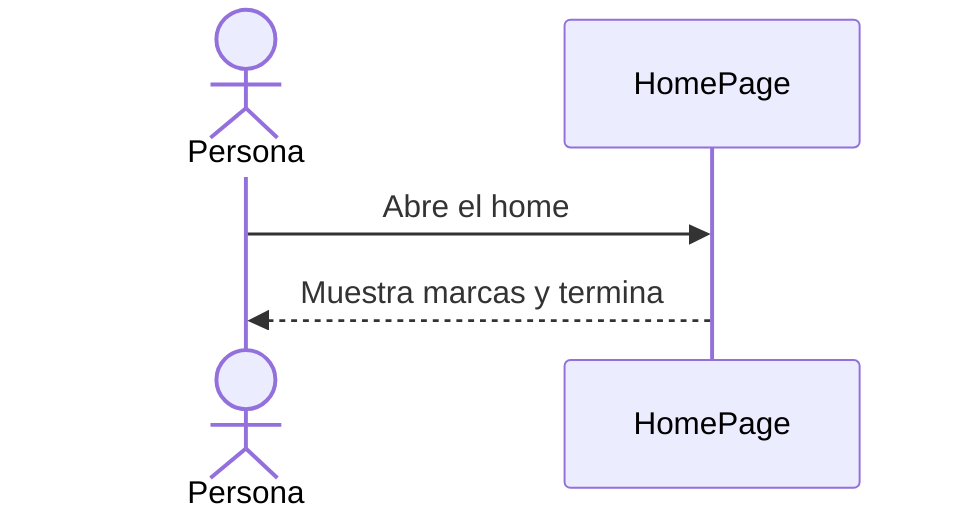
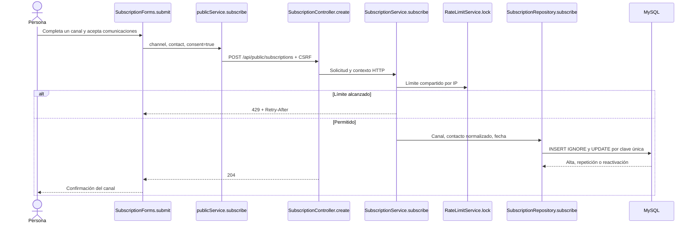

# E6-1 — Formulario de suscripción por Email o WhatsApp

Fuente de alcance: tarjeta [E6-1](https://trello.com/c/oGpQ7IyQ), decisiones conversadas y [modelo inicial](../modelo-inicial.md). Este documento sigue `PROMPT_GENERAR_PLAN_IMPLEMENTACION.md` y registra la ejecución sin confundir pruebas locales con producción.

## Estado actual y objetivo

**COMPROBADO ANTES DE E6-1:** `HomePage` terminaba con marcas; no había tabla, endpoint ni formulario de suscripciones. `apiClient` ya gestionaba CSRF y errores; `RateLimitService` y `ClientIpResolver` ya existían. `docs/trello-backlog.md` mencionaba origen, pero el modelo inicial lo descartó.

**COMPORTAMIENTO IMPLEMENTADO:** el home ofrece dos formularios independientes después de marcas, en una franja terracota. Cada uno guarda solo su canal tras aceptación explícita. El backend responde 204 al alta o repetición activa; esta última conserva la fecha original. Si había baja, un nuevo consentimiento limpia la baja y registra fecha nueva. No se pide nombre ni se guarda origen. No se envían campañas ni se comprueba la titularidad del contacto.

### Flujo anterior



### Flujo acumulado



## Orden y decisiones

| Tanda | Objetivo | Depende de | Estado |
| --- | --- | --- | --- |
| 1 | Migración y API pública | — | Implementada, con validación MySQL pendiente |
| 2 | Formularios y diseño del home | 1 | Implementada |
| 3 | Verificación y registro | 1 y 2 | Parcial: suites completas con fallos ajenos a E6-1 |

```text
Tanda 1 → Tanda 2 → Tanda 3
```

| ID | Decisión | Resolución |
| --- | --- | --- |
| D01 | Origen contradictorio entre backlog y modelo | No guardar origen, según modelo inicial. |
| D02 | Relación entre email y teléfono | No unir filas sin identidad verificada. |
| D03 | Protección del alta pública | 10 envíos por IP y hora, compartidos por canal. |

No quedan decisiones pendientes para E6-1. La baja pública, exportación E6-2 y campañas quedan para tareas posteriores.

## Tanda 1 — Persistencia y API

**Objetivo:** guardar consentimientos separados mediante una API pública protegida.

**Mapa de código:** `[NUEVO] SubscriptionController.create` (`Backend/spring-starter/src/main/java/com/ashenox/starter/subscription/SubscriptionController.java`) → `[NUEVO] SubscriptionService.subscribe` (normalización, límite y regla de consentimiento) → `[NUEVO] SubscriptionRepository.subscribe` (alta o actualización atómica por clave única) → `[NUEVO] V12__create_subscriptions.sql`. `[MODIFICADO] SecurityConfig` habilita únicamente el POST público; `AuthRateLimitScope` agrega `SUBSCRIPTION_IP`; `GlobalExceptionHandler` devuelve errores 400/429.

**Contrato:** `POST /api/public/subscriptions` con `{channel: EMAIL|WHATSAPP, contact: string, consent: true}`. 204 sin cuerpo para alta o contacto ya activo; 400 para solicitud inválida; 403 sin CSRF; 429 con `Retry-After` para límite por IP. `GET` no publica contactos. Email se recorta y pasa a minúsculas; el celular argentino se guarda como `+549` y diez dígitos.

**Persistencia:** una fila puede albergar ambos canales según el modelo, aunque estos formularios crean filas separadas. Los campos de baja ya están presentes; no existe endpoint de baja. Las claves únicas impiden duplicados por canal.

**Tests necesarios:** `SubscriptionControllerTest` cubre canales, normalización, repetición, reactivación, solicitud inválida, CSRF, acceso anónimo y límite compartido. `SubscriptionConcurrencyMySqlTest` comprueba la clave única bajo dos envíos paralelos.

**NO PROBADO:** concurrencia y migración sobre MySQL real; Testcontainers omitió la prueba sin Docker. **RIESGO:** una diferencia de dialecto o concurrencia podría afectar la persistencia real. **TRATAMIENTO:** ejecutar la prueba MySQL antes de desplegar.

**Commit sugerido:** `feat: agregar API pública de suscripciones` (sin ejecutar). **Criterio de cierre:** API, migración y pruebas relacionadas pasan; validación MySQL o su ausencia documentada.

**Resultado de ejecución — PARCIAL:** cuatro pruebas de `SubscriptionControllerTest` pasan sobre H2 con V12 aplicada; una prueba MySQL omitida por falta de Docker. `mvnw.cmd -DskipTests package` pasa. Se usó Java 21 y un agente Byte Buddy al inicio porque la carga dinámica de Mockito quedó bloqueada en este entorno Windows.

## Tanda 2 — Home y formularios

**Objetivo:** presentar los canales por separado en una sección terracota después de marcas.

**Mapa de código:** `[MODIFICADO] HomePage.jsx` monta `[NUEVO] SubscriptionForms.jsx` después de marcas; `[MODIFICADO] publicService.js` llama a `POST /api/public/subscriptions` por `[MODIFICADO] endpoints.js`; `[MODIFICADO] public.css` define franja, tarjetas, foco y diseño adaptable.

**Flujo:** cada formulario habilita su envío tras marcar su propio consentimiento; muestra estado de carga, éxito o error y permite reintentar. El texto identifica el canal y la finalidad, sin enlace de privacidad en esta tarea.

**Tests necesarios:** `SubscriptionForms.test.jsx` comprueba independencia de los dos formularios, aceptación, envío, bloqueo de duplicados durante el envío, errores de red, 429 y reintento. `PublicPages.test.jsx` comprueba la ubicación después de marcas.

**NO PROBADO:** apariencia en todos los tamaños y navegadores. **RIESGO:** el botón flotante de WhatsApp puede superponerse a zonas vacías de la tarjeta en vistas estrechas. **TRATAMIENTO:** revisar específicamente en móvil antes de publicar.

**Commit sugerido:** `feat: agregar formularios de suscripción al home` (sin ejecutar). **Criterio de cierre:** pruebas relacionadas, lint, build y revisión visual realizados.

**Resultado de ejecución — COMPLETA localmente:** 22 pruebas relacionadas pasan; lint y build pasan. La revisión visual del navegador abierto mostró la sección y ambos formularios. Playwright CLI no pudo abrir Chromium porque su ejecutable no está instalado; no se verificó una captura móvil automatizada.

## Tanda 3 — Verificación integral

**Objetivo:** demostrar el flujo completo y documentar los límites de la validación.

**NO PROBADO:** alta desde un navegador real hasta MySQL del entorno de destino, baja simulada sobre MySQL real y revisión móvil automatizada. **RIESGO:** una prueba H2 y una visualización local no validan el despliegue. **TRATAMIENTO:** ejecutar el recorrido integral con Docker/MySQL y navegador antes de publicar.

**Commit sugerido:** `docs: registrar validación de E6-1` si se documentan resultados adicionales; no se creó ningún commit. **Criterio de cierre:** ambos canales, repetición, reactivación y protección pública comprobados sobre MySQL; incidentes y riesgos registrados.

**Resultado de ejecución — PARCIAL:** `mvnw.cmd test` falla por cinco errores de `SmtpMfaEmailSenderTest` al entregar correo MFA en su servidor de prueba; las pruebas E6-1 pasan. `npm test` terminó con 318 pruebas aprobadas y una falla existente en `ContactPage.test.jsx`: espera un encabezado que la página actual no muestra. No se cambió esa prueba ni la página de contacto. `npm run lint`, `npm run build` y el paquete Maven con tests omitidos pasan.

## Protocolo de incidentes y validación final

Registrar cualquier nuevo incidente con tanda, esperado, obtenido, causa confirmada o hipótesis, cambios realizados, resultado posterior y riesgo residual. No alterar tests para obtener verde sin respaldar el cambio de contrato.

La validación final pendiente consiste en registrar email y WhatsApp sin login desde el home contra MySQL, comprobar fechas solo en el canal elegido, repetir sin duplicar, reactivar una baja de prueba y verificar 400/403/429. E6-2 deberá excluir los canales dados de baja al exportar.
