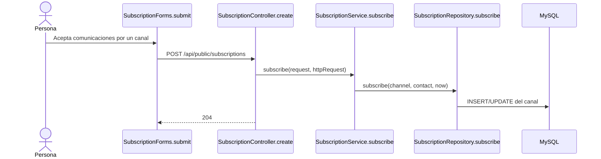
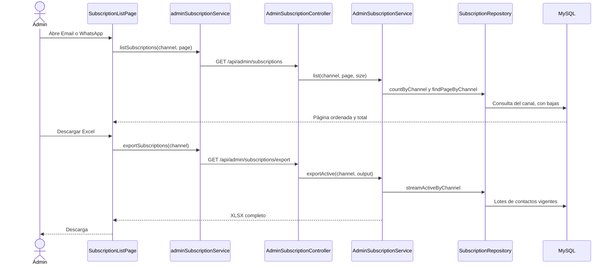
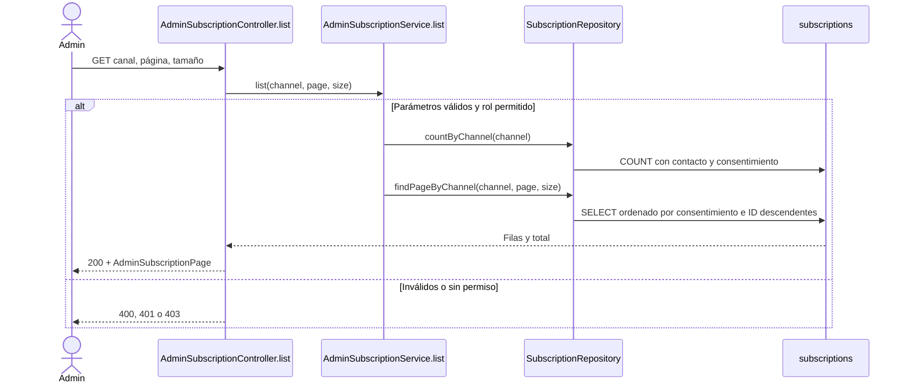
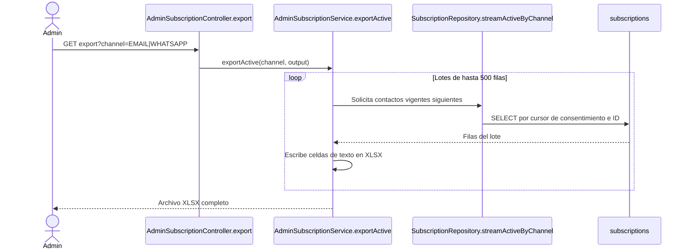
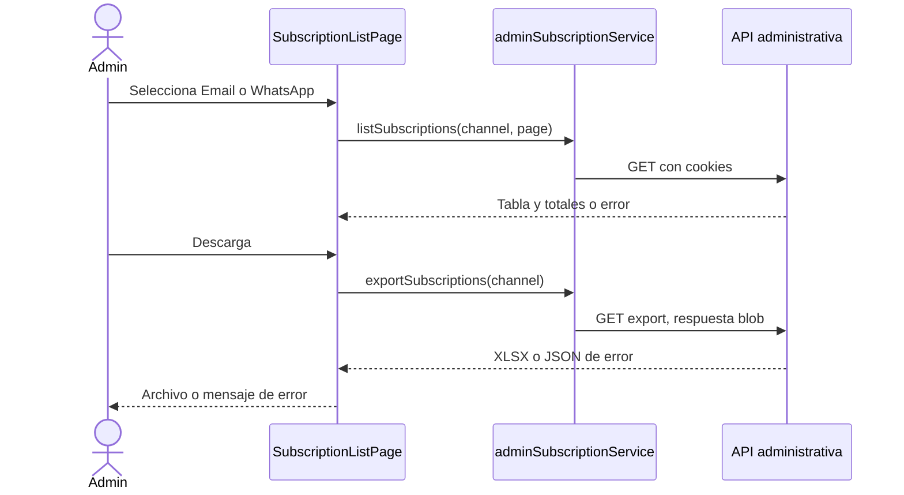

# E6-2 — Consulta y exportación de suscriptores

Fuentes: [tarjeta E6-2](https://trello.com/c/xRxwX87k), `docs/modelo-inicial.md`, decisiones del usuario y código. La tarjeta de Trello solo contiene el título. Este documento conserva plan y resultados de ejecución por separado.

## Estado actual y comportamiento objetivo

**COMPROBADO ANTES DE E6-2:** `SubscriptionForms` enviaba cada canal a `SubscriptionController.create` → `SubscriptionService.subscribe` → `SubscriptionRepository.subscribe` → `subscriptions` (V12). Consentimiento y baja son independientes. No había consulta ni exportación administrativa. `AppLayout` tenía menú por rol; `AdminUserController.list` ofrecía un patrón de paginación.

**COMPORTAMIENTO PROPUESTO:** `ADMIN` y `SUPER_ADMIN` consultan Email o WhatsApp por separado. La tabla incluye contactos activos y dados de baja, con contacto, consentimiento, estado y fecha de baja; muestra 20 por página y los más recientes primero. El XLSX completo de cada canal contiene contacto y fecha de consentimiento únicamente para consentimientos vigentes. No se agrega un mecanismo de baja ni envío de campañas.

### Flujo actual antes de E6-2



### Flujo objetivo



## Orden de implementación

| Tanda | Objetivo | Depende de | Estado |
| --- | --- | --- | --- |
| 1 | Consulta paginada y autorización | — | Implementada localmente |
| 2 | Exportación XLSX completa | 1 | Implementada localmente |
| 3 | Menú, tablas y descarga React | 1 y 2 | Implementada localmente |
| 4 | Validación integral | 1 a 3 | Parcial |

```text
Tanda 1 → Tanda 2 → Tanda 3 → Tanda 4
```

## Tanda 1 — Consulta administrativa

**Objetivo:** consulta paginada por canal, con bajas y control de acceso.

### Mapa de código

```text
[NUEVO] AdminSubscriptionController.list
Backend/spring-starter/src/main/java/com/ashenox/starter/subscription/AdminSubscriptionController.java
    ↓
[NUEVO] AdminSubscriptionService.list
Backend/spring-starter/src/main/java/com/ashenox/starter/subscription/AdminSubscriptionService.java
    ↓
[MODIFICADO] SubscriptionRepository.countByChannel / findPageByChannel
Backend/spring-starter/src/main/java/com/ashenox/starter/subscription/SubscriptionRepository.java
    ↓
subscriptions (V12, existente)
```

**Clases nuevas:** `AdminSubscriptionRow` representa el contacto y fechas del canal; `AdminSubscriptionPage` representa la página y sus totales. `SecurityConfig` se modifica para proteger ambas rutas.

### Flujo de la tanda



**Contrato:** `GET /api/admin/subscriptions?channel=EMAIL|WHATSAPP&page=0&size=20`; `size` entre 1 y 100. Respuesta: `content` (`id`, `contact`, `consentedAt`, `withdrawnAt`, `active`), `page`, `size`, `totalElements`, `totalPages`. No hay migración.

**Tests necesarios:** `AdminSubscriptionTest` cubre páginas, totales, orden con desempate, canales independientes, baja por canal, parámetros inválidos y permisos de `ADMIN`, `SUPER_ADMIN`, `USER` y anónimo. Demuestra que los contactos no se exponen a roles ajenos.

**NO PROBADO:** carga real y plan de ejecución en MySQL. **RIESGO:** la consulta podría requerir un índice con muchos contactos. **TRATAMIENTO:** medir antes de despliegue y agregar migración solo si se confirma.

**Commit sugerido:** `feat: agregar consulta administrativa de suscriptores` (código y tests de esta tanda; no ejecutado).

**Criterio de cierre:** `[x]` flujo y permisos; `[x]` tests H2; `[ ]` MySQL real; `[x]` límite documentado.

**Resultado de ejecución:** consulta implementada y tests dirigidos aprobados en H2. Estado: **COMPLETA localmente**.

## Tanda 2 — Exportación XLSX

**Objetivo:** descargar todos los contactos vigentes de un canal en un XLSX.

### Mapa de código

```text
[NUEVO] AdminSubscriptionController.export
Backend/spring-starter/src/main/java/com/ashenox/starter/subscription/AdminSubscriptionController.java
    ↓
[NUEVO] AdminSubscriptionService.exportActive
Backend/spring-starter/src/main/java/com/ashenox/starter/subscription/AdminSubscriptionService.java
    ↓
[MODIFICADO] SubscriptionRepository.streamActiveByChannel
Backend/spring-starter/src/main/java/com/ashenox/starter/subscription/SubscriptionRepository.java
    ↓
subscriptions (V12, existente)
```

**Clases nuevas:** no se requieren adicionales. `pom.xml` incorpora Apache POI OOXML 5.5.1, disponible en caché local.

### Flujo de la tanda



**Contrato/configuración:** `GET /api/admin/subscriptions/export?channel=...`; `Content-Disposition` identifica canal y fecha de Argentina. Solo contactos con consentimiento y sin baja; encabezados y fechas en zona `America/Buenos_Aires`. Apache POI usa ventana de 100 filas y archivos temporales comprimidos; se abre una hoja nueva al llegar al límite de filas XLSX. No hay migración ni credenciales nuevas.

**Tests necesarios:** `AdminSubscriptionTest` abre el XLSX y comprueba encabezados, orden, exclusión de bajas, más de 20 contactos, archivo vacío y respuesta HTTP con 501 contactos para atravesar un lote. Permisos de exportación para `USER` y anónimo; acceso administrativo en la prueba HTTP.

**NO PROBADO:** descarga con cambios simultáneos y consumo de recursos a escala de producción. **RIESGO:** el conjunto de datos podría cambiar durante la descarga. **TRATAMIENTO:** aceptar para V1 y medir con datos representativos antes de publicar.

**Commit sugerido:** `feat: exportar suscriptores activos a Excel` (dependencia, API y tests; no ejecutado).

**Criterio de cierre:** `[x]` XLSX y filtros; `[x]` tests dirigidos; `[ ]` escala MySQL real; `[x]` límites declarados.

**Resultado de ejecución:** exportación implementada; verificación HTTP de 501 filas aprobada. La lectura interpreta `DATETIME` como UTC, en consonancia con la escritura de E6-1, y el XLSX muestra hora argentina. Estado: **COMPLETA localmente**, pendiente de validación MySQL.

## Tanda 3 — Panel administrativo

**Objetivo:** dos vistas separadas con tabla, paginación y descarga.

### Mapa de código

```text
[MODIFICADO] AppLayout / AppRouter / ProtectedRoute
Frontend/react-starter/src/app/
    ↓
[NUEVO] SubscriptionListPage
Frontend/react-starter/src/admin/pages/SubscriptionListPage.jsx
    ↓
[NUEVO] adminSubscriptionService.listSubscriptions / exportSubscriptions
Frontend/react-starter/src/admin/services/adminSubscriptionService.js
    ↓
[MODIFICADO] endpoints / apiClient
Frontend/react-starter/src/services/
```

**Clases nuevas:** la página y el servicio HTTP anteriores. No se cambia persistencia.

### Flujo de la tanda



**Tests necesarios:** `AdminAccess.test.jsx` comprueba navegación y roles; `SubscriptionListPage.test.jsx` comprueba tabla, baja, cambio de página, descarga y errores; `apiClient.test.js` comprueba JSON de error de descarga binaria. Ejecutar `npm test`, `npm run lint`, `npm run build`.

**NO PROBADO:** diseño y descarga en navegador real. **RIESGO:** una tabla ancha puede resultar incómoda en móvil. **TRATAMIENTO:** revisión visual antes de publicar.

**Commit sugerido:** `feat: mostrar y descargar suscriptores en el admin` (interfaz y tests; no ejecutado).

**Criterio de cierre:** `[x]` vistas, paginación y descarga; `[x]` tests dirigidos, lint y build; `[ ]` revisión en navegador real.

**Resultado de ejecución:** 24 tests dirigidos aprobados; lint y build aprobados. Estado: **COMPLETA localmente**.

## Tanda 4 — Validación integral

**Objetivo:** demostrar el flujo completo y registrar lo que permanece sin comprobar.

**Flujo de la tanda:** registrar ambos canales mediante API pública; preparar una baja por canal y una fila con dos canales; entrar con cada rol; revisar tabla y archivo; repetir sobre MySQL y en navegador. Es una tanda de verificación, por lo que un diagrama adicional no aporta claridad.

**Tests necesarios:** `mvnw.cmd test` y `package`, `npm test`, `npm run lint`, `npm run build`, integración MySQL y navegador de escritorio/móvil. Cada uno demuestra un límite distinto: contratos, compilación, regresión, calidad estática y experiencia real.

**NO PROBADO:** MySQL, navegador real y entorno de destino. **RIESGO:** la suite H2 y los tests de componentes no sustituyen esos recorridos. **TRATAMIENTO:** ejecutarlos antes del despliegue.

**Commit sugerido:** `docs: registrar validación de E6-2` si se separa el registro de resultados; no ejecutado.

**Criterio de cierre:** `[ ]` recorrido integral MySQL/navegador; `[x]` límites e incidentes registrados.

**Resultado de ejecución:** **PARCIAL**. Docker no está accesible (`permission denied` en la tubería de Docker Desktop), por lo que Testcontainers/MySQL no se ejecutan. El recorrido de navegador autenticado no se ejecutó. La suite backend completa obtuvo 597 tests: 0 fallas, 5 errores de `SmtpMfaEmailSenderTest` por entrega SMTP fallida y 171 omitidos; los 5 tests de `AdminSubscriptionTest` pasan en ejecución dirigida. La suite frontend completa obtuvo 325/326 tests aprobados; falló `ContactPage.test.jsx` porque espera un encabezado que ya no coincide con la página actual, ajeno a E6-2. Los 24 tests dirigidos del panel y cliente HTTP pasan. Backend `package` con tests omitidos, frontend `lint` y `build` pasan. El primer intento Maven se bloqueó al adjuntar dinámicamente Byte Buddy; el reintento con `-javaagent` permitió ejecutar los tests.

### Incidentes de validación

**INC-001 — SMTP en suite completa.** Tanda 4. Esperado: envío local de pruebas MFA. Obtenido: cinco errores de `SmtpMfaEmailSenderTest` por `No se pudo entregar el correo MFA`. Clasificación: entorno/infraestructura; causa exacta no confirmada. Resolución: ninguna; no se modificaron código ni tests. Resultado posterior: tests dirigidos E6-2 PASS, suite completa FAIL. Riesgo: regresión SMTP sin validar en este entorno.

**INC-002 — Título de Contacto.** Tanda 4. Esperado: el test encuentra el encabezado largo. Obtenido: `ContactPage` renderiza `Encontranos en General Roca` y `ContactPage.test.jsx` espera otra frase. Clasificación: desajuste previo entre test y código, ajeno a E6-2. Resolución: ninguna; no se modificaron código ni tests. Resultado posterior: 325/326 PASS, suite completa FAIL. Riesgo: regresión de Contacto sin validar plenamente.

**INC-003 — Agente de Mockito.** Tanda 4. Esperado: Maven ejecuta los tests. Obtenido: la carga dinámica de Byte Buddy se bloqueó en una tubería local. Clasificación: entorno. Resolución: ejecutar Maven con `-DargLine=-javaagent:<ruta de byte-buddy-agent 1.18.10>`. Código productivo, tests y configuración: sin cambios por este incidente. Resultado posterior: tests dirigidos E6-2 PASS. Riesgo residual: la suite depende de ese argumento en este Windows.

### Corrección posterior — exportación HTTP asíncrona

**Incidente:** en Tomcat real, `GET /api/admin/subscriptions/export` terminaba su despacho inicial con 200 y un usuario autenticado, pero el despacho `ASYNC` posterior era rechazado por `AuthorizationFilter` cuando la respuesta ya estaba comprometida. La prueba anterior con `MockMvc.with(user(...))` no reproducía la autenticación por cookie JWT.

**Cambio:** `JwtRequestFilter.shouldNotFilterAsyncDispatch()` devuelve `false`. El filtro vuelve a leer y validar la cookie en el despacho asíncrono; las reglas de roles de `SecurityConfig` no cambiaron. No hubo migración ni cambio de contrato HTTP.

**Verificación:** `AdminSubscriptionHttpTest` inició Tomcat en puerto aleatorio con H2, creó sesiones válidas y usó cookies JWT por HTTP. Abrió el XLSX completo para `ADMIN` y `SUPER_ADMIN`; comprobó 403 para `USER` y 401 para anónimo. Pasaron también `AdminSubscriptionTest` (5), `AuthCookieFlowIntegrationTest` (30) y `AccessSessionDatabaseFailureIntegrationTest` (1): **37 tests, 0 fallas y 0 errores**. `mvnw.cmd -DskipTests package` pasó. El primer intento de la prueba HTTP no pudo iniciar Tomcat por una restricción de loopback del sandbox; se repitió con acceso local permitido y pasó.

**Pendiente:** no se repitió la suite completa, que antes registró errores SMTP ajenos a E6-2. Continúan pendientes MySQL y el recorrido visual en navegador. Estado de la validación integral: **PARCIAL**.

## Decisiones pendientes

Ninguna. El usuario definió: tabla con bajas, exportación solo de activos, `ADMIN` y `SUPER_ADMIN`, contacto y fechas, más recientes primero, XLSX completo. Tamaño 20 según el patrón existente. `docs/trello-backlog.md` menciona `origen`, pero prevalece `docs/modelo-inicial.md`, que lo descartó.

## Protocolo de incidentes

Durante nuevas tandas, registrar `INC-XXX` con tanda, contexto, esperado, obtenido, clasificación, causa confirmada o hipótesis, resolución, archivos productivos/tests/configuración modificados, resultado posterior y riesgo residual. No cambiar tests solo para conseguir un resultado verde.

## Flujo total acumulado

```text
IMPLEMENTADO LOCALMENTE
Alta pública por Email o WhatsApp → subscriptions
                                  ↓
Consulta administrativa por canal → tabla paginada con bajas
                                  ↓
Exportación del canal → XLSX completo solo de activos

PENDIENTE DE VALIDACIÓN
MySQL real → navegador autenticado → revisión de escritorio y móvil → entorno de destino
```

## Resumen final

**Orden de implementación:** API → XLSX → panel → validación. Las tres primeras tandas están implementadas localmente; la cuarta permanece parcial.

**Decisiones pendientes:** ninguna.

**Riesgos globales:** rendimiento MySQL con muchos contactos, cambios durante una exportación y experiencia móvil sin revisión visual.

**Validación final:** comprobar ambos canales, permisos, páginas, bajas y XLSX completo contra MySQL y desde un navegador autenticado antes de publicar.
