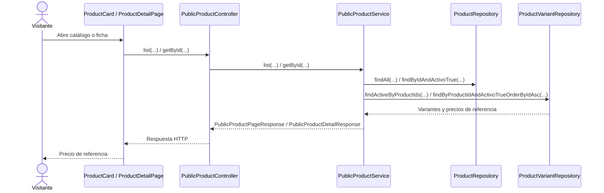
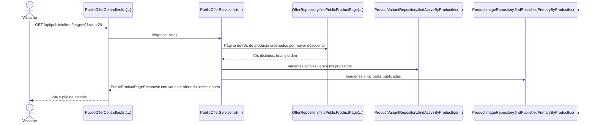
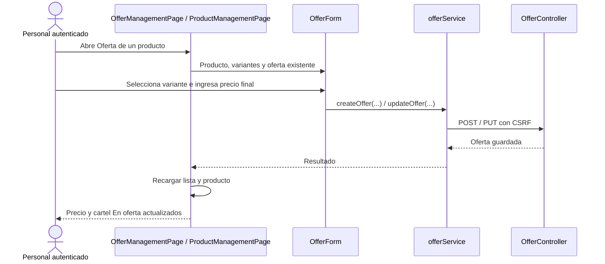
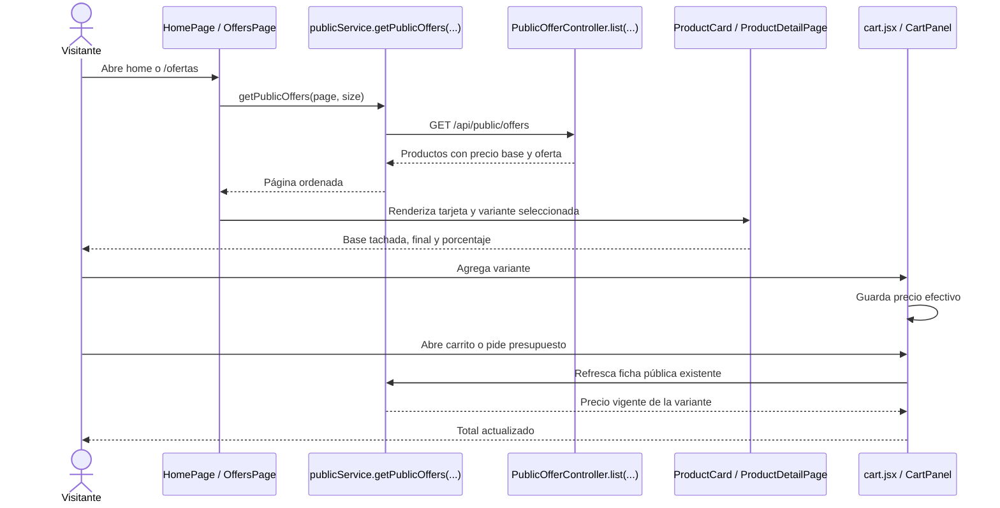

# Ofertas sin vencimiento — plan de implementación por tandas

**Estado:** Tanda 0 completa: documento creado el 06/11/2026. Tandas 1–5 pendientes de ejecución.

Este documento transforma las decisiones acordadas sobre ofertas en un mapa de trabajo. **No autoriza comenzar automáticamente ninguna tanda:** el solicitante indicará cuál ejecutar. Antes de cada ejecución, aplicar `PROMPT_EJECUTAR_TANDA.md`; ante una decisión relevante no prevista, detener la parte afectada y registrarla como `DECISIÓN PENDIENTE`, sin iniciar la tanda siguiente.

## 1. Estado actual y comportamiento objetivo

### COMPROBADO EN EL CÓDIGO ACTUAL

- `V10__create_product_variants.sql` trasladó `precio_referencia` a `product_variants`; `V11__drop_product_price_availability.sql` quitó precio y disponibilidad de `products`. `ProductVariant` guarda `precioReferencia`, `disponible` y `activo`; `Product` guarda `activo` y `destacado`. No existe tabla, entidad, servicio ni endpoint de ofertas.
- `ProductServiceImpl.update(...)` puede cambiar el precio de la variante inicial cuando es la única; `ProductVariantService.update(...)` cambia precios de variantes. Ambos flujos bloquean el producto mediante `ProductRepository.lockById(...)`.
- `ProductController` y `ProductVariantController` permiten `SUPER_ADMIN`, `ADMIN` y `USER`. `SecurityConfig` permite solo los GET públicos enumerados; las mutaciones usan autenticación y CSRF.
- `PublicProductService.list(...)` pagina productos activos y elige por disponibilidad, menor precio de referencia e ID. `getById(...)` entrega las variantes activas. `PublicProductSummaryResponse`, `PublicProductDetailResponse` y `PublicProductVariantResponse` exponen el precio de referencia, sin descuento.
- `ProductManagementPage` muestra el listado administrativo con Editar, Imágenes y Desactivar/Reactivar; `HomePage` tiene carril de categorías. `ProductCard` y `ProductDetailPage` muestran el precio de referencia. `cart.jsx` guarda una copia de ese precio; `CartPanel` consulta de nuevo el producto al abrirse y antes de WhatsApp. `cartMessage(...)` no incluye importes.
- Pruebas relacionadas: `ProductVariantFlowTest`, `ProductVariantConcurrencyMySqlTest`, `ProductControllerTest`, `PublicProductHttpTest`, `ProductManagementPage.test.jsx`, `PublicPages.test.jsx`, `AppLayout.test.jsx`.
- `docs/modelo-inicial.md` y `docs/trello-backlog.md` proponen `Promocion` con inicio/fin. Las tarjetas [E7-1](https://trello.com/c/PaDscFvR) y [E7-2](https://trello.com/c/CvfK3Rwp) están abiertas y sin descripción. Ese diseño difiere de la oferta sin vencimiento acordada aquí; no hay que implementar fechas ni reutilizar `destacado` como indicador de oferta.

### COMPORTAMIENTO PROPUESTO

- Cada variante puede tener a lo sumo una oferta con **precio final fijo**, positivo y menor que su precio de referencia. No hay inicio, fin, vencimiento automático ni campo `activa`. Terminar una oferta borra su fila. `destacado` sigue siendo independiente.
- `SUPER_ADMIN`, `ADMIN` y `USER` autenticados pueden crear, editar y terminar ofertas. Los visitantes solo consultan ofertas publicadas. El alta exige producto y variante activos; permite variante activa sin disponibilidad. Desactivar producto o variante oculta la oferta al público, pero la conserva en administración y la vuelve a publicar al reactivar.
- El porcentaje se calcula con `(precioReferencia - precioOferta) / precioReferencia × 100` usando aritmética decimal. Se ordena por el porcentaje **sin redondear** y se muestra el entero hacia abajo; si el descuento positivo es menor que 1 %, mostrar `<1 %`.
- Una tarjeta pública representa un producto. Si tiene varias variantes ofertadas activas, se elige la de mayor descuento; ante empate, una disponible antes que una no disponible y luego menor ID de variante. En productos sin oferta se conserva la selección actual. La ficha abre por defecto esa misma variante y permite elegir otra.
- El carril del home muestra las seis mejores ofertas y enlaza a `/ofertas`. La página pública muestra 20 productos por página, sin filtros, con orden y desempate estables. El catálogo general también muestra una variante ofertada cuando la hay.

## 2. Mapa global de flujos

### Flujo actual



### Flujo objetivo

Los nombres de clases y métodos de oferta en este diagrama son **propuestos**.

```mermaid
sequenceDiagram
    actor U as Personal autenticado
    participant A as OfferManagementPage / ProductManagementPage
    participant C as OfferController.create(...)
    participant S as OfferService.create(...)
    participant P as ProductRepository.lockById(...)
    participant VR as ProductVariantRepository.findById(...)
    participant O as OfferRepository.saveAndFlush(...)
    participant DB as MySQL
    U->>A: Carga precio final de una variante
    A->>C: POST /api/catalog/offers {variantId, precioOferta}
    C->>S: create(variantId, precioOferta)
    S->>P: lockById(productId)
    S->>VR: findById(variantId)
    VR-->>S: Precio base, estado y producto
    alt Producto y variante activos; precio válido; sin oferta
        S->>O: saveAndFlush(oferta)
        O->>DB: INSERT con variant_id único
        DB-->>O: Oferta persistida
        O-->>S: Oferta
        S-->>C: OfferResponse con descuento calculado
        C-->>A: 201
        A-->>U: En oferta
    else Regla incumplida
        S-->>C: Error de validación o conflicto
        C-->>A: 400 / 404 / 409
    end
```

Lectura pública objetivo: `PublicOfferController.list(...)` → `PublicOfferService.list(...)` → consulta paginada de productos ofertados en MySQL → carga agrupada de variantes, ofertas e imágenes → `PublicProductPageResponse` → carril o página. Para la ficha, `PublicProductService.getById(...)` incorpora los datos de oferta por variante. Terminar: `OfferController.delete(...)` → `OfferService.delete(...)` → bloqueo del producto → `OfferRepository.delete(...)` → `204`; la lectura siguiente vuelve al precio base.

## 3. Orden de implementación

| Tanda | Objetivo | Depende de | Estado |
| --- | --- | --- | --- |
| 0 | Crear y revisar este plan | Ninguna | Completa |
| 1 | Persistencia, reglas y API privada | 0 | Planificada |
| 2 | Contratos y consultas públicas | 1 | Planificada |
| 3 | Gestión en el panel y botón en Productos | 1 | Planificada |
| 4 | Home, página pública, catálogo, ficha y carrito | 2 | Planificada |
| 5 | Recorrido integral y cierre documental | 3 y 4 | Planificada |

```text
Tanda 0 → Tanda 1 ──→ Tanda 2 ──→ Tanda 4 ──┐
                   └→ Tanda 3 ───────────────┴→ Tanda 5
```

Las tandas 2 y 3 pueden revisarse separadamente. Ninguna se ejecutará hasta que el solicitante la indique.

---

## Tanda 0 — Crear el plan

**Objetivo:** dejar un mapa técnico revisable sin implementar la funcionalidad.

**Depende de:** decisiones funcionales acordadas y lectura del código, del modelo inicial, del prompt de planificación y de las tarjetas Trello.

**Mapa de código:** no modifica código. **Archivo nuevo:** `docs/Sprint 7/PLAN_IMPLEMENTACION_OFERTAS.md`, este documento.

**Flujo de la tanda:** inspección de fuentes → redacción de estado comprobado y objetivo → tandas y tests → revisión del Markdown. No hay flujo de aplicación que justifique un diagrama adicional.

**Tests necesarios:** comprobar que el archivo existe, contiene las tandas y que `git status` solo informa este documento. No corresponde ejecutar suites de código por una incorporación documental.

**Qué NO queda probado:** comportamiento de ofertas en backend o frontend. **Riesgo:** el código puede cambiar antes de ejecutar una tanda. **Tratamiento:** contrastar su mapa con el código al iniciarla.

**Commit sugerido:** `docs: planificar ofertas sin vencimiento`, incluyendo solo este Markdown; no ejecutar el commit durante la planificación.

**Criterio de cierre:** documento creado; decisiones y contradicción histórica visibles; tandas 1–5 pendientes; sin cambios de código.

**Resultado de ejecución:** **COMPLETA**. Se creó únicamente este Markdown, se comprobaron sus seis secciones de tanda y el balance de bloques de código, y `git status` mostró solo el nuevo documento. No se ejecutaron suites, ya que no hubo cambios de código.

---

## Tanda 1 — Persistencia y gestión privada

**Objetivo:** gestionar una oferta por variante desde una API protegida, con baja física y coordinación con la edición del precio base.

**Depende de:** Tanda 0.

### Mapa de código

```text
[NUEVO] OfferController — Backend/spring-starter/src/main/java/com/ashenox/starter/catalog/product/offer/controller/OfferController.java
  list(...), create(...), update(...), delete(...) [PROPUESTOS]
    ↓
[NUEVO] OfferService — Backend/spring-starter/src/main/java/com/ashenox/starter/catalog/product/offer/service/OfferService.java
  list(...), create(...), update(...), delete(...) [PROPUESTOS]
    ├→ [EXISTENTE] ProductRepository.lockById(...)
    ├→ [EXISTENTE] ProductVariantRepository.findById(...)
    └→ [NUEVO] OfferRepository — findByVariantId(...), saveAndFlush(...), delete(...) [PROPUESTOS]
           ↓
        MySQL: variant_offers

[MODIFICADOS] ProductServiceImpl.update(...) y ProductVariantService.update(...)
  Verifican oferta al cambiar precioReferencia bajo el bloqueo existente del producto.
[MODIFICADO] GlobalExceptionHandler
  Traduce el conflicto de oferta a 409 con el formato ApiError existente.
```

**Clases/archivos nuevos:** `VariantOffer` representa la fila; `OfferRepository` consulta por variante y pagina ofertas; `CreateOfferRequest` y `UpdateOfferRequest` reciben precio final; `OfferResponse` devuelve ID, producto, variante, precio base, precio final, porcentaje y estados necesarios para el panel; `OfferConflictException` expresa conflictos de negocio. Ubicarlos en el nuevo paquete `catalog.product.offer`. Crear `V13__create_variant_offers.sql` después de V12.

### Flujo de la tanda

El camino feliz del alta está en el flujo objetivo global. La edición sigue `OfferController.update(id, request)` → `OfferService.update(...)` → bloqueo del producto → comprobación del precio base → `OfferRepository.saveAndFlush(...)` → `200 OfferResponse`. La terminación sigue `OfferController.delete(id)` → `OfferService.delete(...)` → bloqueo del producto → `OfferRepository.delete(...)` → `204`. La lista privada incluye todas las filas guardadas, aunque el producto o variante estén inactivos; paginar a 20 por defecto, aceptar tamaño 1–100 y ordenar por nombre de producto, ID de producto e ID de variante. ID inexistente: `404`; alta duplicada o estado incompatible: `409`; entrada inválida: `400`.

### Cambios de persistencia/configuración

`variant_offers`: `id BIGINT` autoincremental, `variant_id BIGINT NOT NULL UNIQUE` con FK a `product_variants`, `precio_oferta DECIMAL(15,2) NOT NULL`, `created_at` y `updated_at` siguiendo `EntidadAuditable`, CHECK de precio positivo e índice de variante aportado por la unicidad. Sin estado ni fechas de vigencia. Las reglas que comparan dos tablas se validan en servicio; la unicidad de base resuelve altas concurrentes. Todas las mutaciones y ediciones de precio base usan el mismo bloqueo de producto. Rechazar `precioReferencia <= precioOferta` al editar precio base; conservar el precio final y recalcular el porcentaje cuando el nuevo precio base sigue siendo mayor.

Rutas privadas: `GET /api/catalog/offers?page=0&size=20`, `POST /api/catalog/offers` con `{variantId, precioOferta}`, `PUT /api/catalog/offers/{id}` con `{precioOferta}`, `DELETE /api/catalog/offers/{id}` con `204`. Autorizar `SUPER_ADMIN`, `ADMIN`, `USER` en controller y `SecurityConfig`, con CSRF para mutaciones. Una oferta por variante, sin endpoint de desactivación.

### Tests necesarios

- **Persistencia:** migración y restricción de unicidad en H2 y MySQL; demuestra que el esquema permite una sola oferta positiva por variante.
- **Servicio/HTTP:** alta, edición, listado, baja física, ID inexistente, precio cero/negativo/igual o superior al base, producto o variante inactivos; demuestra contratos `201/200/204/400/404/409` y que el precio original no se altera.
- **Seguridad:** visitante `401`, roles permitidos, CSRF inválido `403`; demuestra que nadie anónimo muta ofertas.
- **Concurrencia:** dos altas de la misma variante y carrera entre oferta y edición de precio base en MySQL; demuestra unicidad y que nunca queda `precioOferta >= precioReferencia`.
- **Regresión:** edición normal de producto y variante sin oferta; demuestra que el flujo anterior sigue funcionando.

Ejecutar `./mvnw.cmd test` y, al cerrar, `./mvnw.cmd package` desde `Backend/spring-starter` con Java 21.

### Qué NO queda probado

```text
NO PROBADO: publicación y presentación de ofertas.
RIESGO: una respuesta privada correcta no garantiza selección pública coherente.
TRATAMIENTO: Tandas 2 y 4.
```

**Commit sugerido:** `ofertas: agregar persistencia y gestion privada` (migración, código y pruebas de esta tanda).

**Criterio de cierre:** API y migración verificadas; seguridad y concurrencia demostradas; fallos e incidentes registrados; riesgos visibles.

### Resultado de ejecución

**Estado:** COMPLETA (06/11/2026).

**Cambios realizados:** V13, entidad y API privada de ofertas; coordinación de cambios del precio base; tests de migración, HTTP, seguridad y concurrencia.

**Diferencias respecto del plan:** se consulta el ID del producto antes de bloquearlo y luego se carga la entidad; la clave única puede resolver una doble alta concurrente antes que la comprobación del servicio.

**Tests ejecutados y exitosos:** H2 y MySQL, API y regresión. `./mvnw.cmd package` terminó con 644 tests, 0 fallos, 0 errores y 0 omitidos; JAR generado. Tras ampliar un caso solo de test, `OfferControllerTest` volvió a pasar (6/6).

**Tests fallidos:** ninguno en la ejecución final. **Incidentes:** preparación de tests y restricciones del sandbox, resueltos y registrados. **Tests faltantes:** ninguno de la tanda 1. **Riesgos residuales:** lectura pública y presentación pendientes de tandas 2 y 4; entorno de despliegue sin validar.

**Decisiones pendientes descubiertas:** ninguna. **Archivos modificados:** migración, paquete backend de ofertas, servicios de producto/variante, seguridad, manejo de errores, tests y este apartado. Detalle, incidentes y checklist: [RESULTADO_TANDA_1.md](RESULTADO_TANDA_1.md). No se inició otra tanda ni se creó commit.

---

## Tanda 2 — Lectura pública y precios de oferta

**Objetivo:** exponer ofertas publicadas sin duplicar productos ni alterar el significado del precio de referencia.

**Depende de:** Tanda 1.

### Mapa de código

```text
[NUEVO] PublicOfferController.list(...) [PROPUESTO]
  Backend/spring-starter/src/main/java/com/ashenox/starter/catalog/product/offer/controller/PublicOfferController.java
    ↓
[NUEVO] PublicOfferService.list(...) [PROPUESTO]
  Backend/spring-starter/src/main/java/com/ashenox/starter/catalog/product/offer/service/PublicOfferService.java
    ├→ [NUEVO] OfferRepository.findPublicProductPage(...) [PROPUESTO]
    └→ [EXISTENTES] ProductVariantRepository, ProductImageRepository, ProductImageUrlService
    ↓
[MODIFICADOS] PublicProductSummaryResponse y PublicProductPageResponse

[MODIFICADOS] PublicProductService.list(...), related(...), getById(...)
    └→ [MODIFICADOS] PublicProductDetailResponse y PublicProductVariantResponse
[MODIFICADO] SecurityConfig: permitir GET /api/public/offers.
```

**Clases/archivos nuevos:** controller, servicio y proyección/consulta de página pública de ofertas. Reutilizar los DTO públicos de producto para la tarjeta; no crear una segunda representación visualmente equivalente.

### Flujo de la tanda



### Cambios de contratos

`GET /api/public/offers?page=0&size=20`, sin filtros; página cero basada, tamaño 1–100 y formato `{content,page,size,totalElements,totalPages}`. La consulta de IDs debe filtrar producto y variante activos, agrupar por producto, calcular el máximo descuento decimal y **ordenar antes de paginar**; desempatar por ID de producto. Luego cargar variantes, ofertas e imágenes por lotes para evitar N+1. No paginar ofertas y deduplicar en memoria. El porcentaje para ordenar usa precisión completa; el campo `porcentajeDescuento` público usa entero hacia abajo. Agregar `precioOferta` nullable y `porcentajeDescuento` nullable a resúmenes y variantes, manteniendo `precioReferencia` como base; el precio efectivo es `precioOferta ?? precioReferencia`. El resumen del catálogo y la variante predeterminada de la ficha eligen la mejor oferta activa, con los desempates acordados; sin oferta conservan el criterio anterior. Una oferta asociada a un producto o variante inactivos no se publica. Disponibilidad `false` no la oculta.

### Tests necesarios

- **Integración MySQL:** orden con porcentajes próximos, empate, paginación y total sobre productos distintos; demuestra el orden real de la consulta y evita páginas incompletas.
- **HTTP público:** `200` anónimo, tamaños inválidos, producto/variante inactivos, reactivación, variante sin disponibilidad; demuestra visibilidad correcta.
- **Contrato/regresión:** DTO de catálogo, relacionados y ficha con y sin oferta; selección de mejor variante y conservación de `precioReferencia`; demuestra compatibilidad de los campos anteriores.

Ejecutar `./mvnw.cmd test` y `./mvnw.cmd package`.

### Qué NO queda probado

```text
NO PROBADO: representación visual, carril y carrito.
RIESGO: consumidores frontend todavía muestran solo precioReferencia.
TRATAMIENTO: Tanda 4.
```

**Commit sugerido:** `ofertas: publicar precios y listado ordenado` (consultas, DTO, seguridad y pruebas).

**Criterio de cierre:** página ordenada correctamente en MySQL; contratos y visibilidad verificados; regresiones públicas comprobadas.

**Resultado de ejecución:** **PENDIENTE DE EJECUCIÓN**.

---

## Tanda 3 — Administración desde Ofertas y Productos

**Objetivo:** ofrecer dos entradas a la misma gestión de ofertas.

**Depende de:** Tanda 1.

### Mapa de código

```text
[MODIFICADOS] AppLayout y AppRouter
  Navegación y ruta /app/catalog/offers.
    ↓
[NUEVO] OfferManagementPage — Frontend/react-starter/src/catalog/offers/pages/OfferManagementPage.jsx
  listOffers(...), createOffer(...), updateOffer(...), deleteOffer(...) [PROPUESTOS]
    └→ [NUEVO] offerService.js y [MODIFICADO] endpoints.js

[MODIFICADO] ProductManagementPage
  Botón Oferta y cartel En oferta; abre el mismo formulario por producto/variante.
[NUEVO] OfferForm — Frontend/react-starter/src/catalog/offers/components/OfferForm.jsx
  Precio final y selección de variante [PROPUESTO].
```

**Clases/archivos nuevos:** página, formulario reutilizable y servicio HTTP de ofertas. La página y la fila de Productos usan el mismo formulario y contrato.

### Flujo de la tanda



**Cambios de contrato/configuración:** ruta privada `/app/catalog/offers` visible a los tres roles; listado administrativo de 20 por página. Crear desde Ofertas requiere escoger producto activo y variante activa. En Productos, botón `Oferta` abre selección de variante y carga el precio existente si lo hay; si ninguna variante tiene oferta, comienza el alta. El cartel superior derecho `En oferta` aparece cuando cualquier variante tiene fila de oferta, incluso si está temporalmente oculta al público por desactivación. La lista de Ofertas conserva esas filas, indica estado de publicación, ofrece Editar y Terminar, y confirma el borrado. Tras terminar, la fila desaparece sin lista de desactivadas.

### Tests necesarios

- **Servicios/rutas:** verbos, cuerpo, CSRF, errores y protección de ruta; demuestra el uso correcto del contrato.
- **Interfaz:** alta/edición desde ambas entradas, variante correcta, cartel, baja confirmada y desaparición de fila; demuestra sincronización de las vistas.
- **Errores/regresión:** `400/409`, doble envío, respuesta incierta que exige recarga, paginación y controles existentes de Productos; demuestra que no se repiten mutaciones ambiguas.

Ejecutar `npm test`, `npm run lint` y `npm run build` desde `Frontend/react-starter`.

### Qué NO queda probado

```text
NO PROBADO: carril, ficha y carrito públicos; interacción en navegador real.
RIESGO: estado antiguo si otra sesión modifica la misma oferta.
TRATAMIENTO: refrescar producto/oferta al resolver un conflicto y comprobar navegador en Tanda 5.
```

**Commit sugerido:** `ofertas: agregar gestion al panel` (pantalla, servicio, formulario y pruebas).

**Criterio de cierre:** ambas entradas operativas; estados de carga, conflicto y baja verificados; navegación accesible a roles permitidos.

**Resultado de ejecución:** **PENDIENTE DE EJECUCIÓN**.

---

## Tanda 4 — Sitio público y carrito

**Objetivo:** mostrar precios de oferta coherentes en home, página de ofertas, catálogo, ficha y carrito.

**Depende de:** Tanda 2.

### Mapa de código

```text
[MODIFICADOS] endpoints.js y publicService.js
  getPublicOffers(page, size) [PROPUESTO].
    ↓
[MODIFICADO] HomePage + [NUEVO] OffersPage + [MODIFICADO] AppRouter
  Carril de 6 y página /ofertas de 20 por página.
    ↓
[MODIFICADOS] ProductCard y ProductDetailPage
  Precio original tachado, precio final y descuento por variante.
    ↓
[MODIFICADOS] cart.jsx y CartPanel
  Precio efectivo al agregar y al refrescar; conservar cartMessage(...).
```

**Clases/archivos nuevos:** `Frontend/react-starter/src/public/OffersPage.jsx`; extraer un componente de precios compartido solo si evita duplicación concreta entre tarjeta y ficha.

### Flujo de la tanda



**Cambios de interfaz:** carril con controles de desplazamiento equivalentes a categorías, estados vacío/carga/error y enlace a `/ofertas`; página sin filtros y paginación. `ProductCard` y ficha usan `<del>` para original, precio final destacado y porcentaje visible; sin oferta muestran solo el precio normal. El selector de variantes cambia el precio y distintivo. El carrito calcula con `precioOferta ?? precioReferencia` al agregar y refrescar; si la oferta termina vuelve al base. Mantener el texto de WhatsApp sin importes. La visualización usa entero hacia abajo y `<1 %` para descuentos positivos inferiores a 1 %.

### Tests necesarios

- **Home/página:** ocho mejores, enlace, páginas siguientes, vacío/carga/error; demuestra navegación y orden recibido.
- **Tarjeta/ficha:** original tachado, final, porcentaje, variante seleccionada y cambio a variante sin oferta; demuestra precio correcto y accesibilidad.
- **Carrito:** alta, edición y terminación de oferta reflejadas tras refrescar; total y persistencia local coherentes; demuestra que no se usa una copia vieja al pedir presupuesto.
- **Regresión:** productos sin oferta, catálogo filtrado, relacionados y mensaje de WhatsApp; demuestra que el flujo anterior conserva su contrato.

Ejecutar `npm test`, `npm run lint` y `npm run build`.

### Qué NO queda probado

```text
NO PROBADO: recorrido completo con API y MySQL reales.
RIESGO: la copia en localStorage puede estar vieja antes de abrir el carrito.
TRATAMIENTO: refresco al abrir y antes de presupuestar; comprobar el recorrido en Tanda 5.
```

**Commit sugerido:** `ofertas: mostrar descuentos en sitio publico` (vistas, carrito, estilos y pruebas).

**Criterio de cierre:** precios y navegación consistentes en pruebas; carrito usa importe vigente; lint y build pasan.

**Resultado de ejecución:** **PENDIENTE DE EJECUCIÓN**.

---

## Tanda 5 — Validación integral y documentación

**Objetivo:** demostrar el ciclo completo y registrar límites de la validación.

**Depende de:** Tandas 3 y 4.

**Mapa de código:** pruebas de flujo backend (`ProductVariantFlowTest`, `PublicProductHttpTest` y nuevas pruebas de ofertas), frontend (`PublicPages.test.jsx`, `ProductManagementPage.test.jsx` y nuevas pruebas de Ofertas), `docs/modelo-inicial.md`, `docs/trello-backlog.md` y este plan. Modificar documentación para distinguir diseño histórico de la decisión vigente; no editar tarjetas Trello sin pedido explícito. No se prevén clases productivas nuevas en esta tanda; si el recorrido revela un defecto, registrarlo como incidente y corregirlo dentro del alcance afectado.

**Flujo de la tanda:** no se agrega un flujo de aplicación; se ejecuta y observa el flujo objetivo completo ya diagramado.

**Tests necesarios:** con API y MySQL, recorrer producto normal → oferta → edición → cambio válido/inválido de precio base → desactivación/reactivación → terminación → precio normal. Probar variantes múltiples, roles permitidos y visitante, home, `/ofertas`, catálogo, ficha, carrito y WhatsApp. Ejecutar suites backend/frontend, empaquetado, lint y build; seguir `Frontend/react-starter/e2e/README.md` para navegador y dependencias. Registrar por separado tests no ejecutables por falta de Docker, MySQL o navegador.

**Qué NO queda probado:** una prueba local no valida el entorno de despliegue. **Riesgo:** diferencias de configuración o datos fuera del entorno probado. **Tratamiento:** informar entorno, evidencia y limitación exactos.

**Commit sugerido:** `docs: cerrar validacion de ofertas` para documentación y resultados; si se corrige código, usar commits separados por defecto y tanda afectada.

**Criterio de cierre:** recorrido integral demostrado; resultados, incidentes, verificaciones faltantes y riesgos residuales registrados; ninguna tanda posterior iniciada automáticamente.

**Resultado de ejecución:** **PENDIENTE DE EJECUCIÓN**.

## 4. Decisiones pendientes y protocolo de incidentes

| ID | Decisión pendiente | Alternativas | Bloquea |
| --- | --- | --- | --- |
| — | Ninguna para el alcance acordado | — | — |

Decisiones fijadas: oferta por variante; precio final fijo; una oferta por variante; eliminación física al terminar; roles de Productos; productos sin disponibilidad admitidos si la variante está activa; una tarjeta por producto y mayor descuento; porcentaje visual entero hacia abajo; selección ofertada en catálogo; precio base conservado. Si el código de una tanda revela una decisión arquitectónica o funcional no prevista, agregar `DECISIÓN PENDIENTE — DXX` con descubrimiento, importancia, alternativas, consecuencias y tanda condicionada; detener solo la parte afectada.

Cuando falle un test o aparezca un defecto relevante durante una tanda, registrar `INC-XXX` con: tanda, contexto, esperado, obtenido, clasificación (implementación, test, contrato, entorno, datos o desconocida), causa confirmada o hipótesis, resolución, código/tests/configuración modificados, resultado posterior y riesgo. No cambiar un test solo para dejarlo verde. Mantener la planificación original y completar la sección de resultado con estado `COMPLETA`, `PARCIAL` o `BLOQUEADA` al ejecutar.

## 5. Flujo total acumulado

```text
IMPLEMENTADO AHORA
Producto activo → variantes con precioReferencia → catálogo/ficha → carrito → WhatsApp

PLANIFICADO; SIN EJECUTAR
Oferta única por variante → API privada → lectura pública ordenada
→ panel Ofertas y botón en Productos → carril y /ofertas
→ precios comparados en tarjeta/ficha/carrito → baja física → precio base visible
```

Al cerrar cada tanda, actualizar este mapa con lo efectivamente implementado, sin adelantar estados.

## 6. Resumen final

**Orden de implementación:** documento (0) → persistencia y API (1) → lecturas públicas (2) y panel (3) → interfaz pública y carrito (4) → validación integral (5). Cada tanda requiere indicación explícita del solicitante.

**Decisiones pendientes:** ninguna al crear el plan. La diferencia con el diseño histórico de promoción con fechas queda registrada; no implica implementar vigencia.

**Riesgos globales:** consistencia al cambiar precio base en concurrencia; orden y paginación por descuento en MySQL; precio copiado en carrito; diferencias entre pruebas locales y entorno de destino.

**Validación final:** demostrar que una variante pasa de precio normal a oferta y vuelve al precio normal tras la baja, sin cambiar `precioReferencia`, sin vencimiento automático, con precio consistente en todas las vistas y sin mutaciones anónimas.
