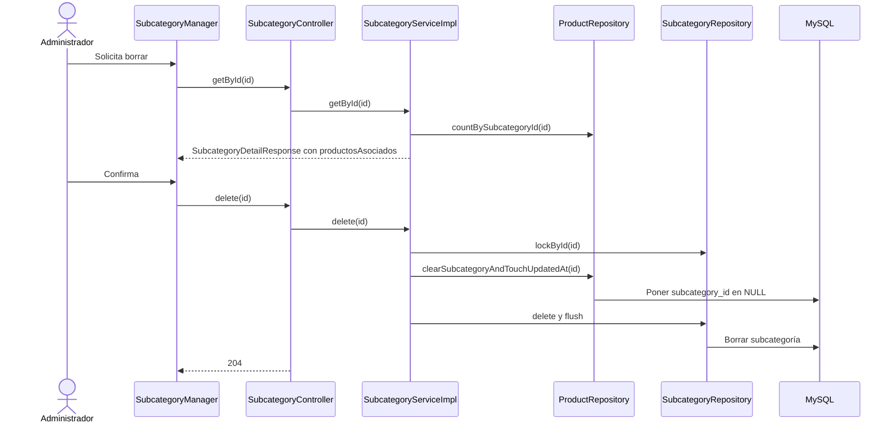
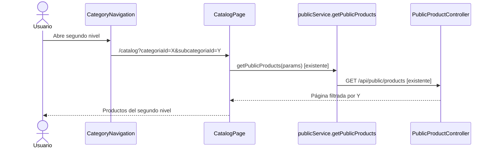

# Plan de implementación por tandas — segundo nivel de subcategorías

**Estado:** tandas 0, 1 y 2 completas; tanda 3 no iniciada.
**Fuente de alcance:** decisiones acordadas para Sprint 8 y `PROMPT_GENERAR_PLAN_IMPLEMENTACION.md`.  
**Fuente del comportamiento actual:** código y pruebas del repositorio revisados durante la planificación.

## Propósito y reglas acordadas

El catálogo admitirá `Categoría → subcategoría de primer nivel → subcategoría de segundo nivel`. El producto conservará una categoría obligatoria y una única subcategoría opcional, que podrá ser de cualquiera de los dos niveles. No se exigirá clasificarlo en una hoja: podrá quedar solo en la categoría o directamente en el primer nivel.

Se usará la tabla `subcategories` con una referencia opcional a otra fila de la misma tabla. La profundidad máxima será dos; el padre quedará fijo después del alta y el nombre será único entre hermanos. Ambos niveles serán visibles y seleccionables en el catálogo público. Filtrar por un nodo padre incluirá sus productos directos y los de sus descendientes. El borrado físico de una categoría o subcategoría se rechazará si tiene hijos o productos asociados directamente; nunca desvinculará productos de manera automática. La desactivación de categorías conservará su comportamiento propio.

## COMPROBADO EN EL CÓDIGO AL PLANIFICAR (antes de la tanda 1)

- `V8__create_subcategories.sql` crea `subcategories(category_id, nombre_normalizado, ...)` y agrega `products.subcategory_id` opcional. Su unicidad es `(category_id, nombre_normalizado)`; no hay relación entre subcategorías. `Product` mantiene `category` obligatorio y `subcategory` opcional.
- `SubcategoryController` ofrece alta, listado, detalle, edición y `DELETE`. `SubcategoryServiceImpl.create(...)` exige categoría activa, normaliza el nombre y fija la categoría. `update(...)` no permite cambiarla. `delete(...)` llama a `ProductRepository.clearSubcategoryAndTouchUpdatedAt(...)` y luego borra la subcategoría en una transacción.
- `SubcategoryDetailResponse` informa `productosAsociados` directos. `SubcategoryManager` muestra esa cifra y advierte que el borrado desvinculará productos. `SubcategoryDeleteMySqlTest` comprueba explícitamente esa desvinculación y su atomicidad; deberá cambiar al nuevo contrato.
- `CategoryController` y `CategoryService` ofrecen alta, listado, edición, desactivación y reactivación, **sin borrado físico**. Desactivar no elimina ni reasigna productos. Las FK de `products` y `subcategories` apuntan a `categories`.
- `ProductServiceImpl.create(...)` valida categoría activa y pertenencia de la subcategoría. `update(...)` distingue `subcategoriaId` omitido de `null`; en algunos caminos obtiene la categoría sin bloqueo previo, aspecto a revisar antes de permitir su borrado físico. `ProductRepository.findPageByFilters(...)` filtra por igualdad exacta de `subcategory.id`.
- `PublicProductController.list(...)` pasa `categoriaId` y `subcategoriaId` a `PublicProductService.list(...)`. `PublicProductFilters.of(...)` filtra también por igualdad exacta de subcategoría. `PublicCatalogController.get(...)` publica categorías activas y una lista plana de subcategorías. `CategoryNavigation` y `CatalogPage` representan un solo nivel. `ProductForm` ofrece una sola selección opcional de subcategoría.
- `SubcategoryConflictException` y `CategoryConflictException` se traducen a HTTP `409 RESOURCE_CONFLICT` mediante `GlobalExceptionHandler`. Los endpoints administrativos de categorías, subcategorías y productos usan `SUPER_ADMIN`, `ADMIN` o `USER`.
- Hay cambios locales previos sin confirmar en archivos del frontend público, incluido `CategoryNavigation.jsx`. Las tandas futuras deben partir de ese estado real y preservar trabajo ajeno a este alcance.

El [modelo inicial](../modelo-inicial.md) describía un solo nivel y el borrado con desvinculación al planificar; se actualizó al implementar la tanda 1.

### Flujo histórico antes de la tanda 1: borrar una subcategoría



## COMPORTAMIENTO PROPUESTO

Las subcategorías existentes serán raíces del primer nivel (`subcategoriaPadreId = null`); no se trasladarán productos durante la migración. La API conservará `categoriaId` y `subcategoriaId` existentes y agregará `subcategoriaPadreId` opcional en alta y respuestas de subcategoría. `POST /api/catalog/subcategories` rechazará un padre de otra categoría o un padre que ya sea de segundo nivel. La edición seguirá sin aceptar cambios de padre.

Un `DELETE` solo tendrá éxito con **cero hijos y cero productos directos**. Para categorías se agregará `DELETE /api/catalog/categories/{id}`; se rechazará cuando haya cualquier subcategoría o producto. La condición se volverá a evaluar dentro de la transacción: un recuento mostrado antes de confirmar es orientativo. Rechazos por dependencias devolverán `409 RESOURCE_CONFLICT` con un mensaje que identifique si bloquean hijos, productos o ambos. Los recursos inexistentes conservarán el tratamiento `404`. El borrado de una categoría vacía será posible esté activa o inactiva. La desactivación no se convertirá en borrado.

El listado administrativo y el público usarán `subcategoriaId` como **nodo seleccionado**: para primer nivel incluirán productos asignados a ese nodo o a hijos suyos; para segundo nivel incluirán únicamente productos directos. El filtro por categoría abarcará todos sus productos. Si se envían ambos IDs, se comprobará que la subcategoría pertenezca a la categoría. Se conservarán las URL actuales; los enlaces nuevos de segundo nivel usarán el mismo parámetro `subcategoriaId`.

### Flujo objetivo completo: clasificar, consultar y proteger el borrado

```mermaid
sequenceDiagram
    actor A as Administrador
    participant F as SubcategoryForm y ProductForm
    participant SC as SubcategoryController
    participant SS as SubcategoryServiceImpl
    participant PC as ProductController
    participant PS as ProductServiceImpl
    participant PR as ProductRepository
    participant DB as MySQL
    participant Pub as PublicProductController
    participant PF as PublicProductService y PublicProductFilters
    A->>F: Crea hijo de primer nivel
    F->>SC: create(categoriaId, subcategoriaPadreId, datos) [contrato propuesto]
    SC->>SS: create(request) [método existente, lógica ampliada]
    SS->>DB: Validar categoría, padre y profundidad; guardar hijo
    DB-->>SS: Subcategoría de segundo nivel
    SS-->>F: SubcategoryResponse con padre [campo propuesto]
    A->>F: Asigna producto al hijo
    F->>PC: update(productoId, subcategoriaId) [existente]
    PC->>PS: update(id, request) [existente, validación ampliada]
    PS->>PR: saveAndFlush(producto) [existente]
    PR->>DB: Guardar referencia al nodo elegido
    PS-->>F: ProductResponse
    A->>Pub: list(subcategoriaId del padre) [existente]
    Pub->>PF: list(...) y of(...) [existentes, filtro ampliado]
    PF->>DB: Consultar productos directos y de hijos
    DB-->>Pub: Página sin duplicados
    A->>SC: delete(id del padre) [existente]
    SC->>SS: delete(id) [existente, regla nueva]
    SS->>DB: Comprobar hijos y productos bajo bloqueo
    DB-->>SS: Existe un hijo
    SS-->>SC: SubcategoryConflictException
    SC-->>A: 409 RESOURCE_CONFLICT, sin cambios
```

## Orden de implementación

| Tanda | Objetivo | Depende de | Estado |
| --- | --- | --- | --- |
| 0 | Persistir una jerarquía de dos niveles sin alterar datos existentes | — | Completa |
| 1 | Gestionar nodos y restringir borrados de subcategoría y categoría | 0 | Completa |
| 2 | Asignar productos y consultar filtros con descendientes | 1 | Completa |
| 3 | Gestionar y navegar ambos niveles en React | 2 | Planificada |

```text
Tanda 0 → Tanda 1 → Tanda 2 → Tanda 3
```

Cada tanda produce un cambio revisable y requiere aprobación antes de iniciar la siguiente. La tanda 1 precede a la 2 para fijar la identidad y las restricciones de los nodos antes de ampliar las asignaciones.

---

## Tanda 0 — Persistencia y modelo

**Objetivo:** representar hijos de primer nivel en la tabla existente, conservando los datos actuales como primer nivel.

**Depende de:** ninguna tanda previa.

### Mapa de código

```text
[NUEVO] V14__add_subcategory_parent.sql (nombre previsto)
Backend/spring-starter/src/main/resources/db/migration/
└── agregar FK de padre, índice y unicidad por hermanos
        ↓
[MODIFICADO] Subcategory
Backend/spring-starter/src/main/java/com/ashenox/starter/catalog/subcategory/model/Subcategory.java
└── mapear parentSubcategory opcional
        ↓
[MODIFICADO] SubcategoryRepository
Backend/spring-starter/src/main/java/com/ashenox/starter/catalog/subcategory/repository/SubcategoryRepository.java
└── consultas de hijos y ámbito de nombre [PROPUESTAS]
```

### Clases/archivos nuevos

La migración `V14__add_subcategory_parent.sql` (nombre previsto), utilizada por Flyway. No se prevé una entidad nueva: ambos niveles usan `Subcategory`.

### Flujo de la tanda

No se incluye `sequenceDiagram`: esta tanda solo prepara esquema y mapeo; el flujo de alta queda en la tanda 1.

### Cambios de persistencia/configuración

Agregar `parent_subcategory_id` nullable y FK a `subcategories.id`. Sustituir `uk_subcategories_category_name` por una unicidad **efectiva** de `(category_id, padre lógico, nombre_normalizado)`, tratando el padre `NULL` como un mismo ámbito raíz; un índice único que deje `NULL` sin normalizar permitiría raíces duplicadas y no cumple el contrato. Indexar el padre para hijos y filtros. No modificar V8 ni crear otra tabla. La coherencia de categoría entre padre e hijo y la profundidad se validarán en servicio durante la tanda 1.

### Tests necesarios

**Migración e integración MySQL:** actualizar una base con V8 y productos existentes; demostrar que todas las subcategorías previas siguen siendo raíces y conservan sus productos. Insertar duplicados en raíz y entre hermanos debe fallar; nombres iguales bajo padres diferentes deben poder existir. **Arranque de pruebas:** verificar que la migración también funcione en el perfil H2 usado por el proyecto.

### Qué NO queda probado

**NO PROBADO:** reglas de profundidad, CRUD y filtros. **RIESGO:** una restricción de unicidad mal definida puede aceptar raíces duplicadas o impedir nombres válidos. **TRATAMIENTO:** tests de MySQL en esta tanda; reglas de servicio en la siguiente.

### Commit sugerido

`catalogo: preparar jerarquia de subcategorias` — migración, entidad, repositorio y pruebas de persistencia de esta tanda.

### Criterio de cierre

- [ ] Migración aplicada sobre esquema existente y esquema vacío.
- [ ] Datos previos y referencias de productos conservados.
- [ ] Unicidad y FK demostradas en MySQL; arranque H2 comprobado.
- [ ] Resultados, pruebas faltantes e incidentes registrados antes de aprobar.

### Resultado de ejecución

**Estado:** COMPLETA.

**Cambios realizados:** migración V14, mapeo del padre, consultas del repositorio y pruebas de persistencia.

**Diferencias respecto del plan:** MySQL inicialmente no pudo ejecutarse por falta de Docker; se validó en el reintento. No se modificaron servicios ni contratos.

**Tests ejecutados:** integración H2, pruebas MySQL mediante Testcontainers y regresión completa de backend. En el reintento específico se ejecutaron 9 pruebas sin omisiones.

**Tests exitosos:** 3 pruebas H2 y 6 MySQL específicas; migraciones desde cero y desde V8 con datos, conservación de referencias, unicidad, FK, validación JPA y consultas del repositorio. Regresión completa: 439 casos exitosos, 177 omitidos al no estar disponible Docker al inicio.

**Tests fallidos:** ninguno en los reintentos. Inicialmente hubo cinco errores SMTP y uno HTTP; ver INC-003. La primera ejecución específica fue interrumpida por INC-002.

**Incidentes:** INC-001, Docker no disponible; INC-002, adjunción dinámica del agente de Mockito; INC-003, errores SMTP y conexión HTTP local. Detalle en el [resultado de la tanda 0](resultado-tanda-0-segundo-nivel-subcategorias.md).

**Tests faltantes:** ninguno de los específicos planificados para esta tanda. La regresión general omitió 177 casos, incluidos los dependientes de Docker; las pruebas MySQL específicas se ejecutaron luego.

**Riesgos residuales:** la validación local no demuestra el comportamiento en el entorno desplegado; profundidad, CRUD y filtros corresponden a las siguientes tandas.

**Decisiones pendientes descubiertas:** ninguna.

**Archivos modificados:** migración V14, entidad y repositorio de subcategorías, pruebas de persistencia y migración, este plan y el documento de resultado.

**Cierre:** [x] migración y datos en MySQL; [x] unicidad y FK en MySQL; [x] arranque H2; [x] incidentes y faltantes registrados.

---

## Tanda 1 — Gestión y borrado restringido

**Objetivo:** crear y consultar ambos niveles; impedir borrados que dejarían hijos o productos sin padre.

**Depende de:** tanda 0.

### Mapa de código

```text
[MODIFICADO] SubcategoryController y DTO de subcategoría
Backend/spring-starter/src/main/java/com/ashenox/starter/catalog/subcategory/
└── create(...), list(...), getById(...), update(...), delete(...)
        ↓
[MODIFICADO] SubcategoryService / SubcategoryServiceImpl
Backend/spring-starter/src/main/java/com/ashenox/starter/catalog/subcategory/service/
└── create(...), update(...), delete(...); validar padre, profundidad y dependencias
        ↓
[MODIFICADO] SubcategoryRepository y ProductRepository
Backend/spring-starter/src/main/java/com/ashenox/starter/catalog/
└── buscar hijos, contar productos y bloquear nodos [consultas PROPUESTAS]

[MODIFICADO] CategoryController → CategoryService → CategoryServiceImpl
Backend/spring-starter/src/main/java/com/ashenox/starter/catalog/category/
└── delete(id) [PROPUESTO] → comprobar subcategorías y productos → CategoryRepository.delete(...)
```

### Clases/archivos nuevos

No se prevé una clase de dominio nueva. Se ampliarán `CreateSubcategoryRequest`, `SubcategoryResponse` y `SubcategoryDetailResponse` con `subcategoriaPadreId`; el detalle informará hijos y productos directos. Si se necesita una excepción específica de borrado, usar el manejo actual de conflictos HTTP sin cambiar el formato de error.

### Flujo de la tanda

```mermaid
sequenceDiagram
    actor A as Administrador
    participant C as SubcategoryController
    participant S as SubcategoryServiceImpl
    participant CR as CategoryRepository
    participant SR as SubcategoryRepository
    participant PR as ProductRepository
    A->>C: create(request con subcategoriaPadreId) [campo propuesto]
    C->>S: create(request) [existente]
    S->>CR: lockById(categoriaId) [existente]
    S->>SR: lockById(subcategoriaPadreId) [existente]
    S->>S: Validar misma categoría y padre de primer nivel [PROPUESTO]
    S->>SR: saveAndFlush(hijo) [existente]
    SR-->>A: 201 y respuesta con padre
    A->>C: delete(id del padre) [existente]
    C->>S: delete(id) [existente]
    S->>SR: lockById y comprobar hijos [consulta PROPUESTA]
    S->>PR: countBySubcategoryId(id) [existente]
    alt Hay hijos o productos
        S-->>A: 409 RESOURCE_CONFLICT; no borrar ni desvincular
    else Nodo vacío
        S->>SR: delete y flush [existentes]
        S-->>A: 204
    end
```

Para categoría, `CategoryController.delete(id)` **propuesto** llamará a `CategoryServiceImpl.delete(id)` **propuesto**; bloqueará la categoría, comprobará hijos y productos y devolverá `204` o `409` bajo las mismas reglas. Mantener desactivación/reactivación como operaciones distintas.

### Cambios de persistencia/configuración

Sin migración nueva. Contratos: `subcategoriaPadreId` opcional en alta y respuestas; `DELETE /api/catalog/categories/{id}` nuevo. `PUT` de subcategoría seguirá editando solo nombre y descripción. Revisar el orden de bloqueos categoría → padre → hijo → producto en las operaciones concurrentes; ajustar cualquier ruta de cambio de categoría de producto que pueda competir con el borrado.

### Tests necesarios

**HTTP y servicio:** alta de primer y segundo nivel, padre inexistente, padre de otra categoría, intento de tercer nivel, nombre repetido entre hermanos, mismo nombre bajo padres diferentes, edición sin traslado, `404` y `409` con mensaje comprensible. **Borrado:** padre con hijos, nodo con productos directos, categoría con hijos o productos, borrado vacío y conservación íntegra de productos ante rechazo. **Concurrencia MySQL:** alta de hijo o asignación/cambio de categoría simultáneos con borrado; comprobar que no quede referencia inválida ni se informe un éxito falso. Reemplazar la expectativa de desvinculación de `SubcategoryDeleteMySqlTest`.

### Qué NO queda probado

**NO PROBADO:** filtros por descendientes y UI. **RIESGO:** un camino de actualización de producto sin el bloqueo requerido podría competir con el borrado. **TRATAMIENTO:** inspección y tests de concurrencia en esta tanda; completar ajuste de asignación en la tanda 2 si forma parte de su flujo.

### Commit sugerido

`catalogo: restringir borrado de categorias y subcategorias` — contratos, servicios, repositorios y pruebas de gestión y borrado.

### Criterio de cierre

- [ ] Profundidad, pertenencia y unicidad validadas.
- [ ] Borrados vacíos devuelven `204`; dependencias devuelven `409` sin modificar productos.
- [ ] Tests HTTP, MySQL y concurrencia pertinentes ejecutados; incidentes y riesgos visibles.

### Resultado de ejecución

**Estado:** COMPLETA.

**Cambios realizados:** contratos y validaciones de jerarquía, borrados restringidos, DELETE de categoría y coordinación de bloqueos. Sin migraciones ni cambios de interfaz o filtros.

**Diferencias respecto del plan:** el orden de búsqueda de categoría y producto en actualización cambió para coordinar el borrado.

**Tests ejecutados y exitosos:** pruebas HTTP y de seguridad H2, unitarias, regresión relacionada y pruebas MySQL de borrado y concurrencia. Detalle y cantidades en el [resultado de la tanda 1](resultado-tanda-1-segundo-nivel-subcategorias.md).

**Tests fallidos e incidentes:** hubo expectativas y preparación obsoletas en intentos iniciales, y Docker estuvo restringido inicialmente; los reintentos específicos pasaron. Ver INC-004 a INC-007.

**Tests faltantes y riesgos residuales:** no se ejecutó la suite completa; faltan dos intercalados inversos de concurrencia detallados en el resultado. La interfaz todavía describe la desvinculación anterior y los filtros por descendientes no están implementados.

**Decisiones pendientes descubiertas:** ninguna.

**Archivos modificados:** backend de categorías, subcategorías y producto; pruebas asociadas; modelo inicial, este plan y el documento de resultado.

**Cierre:** [x] reglas de jerarquía; [x] borrados y conservación de productos; [x] HTTP, MySQL y concurrencia pertinentes; [x] riesgos e incidentes registrados.

---

## Tanda 2 — Productos y filtros con descendientes

**Objetivo:** conservar una sola clasificación opcional por producto y ampliar el significado de los filtros de nodos padres.

**Depende de:** tanda 1.

### Mapa de código

```text
[MODIFICADO] ProductController → ProductServiceImpl
Backend/spring-starter/src/main/java/com/ashenox/starter/catalog/product/
└── create(...), update(...), list(...); validar nodo y ampliar listado
        ↓
[MODIFICADO] ProductRepository / SubcategoryRepository
Backend/spring-starter/src/main/java/com/ashenox/starter/catalog/
└── buscar IDs de nodo e hijos; consultar página sin duplicados [PROPUESTO]

[MODIFICADO] PublicProductController → PublicProductService → PublicProductFilters
Backend/spring-starter/src/main/java/com/ashenox/starter/catalog/product/
└── list(...) y of(...); incluir hijos al filtrar por primer nivel
```

### Clases/archivos nuevos

No se prevén clases nuevas. `CreateProductRequest`, `UpdateProductRequest` y respuestas conservarán `subcategoriaId` opcional; su valor podrá ser un nodo de primer o segundo nivel.

### Flujo de la tanda

```mermaid
sequenceDiagram
    actor U as Comprador
    participant C as PublicProductController
    participant S as PublicProductService
    participant F as PublicProductFilters
    participant R as SubcategoryRepository y ProductRepository
    U->>C: list(categoriaId, subcategoriaId del primer nivel)
    C->>S: list(...) [existente]
    S->>R: Verificar nodo y categoría; obtener IDs de hijos [PROPUESTO]
    R-->>S: ID del padre e IDs de hijos
    S->>F: of(..., IDs del ámbito) [firma PROPUESTA]
    F->>R: findAll(specification, pageable) [existente]
    R-->>S: Página con productos directos y de hijos
    S-->>C: PublicProductPageResponse
    C-->>U: 200 + página y total
```

El listado administrativo de `ProductServiceImpl.list(...)` aplicará el mismo ámbito. Un segundo nivel tendrá solo su propio ID. La asignación seguirá llamando a `ProductServiceImpl.create(...)` o `update(...)` y guardará el ID elegido tras validar categoría y estado activo. `null` conservará la clasificación solo por categoría.

### Cambios de persistencia/configuración

Sin columnas nuevas en `products` ni cambio de las URL de filtro. Mantener paginación y recuentos correctos sin duplicar productos. Si la combinación de `categoriaId` y `subcategoriaId` es incompatible, rechazarla de forma explícita tanto en listado administrativo como público, en vez de depender de una página vacía accidental.

### Tests necesarios

**Integración y HTTP:** crear/editar productos solo en categoría, en primer nivel y en segundo; reasignar a `null`; rechazar nodo de otra categoría o categoría inactiva. Listar por categoría, primer nivel y segundo nivel con productos mezclados; verificar orden, total y paginación sin duplicados. **Regresión:** filtros de marca y atributos, detalle y enlaces existentes conservan el resultado previo cuando no se usa el nuevo nivel.

### Qué NO queda probado

**NO PROBADO:** navegación y formularios React. **RIESGO:** consultas del ámbito jerárquico más costosas. **TRATAMIENTO:** probar paginación y revisar índices/plan de consulta MySQL si los datos muestran degradación.

### Commit sugerido

`catalogo: filtrar productos por descendientes` — servicios, consultas y pruebas de productos y filtros.

### Criterio de cierre

- [ ] Los tres lugares de asignación funcionan y la categoría sigue siendo obligatoria.
- [ ] Filtros de padres incluyen descendientes sin duplicados y totales correctos.
- [ ] Contratos HTTP y regresiones relevantes comprobados; riesgos documentados.

### Resultado de ejecución

**Estado:** COMPLETA.

**Cambios realizados:** filtros administrativo y público incluyen hijos directos al seleccionar un padre; validación pública de pertenencia entre categoría y subcategoría. Se conservan URLs, DTO y asignación única opcional.

**Diferencias respecto del plan:** se usan subconsultas en lugar de obtener previamente IDs. Por decisión del responsable se conserva la edición existente que admite una categoría inactiva sin subcategoría; el alta y la asignación a una subcategoría de categoría inactiva siguen rechazándose.

**Tests ejecutados y exitosos:** 24 pruebas de HTTP, listados y servicio en H2; 2 pruebas MySQL de listado y 4 de integración H2; reejecución de 7 pruebas HTTP públicas con combinación de jerarquía, marca y atributos. Sin fallos ni omisiones en esos grupos; detalle en el [resultado de la tanda 2](resultado-tanda-2-segundo-nivel-subcategorias.md).

**Tests fallidos:** ninguno. **Incidentes:** acceso inicial a Docker y discrepancia de categoría inactiva, registrados en el resultado.

**Tests faltantes:** suite completa, pruebas de carga y entorno desplegado. **Riesgos residuales:** rendimiento con datos reales, interacción fuera de la regresión focalizada y riesgos de concurrencia heredados de la tanda 1.

**Decisiones pendientes descubiertas:** ninguna; la discrepancia sobre edición en categoría inactiva fue resuelta por el responsable.

**Archivos modificados:** repositorio y servicios de filtros de productos; pruebas HTTP y MySQL; este plan y el documento de resultado.

**Cierre:** [x] asignación en tres puntos; [x] filtros y paginación; [x] contratos y regresiones pertinentes; [x] riesgos e incidentes registrados.

---

## Tanda 3 — Administración y navegación pública

**Objetivo:** permitir gestionar la jerarquía, asignar productos en cualquier nivel y navegar ambos niveles de forma accesible.

**Depende de:** tanda 2.

### Mapa de código

```text
[MODIFICADO] SubcategoryManager / SubcategoryForm / subcategoryService
Frontend/react-starter/src/catalog/subcategories/
└── alta de primer o segundo nivel; mostrar árbol, dependencias y errores 409
        ↓
[MODIFICADO] CategoryManagementPage / categoryService
Frontend/react-starter/src/catalog/categories/
└── borrar categoría vacía [acción PROPUESTA]; conservar desactivar/reactivar
        ↓
[MODIFICADO] ProductForm
Frontend/react-starter/src/catalog/products/components/ProductForm.jsx
└── selección opcional de primer y segundo nivel; enviar un subcategoriaId

[MODIFICADO] CategoryNavigation / CatalogPage
Frontend/react-starter/src/public/
└── enlaces y filtros de ambos niveles con URL existente
```

### Clases/archivos nuevos

No se exige un componente nuevo. Puede extraerse una presentación de árbol si reduce duplicación entre móvil, escritorio y administración; mantener el contrato de datos y los flujos de esta tanda.

### Flujo de la tanda



En administración, `SubcategoryManager` cargará el detalle antes de confirmar borrado y mostrará hijos/productos que lo bloquean. La confirmación seguirá sujeta a la comprobación final del servidor. El formulario de producto permitirá dejar ambos niveles vacíos, elegir solo el primero o elegir también el segundo; enviará un único `subcategoriaId`.

### Cambios de persistencia/configuración

Sin cambios de base. Ampliar `subcategoryService` para enviar `subcategoriaPadreId` y `categoryService` para el nuevo `DELETE`; conservar las opciones de mutación sin reintentos automáticos. Mostrar un error de conflicto comprensible sin afirmar que se borró el recurso.

### Tests necesarios

**Componentes y servicios:** creación por niveles, padre fijo al editar, árbol por categoría, producto en cada punto, limpieza de selecciones hijas al cambiar padre, borrado habilitado solo cuando corresponde y manejo de `409`. **Público:** enlaces y filtros de ambos niveles en escritorio y móvil, teclado y foco. **Recorrido integral:** crear jerarquía → asignar producto a segundo nivel → encontrarlo por padre e hijo → rechazar borrado → reasignarlo → borrar hijo y luego padre. Ejecutar `npm test`, `npm run lint`, `npm run build`; en backend, `./mvnw.cmd test` y `./mvnw.cmd package`, con tests MySQL cuando Docker esté disponible.

### Qué NO queda probado

**NO PROBADO:** comportamiento del entorno desplegado hasta validarlo allí. **RIESGO:** menú móvil denso o estado de filtros incoherente al cambiar categoría. **TRATAMIENTO:** revisión visual y de teclado en tamaños móvil/escritorio y tests de navegación.

### Commit sugerido

`catalogo: mostrar dos niveles de subcategorias` — servicios y componentes React, estilos necesarios y pruebas de interfaz. Respetar los cambios locales preexistentes al ejecutar esta tanda.

### Criterio de cierre

- [ ] Administración y catálogo muestran ambos niveles con navegación accesible.
- [ ] Formulario permite categoría sola, primer nivel o segundo nivel.
- [ ] Recorrido integral y verificaciones proporcionales ejecutados; faltantes, incidentes y riesgos registrados.

### Resultado de ejecución

**PENDIENTE DE EJECUCIÓN**

## Registro global de decisiones pendientes

| ID | Decisión | Alternativas | Bloquea |
| --- | --- | --- | --- |
| — | Ninguna decisión funcional o arquitectónica pendiente al cerrar esta planificación. | — | — |

**Decisiones ya resueltas:** una tabla; máximo dos niveles; padre fijo; unicidad entre hermanos; filtros de padres con descendientes; navegación pública de ambos niveles; borrado físico restringido sin desvinculación. Si durante una tanda aparece una alternativa que cambie estos contratos o la arquitectura, registrarla como `DECISIÓN PENDIENTE — DXX` con alternativas, consecuencias y tanda afectada antes de continuar esa parte.

## Protocolo global de incidentes

Durante la ejecución, registrar cada incidente relevante una sola vez como `INC-XXX` con: tanda y contexto; test o comportamiento afectado; esperado y obtenido; clasificación (implementación, test, contrato, entorno, datos o causa desconocida); causa confirmada o hipótesis; resolución; si cambiaron código, tests o migraciones; resultado posterior `PASS`, `FAIL` o `PENDIENTE`; riesgo derivado. No modificar un test solo para que quede verde. Si el contrato esperado cambia sin respaldo de este plan, abrir una `DECISIÓN PENDIENTE`.

## Flujo total acumulado

```text
IMPLEMENTADO HOY — TANDAS 0, 1 Y 2 COMPLETAS
Persistencia y gestión de dos niveles; borrado restringido; asignación de productos y filtros con descendientes en backend. La interfaz todavía es de un nivel.

MODELO ACUMULADO — BACKEND IMPLEMENTADO; INTERFAZ PENDIENTE
Categoría → subcategoría de primer nivel → subcategoría de segundo nivel
    ↓                    ↓                         ↓
Producto directo     Producto directo          Producto directo
    ↓                    ↓                         ↓
Filtro por padre incluye sus productos directos y los de sus hijos
    ↓
Borrado solo de nodos sin hijos ni productos; sin desvinculación
```

Al cerrar cada tanda, actualizar este mapa para distinguir lo implementado de lo restante, sin borrar el plan original.

## Resumen final

### Orden de implementación

Persistencia (0) → gestión y borrado (1) → productos y filtros (2) → interfaz (3). Aprobar el resultado de cada tanda antes de comenzar la siguiente.

### Decisiones pendientes

Ninguna al redactar este plan. Las diferencias entre el modelo inicial y las nuevas reglas están explicitadas arriba.

### Riesgos globales

La concurrencia entre asignaciones y borrados exige un orden consistente de bloqueos y pruebas MySQL. La migración de unicidad debe tratar correctamente las raíces con padre `NULL`. Los cambios locales existentes del frontend deben preservarse al ejecutar la tanda 3. Una prueba local no valida por sí sola el entorno de destino.

### Validación final

Demostrar de punta a punta que un producto puede estar en cualquiera de los tres puntos; que los filtros de categoría y primer nivel incluyen descendientes con totales correctos; que ambos niveles se navegan en móvil y escritorio; y que ningún borrado de padre con hijos ni de nodo con productos modifica datos. Registrar pruebas no ejecutadas, incidentes y riesgos residuales antes de declarar completa la última tanda.
